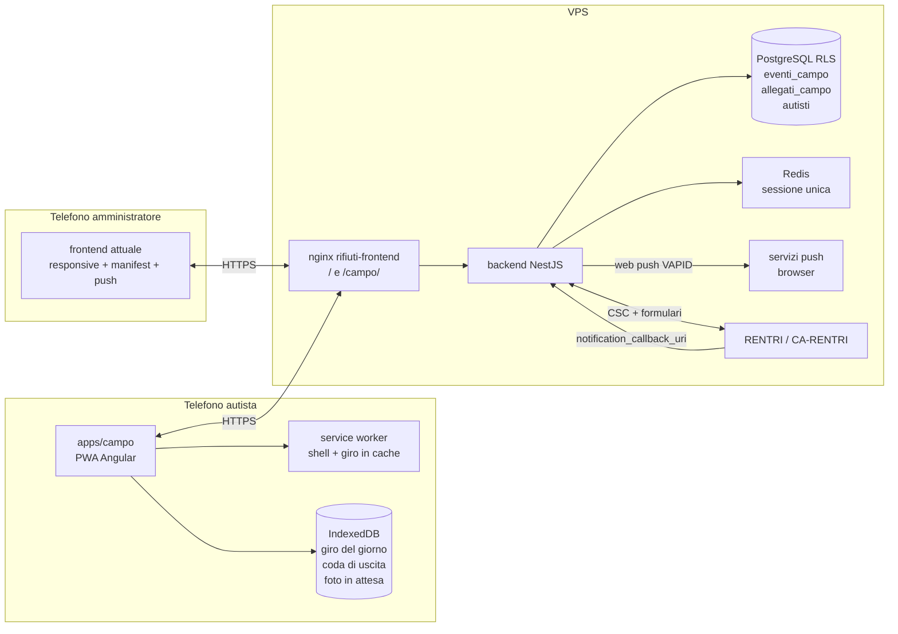
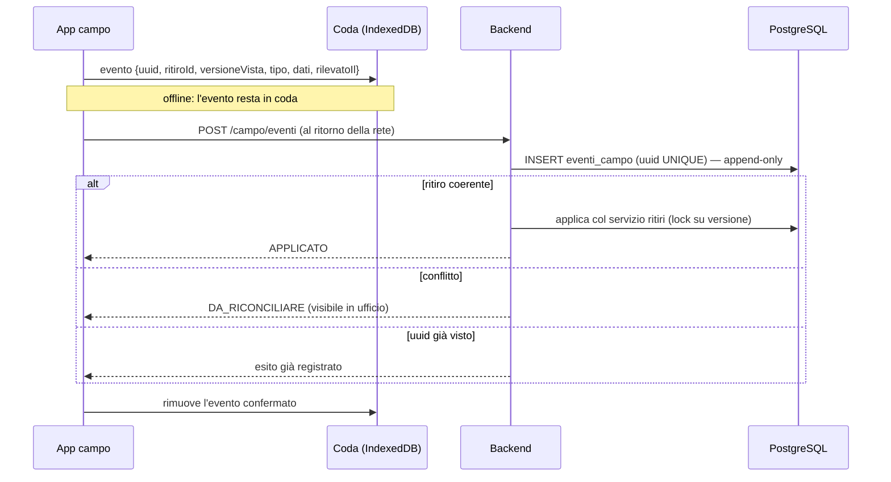
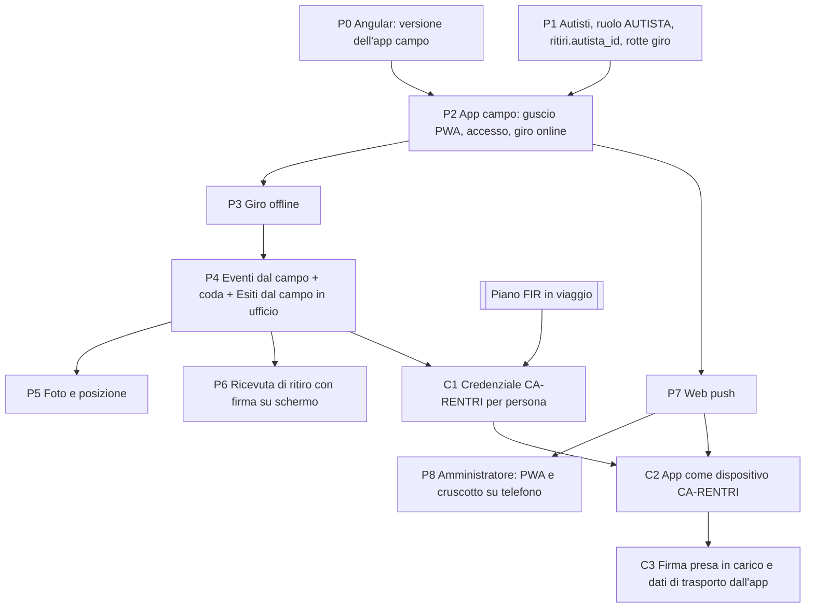

# Studio di fattibilità — app per amministratori e autisti (WasteFlow)

Data: 18/11/2026. Master `e9a61ae5` (PR #109). Sola lettura: nessun branch, nessun commit.
È uno **studio di fattibilità**, non ancora un piano esecutivo: i pezzi del §5 hanno task di
massima, da dettagliare in un piano per pezzo quando Graziano avrà risposto al §7.

Dipendenza esterna: il piano **«RENTRI FIR in viaggio»** (in preparazione da un altro agente).
Questo studio non lo duplica: indica soltanto che cosa l'app richiede da quel piano (§4.6, §5 pezzi C1-C3).

---

## 1. Obiettivo e perimetro

**Obiettivo.** Decidere come portare WasteFlow sul telefono per due figure:

- **Amministratore** (titolare, responsabile d'azienda o d'impianto): cruscotto, cose da fare
  oggi, scadenze, giacenze, avvisi, approvazioni, avanzamento dei ritiri del giorno. Lavora
  **online**: legge dati e decide. Non compila documenti dal telefono.
- **Autista / trasportatore**: giro dei ritiri del giorno, esito di ogni ritiro (eseguito, non
  eseguito, quantità stimata, colli), foto, posizione al momento del ritiro, ricevuta firmata dal
  cliente, FIR del viaggio, firma della presa in carico e della consegna sul FIR digitale. Lavora
  **anche con rete scarsa o assente**.

**Sì (in questo studio):** scelta della tecnologia, offline e sincronizzazione, firma e valore
legale, push, fotocamera e GPS, distribuzione, costi, autenticazione, ruoli, MVP in pezzi.

**No:** il ciclo RENTRI del FIR digitale (quantità, trasporto, soste, trasbordi, accettazione,
annotazioni: piano «FIR in viaggio»); l'aggiornamento di Angular del frontend esistente (piano a
parte, qui solo indicato come dipendenza); logistica di magazzino a palmare (`WWLOGIS`); gestione
completa della flotta (manutenzioni, carburanti: `WWNET67`).

---

## 2. Stato attuale verificato su master

Riferimenti come `file:riga` su `origin/master`.

### 2.1 Frontend

| Fatto | Evidenza |
|--|--|
| **Angular 17.3.12, non 20** (il brief dice 20: è sbagliato). PrimeNG 17, NgRx 17. Angular 17 è fuori supporto (LTS finita a maggio 2025) | `package-lock.json:1255-1256`; `apps/frontend/package.json` (`@angular/core ^17.0.0`); `CLAUDE.md:6-8` |
| Builder `browser` (webpack), budget iniziale 500 kB avviso / 1,5 MB errore | `apps/frontend/angular.json:19`, `:61-69` |
| **Nessuna PWA**: niente `@angular/service-worker`, niente `ngsw-config.json`, niente `manifest.webmanifest`; `index.html` ha `viewport` e `theme-color` chiaro/scuro e basta | `apps/frontend/src/index.html:7-9`; `git grep serviceWorker` vuoto |
| **Responsive parziale**: due breakpoint globali (768 e 576 px) e un pattern di lista per telefono (`lista-telefono`) usato da 36 file, con test | `apps/frontend/src/styles.scss:155`, `:161`; `apps/frontend/src/app/shared/utils/pattern-liste.spec.ts:33` |
| Infrastruttura offline **ereditata dallo spec iniziale**, solo per i permessi: coda in IndexedDB (`idb`) con strategia «vince il server», guard che blocca le operazioni rischiose offline, indicatore di connessione con heartbeat | `core/services/permission-sync-queue.service.ts:1-40`; `core/guards/offline-high-risk.guard.ts`; `core/services/connection-monitor.service.ts:74` |
| Notifiche in app: campanella in **polling ogni 30 s**, nessun web push, nessun websocket nel backend | `core/layout/notification-bell/notification-bell.component.ts:107`; `git grep web-push\|vapid\|WebSocketGateway` vuoto |
| Cruscotto esistente: «Da fare oggi», FIR recenti e per stato, deposito, classifiche, voci di attenzione ordinate per gravità (scadenze di certificato RENTRI e autorizzazioni impianto, formulari da trasmettere, numeri vidimati pronti) | `features/dashboard/dashboard-page/*`; `features/dashboard/attenzione.service.ts:7-44`; backend `application/dashboard/raccogli-attenzione.use-case.ts` |
| Moduli per azienda lato frontend: `moduloGuard` con `data: { modulo }` | `core/guards/modulo.guard.ts` |
| Deploy: un container `rifiuti-frontend` (nginx) su `127.0.0.1:3017` | `docker-compose.prod.yml:185-195` |

### 2.2 Autenticazione, sessione, ruoli

| Fatto | Evidenza |
|--|--|
| In produzione si entra **solo con SPID/CIE** (SAML, passport). Il login per email esiste solo in sviluppo: il controller non è montato in produzione | `auth/strategies/spid.strategy.ts`; `auth/controllers/dev-auth.controller.ts:1-50` |
| Access token 15 min, refresh 7 giorni (Redis) | `auth/services/jwt-tokens.service.ts:59`, `:78` |
| Dopo SPID i token tornano al frontend nel fragment di un redirect a `FRONTEND_URL` | `auth/controllers/auth.controller.ts:115` e seguenti |
| **Sessione unica già applicata**: al login si revocano tutti i refresh e si alza l'«epoca di sessione»; ogni access token emesso prima viene rifiutato | `auth/controllers/auth.controller.ts:102-103`; `auth/strategies/jwt.strategy.ts:66-74` |
| Ruoli grossolani `SUPER_ADMIN`, `ADMIN`, `OPERATOR`, `VIEWER`. Gli endpoint operativi (FIR, registro, anagrafiche, ritiri) decidono **sul ruolo**, non sui permessi granulari (RBAC presente ma usato per audit/permessi) | `prisma/schema.prisma:288-295`; `features/fir/fir-permissions.ts:1-25`; `schema.prisma:1569`, `:1617` |
| **Nessuna anagrafica autisti** e nessun legame utente-autista: lo schema non contiene `autista`, `driver` o `conducente` | `git grep` sullo schema vuoto |
| Moduli commerciali: `pese`, `ritiri` (e altri) nel catalogo; backend in modalità `registra` | `application/admin/feature-catalog.ts:48-49`; `api/controller-moduli.spec.ts:208` |

### 2.3 Ritiri, FIR, firme, pese

| Fatto | Evidenza |
|--|--|
| **Ritiri programmati (4.7)**: data, fascia, `ordineGiro`, produttore e sede, trasportatore, destinatario, **automezzo (non autista)**, CER, quantità presunta, stato `PROGRAMMATO`/`NON_ESEGUITO`/`ANNULLATO` con motivo, `versione` per il lock ottimistico, `chiaveIdempotenza`. Mai cancellati | `prisma/schema.prisma:4496-4579`; migration `20261110100000_ritiri_e_modelli` |
| Pagina «Ritiri del giorno» e distinta PDF per mezzo, in ordine di giro: è già la base del «giro» dell'autista | `features/ritiri/ritiri-giorno.component.ts`, `distinta-dialog.component.ts`; `api/ritiri/stampa-ritiri.controller.ts:35` |
| Generazione in serie delle **bozze FIR** dai ritiri, idempotente (indice parziale `firs_ritiro_attivo_key`), nessuna trasmissione a RENTRI | `application/ritiri/genera-fir-da-ritiri.service.ts:1-15` |
| FIR: `transportDate` fissata all'emissione e `presaInCaricoIl` separata (scritta dopo le prime firme) | `prisma/schema.prisma:445-452` |
| `FIRSignature` (hash documento, certificato, firmatario): firma lato WasteFlow, distinta dalle firme RENTRI | `prisma/schema.prisma:698-733` |
| **Firma remota RENTRI già implementata** (CSC: `credentials/info` → `/hash` → `authorize` → polling → `sign-hash` → `acquisizione-firma` → stato riletto dall'ente). La credenziale è **una per azienda**, non per persona. Limite noto: niente ripresa di un'autorizzazione già in corso (attesa 20 s per chiamata contro 120 s di conferma) | `application/rentri/completa-operazione-con-firma.use-case.ts:162-200`, `:246-255`, `:40`, `:50` |
| Il contratto RENTRI prevede l'**invio del FIR a un dispositivo** (`POST /{numero_fir}/invia-a-dispositivo?credentials_id=`) e il **conducente obbligatorio** nei dati di trasporto terrestre | `docs/contracts/rentri/formulari.yaml:1583-1600`, `:8865-8875` |
| CA-RENTRI: un software può **registrarsi come dispositivo** di autorizzazione (`POST /credentials` con `device_info.notification_callback_uri` e `notification_callback_parameters`, boarding con QR + PIN); l'`authorize` «genera l'invio di una notifica al dispositivo mobile associato alle credenziali» | `docs/contracts/rentri/ca-rentri.yaml:157-234`, `:825-840`, `:1216-1232`, `DeviceInfo` `:3055-3100` |
| Pese: pesata immutabile, fonti `STRUMENTO`/`FILE`/`MANUALE`/`TARA_ANAGRAFICA`/`SIMULATA`; agente di pesa locale (4.8b) con letture firmate | `prisma/schema.prisma:2727-2735`, `:2878-2910`; migration `20261113100100_pese_agenti`; `docs/superpowers/plans/2026-11-13-fase4-8b-agente-pesa.md` |
| Allegati salvati **in database** (`Bytes`) con sha256 | `prisma/schema.prisma:2952-2968` (`AllegatoPesa`) |

### 2.4 Riferimento interno: Neat app agenti

`~/Progetti/neat/neat-porting/apps/agent-app`: app Angular **separata** nel monorepo Nx, Angular
20.3, `@angular/service-worker`, PWA su nginx (`agenti.neat.ignicraft.com`, porta 4202), **web push
VAPID** (`core/push.service.ts`, backend `modules/customer-portal/push-notification.service.ts`).
Il service worker mette in cache **solo la shell** (`ngsw-config.json`: `dataGroups: []`): è una PWA
online, non offline. Per gli autisti di WasteFlow serve un passo in più: i dati del giro in
IndexedDB e una coda di uscita.

---

## 3. Comportamento WinWaste da replicare

- **App e dispositivi per autisti** (`WWNET38.FrmDevice*`, `FrmDeviceAutistaOperatore`,
  `FrmPIN_OTP`, `frmHUB`/`FrmConfigHUB`): FIR digitale in campo, firma con PIN/OTP
  (`winwaste/docs/funzionalita.md:82`, `:237`, `:309`, `:369`).
- **«Rentri in Cloud» / ViviFir**: WinWaste spinge soggetti, sedi, autisti, automezzi,
  autorizzazioni e i FIR presi in carico **sull'hub del fornitore**, da cui li legge l'app
  (`winwaste/docs/rentri/03-aggancio-a-winwaste.md` §3.3; `qform.InviaHub`). Il prezzo è che dati
  e certificato lasciano il cliente (`rentri/04-confronto-con-rifiuti.md:204`).
- **Dispositivi CA-RENTRI**: WinWaste si registra come dispositivo con un `guidww` nei
  `notification_callback_parameters` e riceve notifiche `RentriPushNotification { action, handle,
  otp, expires_in, credentials_id, NumeroFIR }` (`rentri/01-autenticazione-e-firma.md:126-132`;
  `rentri/02-endpoint-e-flussi.md:303`). Elenco «chi firma con quale smartphone su quale sito»
  (`GetAllCredentialDevices`, `02-endpoint-e-flussi.md:298`).
- **Anagrafica autisti e scadenze** (patenti, visite, ADR): `WWNET02.AUTISTI`, `WWNET67`
  (`funzionalita.md:65`, `:89`, `:197-202`). Sul FIR cartaceo c'è il campo `AUTIST`
  (`formulari.md:75`).
- **Distinta ritiri** con passaggio alla griglia dei FIR digitali (`frmstamparitiri`, F12:
  `formulari.md:261`): già replicata da 4.7.

**Vantaggio da tenere** (messaggio commerciale già sostenuto dal codice): la stessa funzione
**senza hub di terzi** e senza che il certificato lasci la piattaforma.

---

## 4. Analisi e design

### 4.1 Le tre opzioni a confronto

| Criterio | (a) PWA Angular (stesso frontend o app separata nel monorepo) | (b) Capacitor sopra Angular | (c) Nativa / Flutter |
|--|--|--|--|
| Riuso del codice | Alto: modelli, servizi HTTP, tema, `lista-telefono`, guard dei moduli | Alto: stessa app di (a) dentro un guscio nativo | Nullo: seconda base di codice (Dart), seconda serie di modelli e test |
| Offline e dati | IndexedDB (`idb` già in dipendenze, o Dexie come Neat) + service worker; Background Sync solo su Chrome/Android, **non su iOS**: la coda si svuota quando l'app è aperta | Come (a) più SQLite e lavoro in background con plugin | Migliore (SQLite, lavoro in background nativo) |
| Push | Web push VAPID (come Neat). Android affidabile; **iOS solo da 16.4 e solo con l'app installata sulla home**, consegna meno prevedibile | FCM/APNs nativi, affidabili | FCM/APNs nativi |
| Fotocamera | `<input type=file capture>` / `getUserMedia`: sufficiente | Plugin Camera | Nativa |
| GPS | Solo in primo piano (`navigator.geolocation`): basta per «posizione al momento dell'evento» | Anche in background (plugin), se mai servisse | Anche in background |
| Bluetooth (pese portatili, stampanti) | Web Bluetooth **assente su iOS** | Plugin | Nativo |
| Distribuzione | Link + «Aggiungi alla schermata Home». Aggiornamento immediato a ogni deploy | Store (Apple 99 $/anno, Google 25 $ una tantum) o APK/MDM per Android; revisione Apple | Come (b) |
| Build iOS | Nessuna | **Serve un Mac** (Xcode): Graziano lavora su Fedora, quindi Mac in affitto o CI macOS | Come (b) |
| Manutenzione | Una sola pipeline (Gitea CI attuale) | Pipeline web + build firmate Android/iOS, aggiornamenti dei plugin | Pipeline separata, competenze Dart (esistono: Fast Selling), doppio sviluppo di ogni funzione |
| Firma FIR digitale | Non cambia: la firma legale la produce CA-RENTRI (§4.4) | Idem | Idem |

**Stesso frontend o app separata?** Per l'**amministratore** basta il frontend attuale: lavora
online, le pagine esistono (cruscotto, attenzione, giacenze, ritiri del giorno), mancano il
manifest, il push e qualche pagina adattata al telefono. Per l'**autista** conviene un'**app
separata** `apps/campo`:

- bundle piccolo (il frontend attuale porta PrimeNG, chart.js, xlsx, jspdf: pesante su 4G);
- service worker con **dati in cache** e coda di uscita, che nel frontend d'ufficio sarebbero un
  rischio (dati vecchi mostrati come attuali in pagine che oggi assumono la rete);
- superficie minima: l'autista vede solo il suo giro, quindi rotte e permessi dedicati;
- si può partire su una **versione di Angular supportata** senza aspettare l'aggiornamento del
  frontend (npm workspaces ammette versioni diverse per app; costo: due versioni installate);
- se un giorno servono push affidabili su iOS, GPS in background o Bluetooth, la stessa app si
  incapsula con **Capacitor** senza riscriverla, purché fotocamera, posizione, push e archivio
  locale passino da servizi astratti fin dal primo pezzo.

Flutter non conviene: raddoppia ogni funzione e ogni test per un vantaggio (offline e background)
che a questo perimetro non serve.

### 4.2 Architettura proposta



Un solo container frontend che serve due build (`/` e `/campo/`) evita una porta nuova e una
voce nuova nella tabella delle porte del VPS. In alternativa un container proprio sulla prima
porta libera (3029, da verificare con `ss -tlnp`: 3028 è riservata a seospider).

### 4.3 Offline e sincronizzazione

**Principio.** L'app non modifica lo stato: **registra fatti** («alle 9:42, presso la sede X, il
ritiro R è stato eseguito con 3 colli, quantità stimata 420 kg, foto F1-F2»). Il backend applica
ogni fatto con i servizi esistenti (ritiri, FIR) e risponde con l'esito. Il registro cronologico
resta **append-only e scritto solo dal backend**: l'app non crea mai movimenti e non assegna mai
numeri.

**Prima di partire (online).** L'app scarica il giro: ritiri `PROGRAMMATO` del giorno per l'autista
(o il suo mezzo), in ordine di giro, con indirizzi delle sedi, CER, quantità presunta, note
operative, bozze FIR già generate (4.7) e i loro numeri. **La numerazione si fissa in ufficio**:
per il FIR cartaceo il numero vidimato è già sulla bozza; per il FIR digitale la creazione presso
RENTRI richiede la rete (piano «FIR in viaggio»).

**In viaggio.** Ogni evento va in una **coda di uscita** in IndexedDB con:

- `id` UUID generato sul telefono = **chiave di idempotenza** (stesso schema di
  `ritiri.chiave_idempotenza`): un reinvio dopo un timeout non duplica nulla;
- `versioneVista` del ritiro (il campo `versione` esistente) per riconoscere i conflitti;
- `rilevatoIl` (orologio del telefono, **mai** usato come data legale) e, dal server, `ricevutoIl`;
- allegati come blob separati, compressi sul telefono (JPEG, lato lungo ~1600 px, ~300 kB).

La coda si svuota all'apertura dell'app, al ritorno della rete e a intervalli mentre l'app è
aperta. Su iOS non c'è Background Sync: l'app lo dice («3 esiti da inviare, apri l'app quando hai
rete»).

**Conflitti.** Regola unica: **i dati anagrafici e di pianificazione li decide l'ufficio, i fatti
del campo non si scartano mai**.

| Caso | Esito |
|--|--|
| Evento su ritiro ancora `PROGRAMMATO` e `versione` uguale | applicato |
| Ritiro modificato in ufficio (versione diversa) ma ancora `PROGRAMMATO` | applicato se l'evento non tocca i campi cambiati, altrimenti **«da riconciliare»** |
| Ritiro `ANNULLATO` in ufficio mentre l'autista era offline e lo ha eseguito | **«da riconciliare»**: l'evento resta registrato e compare all'ufficio in «Esiti dal campo»; nessuna scrittura automatica sul ritiro |
| Evento duplicato (stesso UUID) | risposta identica alla prima, nessun effetto |
| Utente diverso da chi ha creato l'evento (telefono passato a un collega) | rifiutato: la coda è legata all'utente; al cambio utente l'app chiede cosa fare degli eventi pendenti |



**Dati sul telefono.** IndexedDB non è cifrato. Si tengono solo i dati del giro del giorno, si
cancellano a fine giornata e al logout; niente listini, niente dati di fatturazione.

### 4.4 Firma e valore legale

Tre firme diverse, da non confondere:

| Firma | Chi firma | Come | Valore |
|--|--|--|--|
| **FIR digitale RENTRI** (produttore alla partenza, trasportatore alla presa in carico, destinatario all'accettazione) | ogni soggetto con la **propria credenziale CA-RENTRI** | CSC remoto: `/hash` → `authorize` (notifica al dispositivo, conferma con PIN/OTP) → `sign-hash` → `acquisizione-firma`. La firma XML del formulario la compone RENTRI sul `digest_to_sign`: **sul telefono non si produce XAdES** | firma del documento ufficiale |
| **FIR cartaceo** (vidimato) | produttore, trasportatore, destinatario | **autografa sulle copie di carta** | firma del documento ufficiale; il telefono non la sostituisce. Utile la **foto della copia firmata** (prova interna, e base per il caricamento della copia cartacea su RENTRI: endpoint `copia-cartacea/caricamento`, piano FIR in viaggio) |
| **Ricevuta di ritiro** sul telefono dell'autista (firma su schermo del cliente) | chi consegna il rifiuto | tratto a mano su canvas + nome + ora + hash del contenuto, PDF | **firma elettronica semplice**: prova commerciale (contestazioni di fatturazione, colli, orari). **Non** vale come firma del FIR e non va presentata così |

Conseguenze per il design:

1. **La credenziale RENTRI va portata dall'azienda alla persona.** Oggi `completa-operazione-con-firma`
   legge un solo `credentials_id` per azienda (`:246`). Per un trasportatore con dieci autisti
   ogni autista deve firmare con la sua credenziale. È un requisito del piano «FIR in viaggio».
2. **L'app può essere il dispositivo di autorizzazione CA-RENTRI.** Il contratto lo prevede
   (`ca-rentri.yaml`, `DeviceInfo.notification_callback_uri`): RENTRI chiama il nostro backend, il
   backend manda un push all'app, l'autista conferma con il PIN. Così non serve una seconda app
   e il certificato non esce dalla piattaforma. Da provare sul demo RENTRI prima di impegnarsi:
   tempi (la conferma scade in 120 s, `:50`), comportamento con il telefono bloccato, transito
   del PIN (mai memorizzato, solo inoltrato).
3. **La firma del produttore alla partenza non si fa sul telefono dell'autista**: il produttore
   firma con la sua credenziale, sul suo dispositivo. L'app dell'autista mostra lo stato
   («in attesa della firma del produttore») e, se il produttore non è digitale, si ricade sul
   cartaceo secondo le regole del piano FIR in viaggio.
4. Le firme RENTRI **richiedono la rete**: offline l'app può solo mettere in coda i fatti e
   mostrare che la firma è da fare. Che cosa preveda la norma quando la rete manca durante un
   trasporto con FIR digitale va verificato nel piano FIR in viaggio (qui **non** lo si assume).

```mermaid
sequenceDiagram
  participant U as Autista (app campo)
  participant B as Backend
  participant R as RENTRI / CA-RENTRI
  U->>B: «Firma presa in carico» FIR n.
  B->>R: POST /{fir}/hash (certificato della credenziale dell'autista)
  R-->>B: digest_to_sign, token
  B->>R: POST /credentials/authorize
  R->>B: callback (notification_callback_uri) {handle, otp?}
  B->>U: web push «Autorizza la firma del FIR n.»
  U->>B: conferma + PIN (inoltrato, mai salvato)
  B->>R: authorize-confirmation → sad
  B->>R: sign-hash → firma
  B->>R: acquisizione-firma
  R-->>B: esito; B rilegge lo stato dell'ente
  B-->>U: «Presa in carico firmata»
```

### 4.5 Push, fotocamera, GPS, pesata

- **Push.** Web push VAPID come Neat: tabella delle sottoscrizioni per utente e azienda (RLS),
  invio dal backend. Usi: all'amministratore le voci **critiche** di `raccogli-attenzione` (non
  tutte: soglia configurabile), gli esiti «da riconciliare», un ritiro non eseguito; all'autista
  «giro modificato» e l'autorizzazione di firma (§4.4). La campanella resta il canale di ripiego.
- **Fotocamera.** `<input type="file" accept="image/*" capture="environment">`, compressione sul
  telefono, sha256, upload in coda. Archiviazione: come `AllegatoPesa` (`Bytes` in database) per
  l'MVP, con un tetto per foto e per evento. Stima: 30 ritiri/giorno × 2 foto × 300 kB ≈ 18 MB al
  giorno per azienda, ~5 GB l'anno: accettabile all'inizio, da spostare su object storage quando
  i clienti crescono.
- **GPS.** Solo la **posizione al momento dell'evento** (lat, lon, accuratezza), in primo piano,
  con il permesso del browser. **Niente tracciamento continuo**: per dei dipendenti ricade
  nell'art. 4 dello Statuto dei lavoratori (controllo a distanza: accordo sindacale o
  autorizzazione dell'Ispettorato) e nel GDPR; va in informativa. Il tracciamento, se mai voluto,
  richiede anche Capacitor (background).
- **Pesata.** La pesata fiscale resta all'impianto (pesa + agente 4.8b). L'autista registra solo:
  quantità **stimata** alla partenza (va sul FIR come «peso da verificarsi a destino» quando
  previsto) e, se il produttore ha una pesa, il **peso dichiarato con foto dello scontrino**, che
  in ufficio diventa una pesata `MANUALE` con allegato. Nessuna pesata creata direttamente dal
  telefono. Pese portatili Bluetooth: solo con Capacitor (Web Bluetooth manca su iOS).

### 4.6 Autenticazione, sessione unica, ruoli, moduli

- **Ruolo nuovo `AUTISTA`** (valore aggiuntivo di `UserRole`, migration additiva): vede e scrive
  **solo** il proprio giro tramite rotte `/api/v1/campo/*`; nessun accesso alle rotte d'ufficio
  (che oggi ammettono `OPERATOR`/`ADMIN`). Fail-closed anche nel `RolesGuard`.
- **Anagrafica autisti** (`autisti`: nome, cognome, codice fiscale, trasportatore, patente e
  scadenze di base, `user_id` facoltativo), RLS. **`ritiri.autista_id`** facoltativo (migration
  additiva) e, in alternativa per chi pianifica per mezzo, abbinamento mezzo-autista per giorno.
  Serve anche al FIR: il **conducente è obbligatorio** nel trasporto terrestre RENTRI
  (`formulari.yaml:8865`), oggi non esiste un dato da cui prenderlo.
- **Accesso.** In produzione c'è solo SPID/CIE. Per gli autisti tre problemi: login sul telefono
  ogni 7 giorni (scadenza del refresh), autisti senza SPID/CIE, e il callback SPID che oggi torna
  sempre a `FRONTEND_URL` (serve una destinazione `/campo/` in elenco chiuso). Opzioni al §7.
- **Sessione unica.** Per l'autista nessun problema (usa solo il telefono). Per l'amministratore
  aprire il cruscotto dal telefono **chiude la sessione sul PC** (`jwt.strategy.ts:66-74`). È la
  regola di Graziano: un'eccezione (una sessione per canale) può darla solo lui. Domanda al §7.
- **Offline e token.** L'access token dura 15 minuti: offline l'app mostra comunque il giro in
  cache e accoda gli eventi; al ritorno della rete rinnova col refresh. Se il refresh è scaduto o
  la sessione è stata superata da un altro accesso, gli eventi restano in coda finché **lo stesso
  utente** rientra.
- **Modulo commerciale `campo`** nel catalogo, dichiarato sul controller come gli altri, in
  modalità `registra`.

### 4.7 Sicurezza (sintesi)

Superficie nuova = rotte `/campo/*` + callback CA-RENTRI pubblica. Callback: nessun dato
dell'azienda in chiaro, verifica dei `notification_callback_parameters` con un segreto per
dispositivo, rate limit. Eventi: validazione rigida (whitelist DTO), limiti di dimensione e di
numero di foto, sha256 controllato lato server. PIN CA-RENTRI: solo inoltrato, mai in log. Dati
locali minimi e cancellati a fine giornata. Nessun servizio esterno nuovo oltre ai push del
browser (endpoint di Google/Apple/Mozilla che ricevono solo un payload cifrato: va comunque
deciso, regola «nessun dato del cliente a servizi esterni senza decisione esplicita» — il payload
può essere vuoto e l'app legge i dettagli dal backend).

---

## 5. MVP in pezzi

Ogni pezzo = una PR con CI verde, TDD, migration additive, RLS su ogni tabella nuova (conteggio
RLS aggiornato). Task di massima: il dettaglio T0..Tn va scritto nel piano del singolo pezzo.



| Pezzo | Contenuto | Task di massima (TDD) | Fatto quando |
|--|--|--|--|
| **P0** | Decisione e predisposizione della versione di Angular per `apps/campo` (§7 D2) | T0 prova di installazione di due versioni nel workspace; T1 CI che builda e testa entrambe | CI verde con `apps/campo` vuota |
| **P1** | Backend: tabella `autisti` (RLS), `UserRole.AUTISTA`, `ritiri.autista_id`, rotte `GET /campo/giro?data=` filtrate sull'autista, modulo `campo`; frontend d'ufficio: anagrafica autisti e campo autista nel ritiro e nella distinta | T0 migration + RLS + test Postgres d'isolamento; T1 guard di ruolo fail-closed (un AUTISTA riceve 403 su `/fir`, `/ritiri`); T2 servizio giro (solo ritiri dell'autista, ordine di giro); T3 UI anagrafica; T4 e2e Playwright | un autista vede solo il suo giro; nessuna rotta d'ufficio gli risponde |
| **P2** | `apps/campo`: manifest, service worker (solo shell), accesso SPID/CIE con ritorno a `/campo/`, elenco e dettaglio ritiri online, build nel container frontend | T0 redirect SPID in elenco chiuso (test di rifiuto delle destinazioni non ammesse); T1 guscio e rotte; T2 test unitari dei servizi; T3 e2e su viewport telefono | installabile su Android e iOS, giro visibile |
| **P3** | Giro offline: snapshot in IndexedDB, data dell'ultimo aggiornamento sempre visibile, cancellazione a fine giornata/logout | T0 servizio archivio astratto (per Capacitor futuro); T1 test con rete spenta (Playwright `offline`) | aereo attivato: il giro resta consultabile |
| **P4** | Eventi dal campo: tabella `eventi_campo` append-only (uuid UNIQUE, RLS, mai UPDATE/DELETE per il ruolo applicativo), `POST /campo/eventi`, applicazione con lock su `versione`, coda di uscita nell'app, pagina d'ufficio «Esiti dal campo» con i «da riconciliare» | T0 migration + `ruoli-db.sql`; T1 idempotenza (stesso uuid due volte); T2 conflitto su ritiro annullato; T3 coda con rete intermittente; T4 e2e completo | nessun evento perso o duplicato con rete che va e viene |
| **P5** | Foto (compressione, sha256, limiti) e posizione al momento dell'evento; informativa | T0 tabella `allegati_campo` (RLS); T1 rifiuto oltre i limiti; T2 hash verificato | foto e posizione visibili in ufficio sull'esito |
| **P6** | Ricevuta di ritiro: firma su canvas, PDF con hash, invio al cliente facoltativo | T0 generazione PDF; T1 dicitura «non sostituisce il FIR» | ricevuta archiviata e scaricabile |
| **P7** | Web push VAPID: sottoscrizioni (RLS), invio, preferenze per utente, payload senza dati | T0 tabella + rotte; T1 rimozione al logout; T2 invio solo agli utenti dell'azienda | notifica ricevuta su Android e iOS installata |
| **P8** | Amministratore: manifest e service worker (solo shell) sul frontend attuale, cruscotto e «Da fare oggi» rivisti a 360-414 px, push delle voci critiche | T0 test di layout a viewport stretta; T1 e2e su telefono | cruscotto usabile a una mano, nessuno scroll orizzontale |
| **C1** | (piano FIR in viaggio) credenziale CA-RENTRI per persona invece che per azienda | — | — |
| **C2** | App come dispositivo CA-RENTRI: boarding (QR + PIN), callback pubblica, push di autorizzazione, conferma con PIN; prima una prova sul demo RENTRI | T0 spike sul demo; T1 callback con verifica dei parametri; T2 ripresa di un'autorizzazione in corso (oggi assente) | firma del demo autorizzata dal telefono entro 120 s |
| **C3** | (con piano FIR in viaggio) firma della presa in carico e dati di trasporto (conducente, targhe) inviati dall'app | — | — |

**Ordine consigliato:** P1 → P2 → P3 → P4 è l'MVP dell'autista **senza RENTRI**, utile subito
anche con FIR cartaceo (esiti, non eseguiti, quantità stimate, foto della copia firmata). P7 e P8
possono andare in parallelo dopo P2. C1-C3 seguono il piano FIR in viaggio.

---

## 6. Rischi e punti aperti

1. **Angular 17 fuori supporto.** Indipendente dall'app, ma due versioni nello stesso workspace
   costano (installazione, CI, librerie condivise impossibili). L'aggiornamento del frontend va
   pianificato comunque.
2. **iOS.** Web push solo con l'app installata e consegna meno prevedibile, nessun Background
   Sync. Se l'autorizzazione della firma (120 s) non regge su iOS, C2 richiede Capacitor (e un Mac).
3. **Autorizzazione CA-RENTRI dal nostro dispositivo**: dedotta dal contratto, mai provata.
   Rischio di ban (423) con richieste ripetute; il limite «niente ripresa» di
   `completa-operazione-con-firma` va tolto prima.
4. **Norma sul FIR digitale senza rete** e sulla firma del produttore non digitale: da chiarire
   nel piano FIR in viaggio; l'MVP non deve promettere un FIR digitale offline.
5. **Accesso degli autisti**: SPID/CIE non per tutti; un metodo alternativo indebolisce
   l'identità e va deciso (§7).
6. **Statuto dei lavoratori e GDPR** per posizione e foto: informativa e, per il tracciamento,
   accordo sindacale. L'MVP raccoglie solo la posizione all'evento.
7. **Crescita del database** con le foto in `Bytes`: limite per foto e piano di uscita verso
   object storage.
8. **Telefoni condivisi** fra autisti: la coda legata all'utente evita invii a nome sbagliato,
   ma serve un logout rapido e chiaro.
9. Lo stato «SPID in produzione» non è stato verificato su produzione (vincolo di sola lettura):
   va confermato prima di P2.

---

## 7. Domande per Graziano

**D1 — Forma dell'app.**
- **(A) App separata PWA `apps/campo` per gli autisti + frontend attuale reso installabile e
  adatto al telefono per gli amministratori** (consigliata)
- (B) Tutto nel frontend attuale, anche l'autista
- (C) Capacitor da subito (store, Mac per iOS)
- (D) App nativa / Flutter

**D2 — Versione di Angular dell'app campo.**
- **(A) Angular 20 (o la versione supportata corrente) da subito; aggiornamento del frontend in un
  piano separato** (consigliata)
- (B) Prima aggiornare il frontend da 17, poi l'app sulla stessa versione
- (C) App su Angular 17 come il frontend

**D3 — Accesso degli autisti.**
- **(A) SPID/CIE come oggi, con refresh più lungo (es. 30 giorni) solo sul canale campo** (consigliata)
- (B) Abbinamento del telefono fatto dall'amministratore (QR) + PIN dell'autista, senza SPID
- (C) Entrambi: SPID/CIE di regola, abbinamento QR per chi non li ha
- (D) SPID/CIE con la scadenza attuale di 7 giorni

**D4 — Sessione unica per l'amministratore su telefono e PC.**
- **(A) Nessuna eccezione: entrare dal telefono chiude la sessione sul PC** (consigliata, regola attuale)
- (B) Eccezione: una sessione per canale (ufficio e telefono), sempre una sola per canale

**D5 — Firma su schermo.**
- **(A) Solo come ricevuta di ritiro commerciale (firma elettronica semplice), dichiarata come non
  sostitutiva del FIR** (consigliata)
- (B) Non farla
- (C) Usarla anche come prova sul FIR cartaceo

**D6 — Autorizzazione delle firme RENTRI dal telefono.**
- **(A) L'app diventa il dispositivo CA-RENTRI dell'autista, dopo una prova sul demo** (consigliata)
- (B) L'autista autorizza con un'altra app (quella indicata dal portale RENTRI)
- (C) Rimandare: l'MVP non firma su RENTRI

**D7 — Posizione.**
- **(A) Solo la posizione al momento dell'evento, con informativa** (consigliata)
- (B) Tracciamento continuo del mezzo (Capacitor + accordo sindacale/INL)
- (C) Nessuna posizione

**D8 — Commerciale e ordine.**
- **(A) Modulo `campo` separato; MVP senza RENTRI (P1-P4) in parallelo al piano FIR in viaggio,
  C1-C3 dopo** (consigliata)
- (B) Incluso nel modulo `ritiri`, stesso ordine
- (C) Tutto dopo il piano FIR in viaggio


---

## Decisioni di Graziano (18/11)

- **App campo**: PWA separata `apps/campo` per autisti + frontend attuale adattato al telefono per amministratori; app su Angular supportato (frontend oggi Angular 17.3, aggiornamento in piano a parte); autisti SPID/CIE con refresh 30 giorni solo sull'app; sessione unica senza eccezioni; firma su schermo = ricevuta di ritiro; app come dispositivo CA-RENTRI dopo prova demo; posizione solo all'evento; modulo `campo`; P1-P4 in parallelo al FIR in viaggio, C1-C3 dopo.
