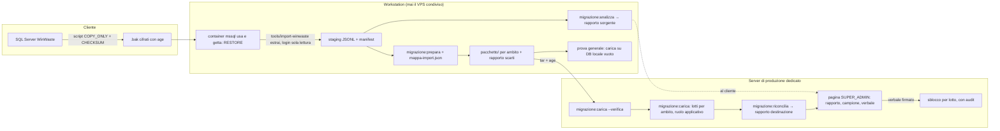
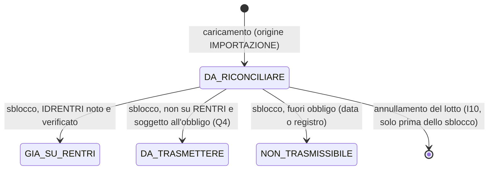
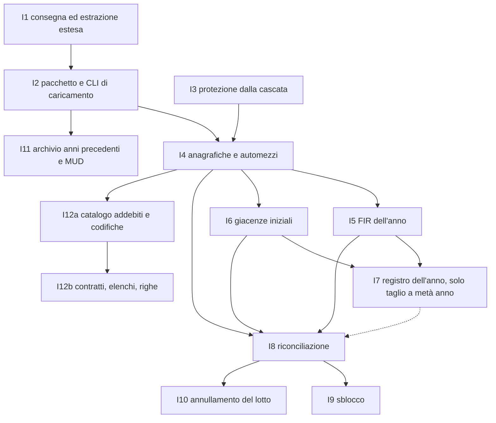

# Fase 3 blocco 2: import da WinWaste dopo la PR A — piano

Data: 2026-11-18. Stato: proposta, da approvare (domande al §7).
Codice letto: `origin/master` @ `e9a61ae5` di `rifiuti` (sola lettura, nessun branch creato).
Precede: piano del blocco 1 `docs/superpowers/plans/2026-11-14-fase3-import-piano.md` (PR #94 e #95, in produzione).

> **Per chi esegue:** `superpowers:subagent-driven-development`, un pezzo alla volta, un worktree e un
> database di test per pezzo (porte libere, mai la 4200). Implementa sonnet, rivede opus. TDD:
> ogni task scrive prima il test rosso. Ogni pezzo è una PR con CI verde. I test Postgres girano col
> ruolo `wasteflow_app` (`creaPrismaServiceApplicativo()` + `TenantContext.run`).

---

## 1. Obiettivo e perimetro

**Obiettivo.** Portare in WasteFlow i dati di un cliente WinWaste partendo dalla PR A (staging,
parser, motore di caricamento, blocco all'invio), fino allo sblocco controllato dell'invio a
RENTRI. Il risultato è una procedura ripetibile, idempotente, per un tenant alla volta, che il
cliente può verificare e firmare.

**Sì (in questo blocco).**

| Area | Roadmap | Pezzi |
|---|---|---|
| Consegna dei dati dal cliente (`.bak`), ripristino ed estrazione estesa | 3.2 | I1 |
| Pacchetto di caricamento e CLI di caricamento sul server | 3.2-3.5 | I2 |
| Protezione del registro dalla cancellazione a cascata (Q7 del 14/11) | §9 punto 11 | I3 |
| Aziende, sedi, anagrafiche, autorizzazioni, automezzi | 3.3 | I4 |
| FIR dell'anno: cartacei e vidimati da WinWaste, digitali riacquisiti da RENTRI | 3.5 | I5 |
| Giacenze iniziali al taglio | 3.4 | I6 |
| Registro dell'anno in corso (solo con taglio a metà anno) | 3.4 | I7 |
| Riconciliazione: rapporto di destinazione e sei confronti | 3.6 | I8 |
| Sblocco dell'invio a RENTRI, con audit | 3.6 | I9 |
| Annullamento di un lotto prima dello sblocco | 3.1 (lotto annullabile) | I10 |
| Archivio degli anni precedenti e MUD storici | 3.7 | I11 |
| Contratti e listini | 3.8 | I12a, I12b |

**No.**

- Eseguire binari WinWaste (nostri o del cliente sulla nostra macchina). Si lavora solo da `.bak` o
  da una lettura in sola lettura del suo SQL Server. Il `.mdf` modello dell'installer si **attacca**,
  non si esegue (come già fa il test opt-in di `tools/import-winwaste`).
- Passare da `WWREM` o dal canale di backup verso Nica.
- Certificati RENTRI e password in `LISTINI`/`VERSIS` (si ricaricano in WasteFlow).
- Serie vidimate `WWQRCODE` (restano all'elenco dei vidimati RENTRI).
- Contabilità (`PNTESTATA`, `PNDETTAGLIO`, fatture aperte, prima nota): resta nel gestionale.
- Importare gli anni precedenti come movimenti vivi (falserebbe giacenze e numerazione).
- `RELAZ` come abbinamenti: si ricalcola col FIFO di 4.6 e si mostrano le differenze
  (raccomandazione D9 del piano 4.6, `docs/superpowers/plans/2026-10-31-fase4-6-abbinamento.md:87-90`).
- La dimensione «magazzino» di WinWaste come dato vivo (D12: si riconcilia per registro, vedi Q8).

**Vincoli ereditati (non si ridiscutono).** Import per tenant col ruolo applicativo, solo `INSERT`
con `ON CONFLICT (tenant_id, import_source, legacy_key) WHERE import_source IS NOT NULL DO NOTHING`,
a blocchi col tenant reimpostato; aziende e sedi del gruppo col ruolo di sistema o dal flusso di
amministrazione; movimenti **e** FIR importati bloccati all'invio finché la riconciliazione non è
chiusa, anche nei job AUTOMATICA e IBRIDA; dubbio su RENTRI = si interroga, mai si reinvia;
staging fuori dal database (Q2 del 14/11); caricamento con una CLI dentro l'immagine del backend
sul server, dai file trasformati cifrati con age e cancellati a fine lotto (Q3 del 14/11);
correzioni F2-3 ammesse sugli importati non riconciliati, ma non trasmesse (Q4 del 14/11);
migration additive con `SET LOCAL lock_timeout`; RLS ENABLE+FORCE su ogni tabella nuova; moduli
del backend in modalità `registra`; nessun dato del cliente a servizi esterni senza decisione;
sessione unica per utente (la pagina SUPER_ADMIN non introduce eccezioni).

---

## 2. Stato attuale verificato su master

Percorsi relativi a `apps/backend/` salvo indicazione.

**Motore di caricamento (PR A).**
- `src/application/migrazione/caricamento/inserisci-a-blocchi.ts:42-100`: `inserisciABlocchi` con
  blocchi in `TenantContext.run` + `$transaction` sul client applicativo, `SET CONSTRAINTS ...
  IMMEDIATE` come ultimo statement (`:81`), lotto `FALLITO` al primo errore (`:91-96`). **Chiama
  sempre `lotti.completa` alla fine (`:98`)**: un lotto con più fasi (ditte, poi sedi, poi ruoli)
  oggi non si può caricare in un lotto solo. **Nessun chiamante** fuori dagli spec
  (`git grep inserisciABlocchi` trova solo la definizione).
- `src/application/migrazione/caricamento/lotti-import.service.ts:35-129`: `avvia`, `registraBlocco`
  (`FOR NO KEY UPDATE`, `:77-80`), `completa`, `fallisci`, `leggi`. Nessun `annulla`.
- `src/application/migrazione/caricamento/tipi.ts:57-76`: `InserisciBlocco<R>`, blocco da 200,
  vincolo differito `waste_movements_importato_bloccato`.
- `src/application/migrazione/caricamento/errori.ts:58-83`: `causaSenzaDati` (mai valori delle righe).

**Schema dell'import.**
- `prisma/schema.prisma:4782-4790` `AmbitoLottoImport` = `ANAGRAFICHE`, `REGISTRO`, `GIACENZE`,
  `FIR`: **mancano** `CONTRATTI` e `ARCHIVIO`. `:4807-4838` `LottoImport`.
- Migration `20261114140200_provenienza_import`: `import_source`, `legacy_key`, `lotto_import_id`,
  CHECK «tutti o nessuno», unico parziale e trigger di immutabilità su **7 tabelle**
  (`waste_movements`, `firs`, `ditte`, `sedi_ditte`, `produttori`, `trasportatori`, `destinatari`).
  **Mancano** clienti, contratti, elenchi e righe di addebito, catalogo addebiti, automezzi.
- Migration `20261114140300_blocco_invio_importati`: trigger `movimenti_trasmissione_rentri_importati`,
  **da `DA_RICONCILIARE` non si esce** («lo sblocco è 3.6, che allenterà questa regola con una
  funzione dedicata e audit»); vincolo differito `waste_movements_importato_bloccato`.
- Migration `20261114140400_blocco_invio_fir_importati`: `firs.bloccato_invio`, `motivo_blocco_invio`;
  trigger `firs_sblocco_importati`: un FIR importato **non** si sblocca.
- Migration `20261114140500_lotti_import_transizioni`: un lotto non `IN_CORSO` non si modifica più.
  **Conseguenza:** oggi `COMPLETATO → ANNULLATO` è vietato dal database; l'annullamento (I10) deve
  allentare il trigger.
- `prisma/schema.prisma:3097-3119` `StatoTrasmissioneRentri` con `DA_RICONCILIARE`; `:3140-3175`
  `MovimentoTrasmissioneRentri` (1:1, `identificativoRentri`, `bloccatoInvio`, esclusione).
- `src/application/rentri/registro/catena-importata.ts`: frammento SQL che esclude le correzioni la
  cui catena parte da un importato non riconciliato (adozione e accodamento).

**Staging ed estrazione (PR B, #94).**
- `src/application/migrazione/staging/colonne-documentate.ts:467-515`: catalogo di **7 tabelle**
  (`MOVIMENTI`, `FORMULARI`, `GIACENZE RIFIUTI`, `CAUSALI RIFIUTI`, `REGISTRI RIFIUTI`, `VERSIS`,
  `RENregistrazioni`). Mancano anagrafiche, autorizzazioni, automezzi, magazzini, numerazioni,
  le altre tabelle RENTRI, contratti e listini.
- `src/application/migrazione/staging/parser/ren-registrazioni.ts`: legge solo chiave,
  `XSEINVIATO`, `IDRENTRI` (serve al confronto 5).
- `src/domain/migrazione/chiavi-legacy.ts:46-100`: `chiaveMovimento`, `chiaveDitta`,
  `chiaveSoggetto`, `chiaveSede`. Nessuna chiave per contratti, elenchi, righe, registrazioni RENTRI.
- `src/application/migrazione/estrazione/estrai-staging.ts` (nucleo senza driver, rifiuta un login
  che scrive, oscura `VERSIS.C1..C5`) e `tools/import-winwaste/` (driver `mssql`, test opt-in con
  attach dei `.mdf` modello in un container usa e getta).
- `src/cli/migrazione-analizza.ts` + `package.json:29` (`ts-node`): unica CLI. **Nessuna CLI di
  caricamento**, nessuna trasformazione verso i modelli di WasteFlow.

**Registro e giacenze.**
- `src/application/registro/numerazione-annotazione.ts:16-67`: `bloccaProgressivo` (advisory lock
  `<registro>-<anno>`), `numeraAnnotazione` (max+1, mai sotto il progressivo iniziale),
  `inserisciAnnotazione` (hash v2 concatenato).
- `src/application/registro/use-cases/registra-movimento.use-case.ts:201` (date non future), `:322`
  (giacenza dello scarico), `:343` (numerazione): controlli dell'inserimento corrente, da **non**
  riusare per l'import (roadmap §4, regole fisse).
- `src/application/registro/verifica-catena-registro.service.ts:5,49-54`: un numero mancante è un
  `BUCO`. I protocolli WinWaste possono avere buchi: oggi la verifica li segnalerebbe come alterazione.
- `prisma/schema.prisma:926-942` `RegistroProgressivoIniziale`; `:945-952`
  `GiacenzaInizialeProvenienza.IMPORTAZIONE` («riservato alla Fase 3»); `:963-990`
  `GiacenzaIniziale` (unico per registro, CER, stato fisico, unità; `origini` con anno e protocollo).
- `prisma/schema.prisma:2295-2320` `RegistroRifiuti` con `identificativoRentri` e
  `invioRentriAutomaticoDal`.

**Anagrafiche (F2-10).** `prisma/schema.prisma:2596-2629` `Ditta` con unici `(tenant, partita_iva)`
`:2621` e `(tenant, codice_fiscale)`; `:2630` `SedeDitta`; `:1331`, `:1376`, `:1429` ruoli;
`:2806` `Automezzo`.

**Fatturazione (Fase 4).** `prisma/schema.prisma:3450` `Cliente`, `:3507` `ContrattoCliente`,
`:3716` `Addebito`, `:3817` `ElencoAddebiti`, `:3877` `RigaAddebito`, `:4464`
`MarcatoreAddebitoFatturato` (richiede un `documentoId` reale: non rappresenta un «fatturato in
WinWaste»), `:4130` `ImpostazioneFatturazione.fatturazioneDa` (letta da
`src/application/fatturazione/selezione-fatturazione.ts:412` e da `conferma-legame.service.ts:416`).

**RENTRI.** `src/infrastructure/rentri/rentri-registri.client.ts:187,239,257` letture
`elencaMovimenti`, `dettaglioMovimentoPerAnnoProgressivo`, `dettaglioMovimentoPerIdentificativo`;
`src/application/rentri/registro/confronto-registrazione-rentri.ts:38` `confrontaConRentri`;
`src/application/rentri/acquisisci-formulario-rentri.use-case.ts` (FIR creati da terzi).

**RLS.** `src/infrastructure/persistence/rls-catalogo.postgres.spec.ts:83` `toBe(88)`;
`prisma/sql/ruoli-db.sql:50-53` liste `v_sola_lettura`, `v_solo_inserimento`, `v_senza_cancellazione`.
Ultima migration: `20261118100000_movimenti_sede_controparte`.

**Frontend.** Pagina SUPER_ADMIN `apps/frontend/src/app/features/admin/system-health/` (modello per la
pagina dei lotti); `apps/frontend/src/app/app.routes.ts:340-350` rotte `admin/*`.

---

## 3. Comportamento WinWaste da replicare (e da leggere)

| Tema | Come lo fa WinWaste | Fonte |
|---|---|---|
| Database | Uno per ditta e anno `WW<ditta4><anno4>`; MUD in `ww<az>MU<aa>`; amministrazione in `adminwwnet` (contiene utenti e credenziali: **non si chiede**) | `schema-db-winwaste.md §1`; `mud.md §3` |
| Backup | L'agente di WinWaste fa `BACKUP DATABASE ... WITH INIT, COMPRESSION` **completo + differenziale** in `%TEMP%\Winwaste\Backup` (`WWREM.cs:52214-52267`, letto, non eseguito). Un nostro backup completo non `COPY_ONLY` spezzerebbe la sua catena di differenziali | `decompilato/WWREM/WWREM/WWREM.cs:52122-52267` |
| Integrità | Nessuna FK, nessun indice oltre alle PK; anagrafiche senza PK (`UNITA LOCALI`, `SEDI LEGALI`, `AUTORIZZAZIONI`, `AUTOMEZZI`) | `schema-db-winwaste.md §1, §3` |
| Anagrafiche | `CLIFOR` (`PRECOD` C/F + `COD` 6), `SEDI LEGALI`, `UNITA LOCALI` (`PRECOD` = soggetto, `COD` 4); nei movimenti la controparte è `soggetto.unità` (11 caratteri); il ruolo P/T/S/I viene da autorizzazioni e campi `PROD/TRAS/SMAL/INTE` | `schema-db-winwaste.md §2.2`; `funzionalita.md §3.1` |
| Registro dopo il RENTRI | Il progressivo non vive più in `PROT1..4`: `StampaRegRentri` consolida i `MOVIMENTI` in `RENregistrazioni` (PK `REGISTRO+PROTOCOLLO`, legame `CODMOVIMENTO+ANNOMOVIMENTO`); **un movimento può dare più registrazioni** (es. `OPER 12` → `DT`/C + `aT`/K); `XSEINVIATO`, `IDRENTRI` | `rentri/03-aggancio-a-winwaste.md §3.1`; `movimenti.md §3.3` |
| Giacenza | Calcolata (`KGNUM - GIASCAR`, `RELAZ`), a volte disallineata; correttore con soglia 0,001 kg | `giacenze.md §6-7`; `movimenti.md §2.6` |
| FIR | `FORMULARI` (101 colonne), `C7` `''`/`R`/`9`/`A`/portale; dei digitali solo `C6='INVIATO A RENTRI DA …'`; `XRENTRIFIRTRASMESSI.IDRENTRI` | `formulari.md §2`; `rentri.md §5.4` |
| Contratti | `CONTRATTI` (32), `ELENCHIADDEB` (14), `ADDEBCON` (63, `SCA1..12`/`GIAF1..12`), `ADDEBITI` (sei listini) | `schema-db-winwaste.md §2.4`; `contratti.md §3`; `fatturazione.md §4` |
| MUD | `MUDAZ`/`MUDTERZI` (`M1..M46`), correzioni manuali non rielaborabili | `mud.md §3` |
| Riconciliazione | Non esiste | `04-piattaforma-e-migrazione.md §4.5` |

Decisioni già prese che toccano l'import: codice di rinnovo `O` convertito in `S` (3.8), tabelle a
scaglioni con fascia `D/W` seguita da `A/X` segnalate e rifiutate, scaglioni corretti rispetto a
WinWaste (`rifiuti-decisioni-31-10.md`); D9 ricalcolo FIFO (piano 4.6).

---

## 4. Design

### 4.1 Flusso

I file `.bak`, staging e pacchetto si cancellano a fine import (registro della cancellazione nel
rapporto). Nel database restano solo lotti, rapporti, audit e i record importati.

### 4.2 Come ottenere i dati dal cliente (I1)

Raccomandazione (Q2): **backup `COPY_ONLY` fatto dall'IT del cliente**, con uno script `sqlcmd`
che forniamo noi e che il cliente legge prima di eseguirlo.

- Database richiesti: solo gli archivi `WW<ditta><anno>` degli anni necessari (anno del taglio più
  gli anni dell'archivio, Q7) e i `ww<az>MU<aa>` dei MUD storici. **Non** `adminwwnet` (utenti,
  credenziali), **non** `WWQRCODE`, **non** `modelli`.
- Comando: `BACKUP DATABASE [..] TO DISK = N'..' WITH COPY_ONLY, CHECKSUM, COMPRESSION, INIT`
  (`COPY_ONLY` non sposta la base dei differenziali dell'agente WinWaste; `CHECKSUM` fa verificare
  le pagine; `COMPRESSION` se l'edizione lo consente, altrimenti senza). Poi `RESTORE VERIFYONLY`
  sul posto e `Get-FileHash -Algorithm SHA256`, con l'elenco delle impronte in un file a parte.
- Trasferimento: il cliente cifra con la nostra chiave pubblica age (`age -r`), oppure carica su un
  canale suo; noi non apriamo porte. L'elenco delle impronte viaggia per un canale diverso.
- Prima del trasferimento: DPA firmato (roadmap §8). Conservazione dei `.bak` sulla workstation:
  cartella 0700 fuori dai repo, cancellazione a fine import e comunque entro 30 giorni (Q2).
- Ripristino: container `mcr.microsoft.com/mssql/server` della **versione uguale o successiva** a
  quella del cliente (un `.bak` di una versione più nuova non si ripristina su una più vecchia),
  `RESTORE FILELISTONLY` poi `RESTORE DATABASE ... WITH MOVE`, solo su `127.0.0.1`, password casuale
  in un file temporaneo 0600; login `db_datareader` per l'estrattore (che rifiuta già un login con
  scrittura). Il container e i file ripristinati si rimuovono a fine estrazione.
- Alternative (Q2): estrattore eseguito presso il cliente con un login di sola lettura (esce solo
  lo staging già filtrato; serve Node sul loro PC o una nostra sessione remota); copia di
  `.mdf`/`.ldf` a servizio fermo (fermo dell'applicazione, rischio di file incoerenti). Un `.bak`
  prodotto dal backup di WinWaste va bene solo se è un completo: un differenziale da solo non si
  ripristina.

### 4.3 Modello dati (migration, tutte additive)

| Pezzo | Migration | RLS |
|---|---|---|
| I2 | nessuna (pacchetto e mappa sono file) | — |
| I3 | trigger `tenants_registro_protetto` `BEFORE DELETE ON tenants`: rifiuta se esistono `waste_movements`, `firs` o `lotti_import` dell'azienda, salvo `set_config('app.consenti_cancellazione_azienda', 'on', true)` impostato solo dal ruolo proprietario nei test e dagli script di pulizia | invariato |
| I4 | colonne di provenienza (stesso schema di `20261114140200`) su `automezzi` | invariato (88) |
| I5 | nessuna (le colonne su `firs` ci sono); eventuale indice per la ricerca per `legacy_key` | — |
| I7 | `buchi_numerazione_importati` (`tenant_id`, `registro_id`, `anno`, `da`, `a`, `lotto_import_id`, `motivo`; FK composte; insert-only in `v_solo_inserimento`) letta da `verifica-catena-registro`: un buco dichiarato all'import non è un'alterazione | 88 → 89 |
| I8 | `rapporti_riconciliazione` (`tenant_id`, `lotto_import_id` o elenco di lotti, `versione`, `esiti` JSONB per confronto 1-6, `stato` `APERTO`/`CHIUSO`, `chiuso_da`, `chiuso_il`, `hash_rapporto`); `campioni_riconciliazione` (righe scelte a caso, esito a mano); `verbali_riconciliazione` (allegato PDF firmato, impronta) | +3 |
| I9 | funzione `sblocca_importati(lotto, ...)` `SECURITY DEFINER` con `search_path` fisso, che imposta un flag di transazione letto dai trigger `movimenti_trasmissione_rentri_importati` e `firs_sblocco_importati` (riscritti per accettare l'uscita da `DA_RICONCILIARE` **solo** con il flag); tabella `sblocchi_import` insert-only (chi, quando, lotto, rapporto, conteggi per esito); valore `IMPORTAZIONE` resta come origine | +1 |
| I10 | `lotti_import_transizioni` riscritto: `COMPLETATO`/`FALLITO` → `ANNULLATO` ammesso; funzione `annulla_lotto_import` (vedi §4.6); tabella `annullamenti_lotto_import` insert-only | +1 |
| I11 | enum `ambito_lotto_import` + `ARCHIVIO` (migration da sola); `archivi_importati` (anno, archivio, hash del pacchetto, conteggi) e `righe_archivio_importato` (tabella sorgente, `cod`, `dati` JSONB grezzo decodificato, insert-only); `documenti_archivio_importato` (MUD telematici, ricevute, PDF: file nello storage esistente, impronta SHA-256) | +3 |
| I12a | colonne di provenienza su `addebiti` e sulle codifiche che si importano davvero (T0 decide quali: condizioni di pagamento sì, codici IVA solo per corrispondenza) | invariato |
| I12b | enum + `CONTRATTI`; provenienza su `clienti`, `contratti_cliente`, `elenchi_addebiti`, `righe_addebito` (e figlie degli scaglioni se servono) | invariato |

Ogni migration: commento «Cosa fa / Ripristino a mano / Da migration fallita (P3009)»,
`SET LOCAL lock_timeout = '5s'`, CHECK e trigger solo nella migration (`migrate diff` invariato),
`rls-catalogo` aggiornato, `ruoli-db.sql` aggiornato e rieseguito due volte nei test.

### 4.4 Pacchetto, mappa e CLI (I2)

- **Mappa di import** `mappa-import.json` (scritta dall'operatore, versionata col pacchetto,
  impronta nel lotto): ditta WinWaste → tenant; registri WinWaste (`REG`/`REGISTRO`) e magazzini →
  `registroId`; unità locali dell'azienda → sede/`RentriUnitaLocale`; `OPER`/`CAUS` → causale F2-5
  (le corrispondenze `dedotta` di `oper.ts` vanno confermate una per una); data di taglio; agganci
  a ditte già presenti in WasteFlow (P.IVA uguale: si usa l'id esistente, non si inserisce). La mappa
  non contiene dati personali.
- **`migrazione:prepara`** (workstation, puro, niente Prisma né Nest, come l'analizzatore): staging +
  mappa → `pacchetto/<archivio>/` con `manifest.json` (formato `wasteflow-pacchetto/1`, hash dello
  staging d'origine, hash della mappa, righe e SHA-256 per file) e un JSONL per ambito e fase nella
  forma dei modelli di WasteFlow, con `legacyKey`. Scarti tipati come nel blocco 1.
- **`migrazione:carica`** (server, compilato in `dist/cli/`, dentro l'immagine del backend):
  `NestFactory.createApplicationContext` con il solo modulo di migrazione, client **applicativo**.
  Opzioni: `--tenant`, `--pacchetto`, `--ambito`, `--verifica` (solo letture: collisioni su P.IVA,
  CF, `firNumber`, progressivi già occupati, registri e causali della mappa inesistenti; esce 2 se
  c'è un bloccante), `--dimensione-blocco`. Rivalida ogni record lato server con i validatori di
  dominio (CER a catalogo, causale coerente col verso, unità): il pacchetto non è fidato.
- **Lotto a fasi.** `inserisciABlocchi` riceve `concludi?: boolean` (default `true`, compatibile);
  un orchestratore `caricaAmbito` esegue le fasi (es. ditte → sedi → ruoli) sullo stesso lotto e
  chiama `completa` alla fine. Le FK fra record importati si risolvono dentro il blocco con
  `SELECT id ... WHERE tenant_id = $1 AND import_source = 'WINWASTE' AND legacy_key = ANY($2)`.
- **Prova generale.** Stessa CLI contro un PostgreSQL locale creato dalle migration, con un tenant
  di prova: i dati restano sulla workstation. Il rapporto di destinazione della prova va al cliente
  insieme al rapporto sorgente.

### 4.5 Registro, giacenze e numerazione (I6, I7)

- **Giacenze iniziali (I6).** Al taglio, per registro, CER, stato fisico e unità: ricalcolo
  indipendente da `RELAZ` e `[GIACENZE RIFIUTI]` (righe `G0..G5`), confronto con `GIASCAR` prima del
  caricamento, differenze ≥ 0,001 kg nel rapporto per il cliente (mai corrette in silenzio). Si
  scrive `giacenze_iniziali` con `provenienza = IMPORTAZIONE` e `origini` (anno e protocollo dei
  carichi aperti). Serve sia al taglio di inizio anno sia a metà anno.
- **Registro dell'anno (I7, solo con taglio a metà anno).** Use case dedicato
  `ImportaAnnotazioniUseCase`: sotto `bloccaProgressivo`, inserisce in ordine di protocollo
  conservando anno e progressivo originali, calcola l'hash v2 concatenato come
  `inserisciAnnotazione`, salta i controlli di data futura e giacenza, crea nella stessa transazione
  la riga `DA_RICONCILIARE` con `identificativoRentri` se `IDRENTRI` è noto; registra i buchi in
  `buchi_numerazione_importati`. Rifiuta se il registro ha già annotazioni non importate in
  quell'anno (la numerazione non si mescola). Fonte delle annotazioni: Q3.
- Le annotazioni nuove fatte in WasteFlow proseguono da `max+1` (`numerazione-annotazione.ts:57`).
- I legami commerciali (4.3) non si creano: con `fatturazioneDa` = giorno dopo il taglio gli
  importati non sono fatturabili.

### 4.6 Riconciliazione, sblocco, annullamento (I8, I9, I10)

- **Confronti (I8)**, fonte = rapporto sorgente, destinazione = query su WasteFlow per lotto:
  (1) conteggi per tabella, causale, stato; (2) totali per CER, anno, verso, unità (mai kg + m³);
  (3) giacenza al taglio per CER e registro, soglia 0,001 kg; (4) numerazione: primo, ultimo,
  buchi dichiarati, collisioni; (5) RENTRI: `XSEINVIATO='X'`/`IDRENTRI` contro le righe
  `DA_RICONCILIARE` con identificativo, più verifica **in sola lettura** su RENTRI con
  `dettaglioMovimentoPerIdentificativo` (credenziali del cliente già caricate; nessuna POST);
  (6) campione: N movimenti e N FIR scelti con seme registrato, stampati dai due lati, esito a mano.
  Il rapporto è versionato e ha un hash; si chiude solo con tutti i confronti `OK` o con le
  differenze accettate una per una con motivo.
- **Sblocco (I9)**: per lotto, da SUPER_ADMIN (Q5), solo con rapporto `CHIUSO` e verbale firmato
  caricato. Classifica ogni riga nello stato del diagramma; FIR: `bloccato_invio` → falso solo per
  i FIR la cui riconciliazione ha esito positivo. Le righe che vanno `DA_TRASMETTERE` **non** entrano
  nell'adozione automatica (sono già righe) ma in coda manuale, in ordine di protocollo; restano
  soggette all'interruttore `RENTRI_REGISTRO_INVII_ATTIVI`. Le correzioni F2-3 fatte nel frattempo
  sugli importati diventano accodabili dopo lo sblocco della radice.
- **Annullamento (I10, Q6)**: `annulla_lotto_import(lotto)` col ruolo di sistema, solo se: lotto
  `COMPLETATO` o `FALLITO`, nessuna riga del lotto sbloccata, nessun record che dipende da quelli
  del lotto (correzioni F2-3, legami 4.3, abbinamenti 4.6, ricopie, FIR collegati da altri lotti,
  FK da record non importati). Cancella in ordine di dipendenza con un flag di transazione che i
  trigger `..._no_delete` e di immutabilità riconoscono, scrive l'audit e porta il lotto
  `ANNULLATO`. Senza questa funzione il ruolo applicativo resta senza `DELETE` sugli importati.

### 4.7 API e frontend

- `GET /admin/import/lotti?tenantId=` e `GET /admin/import/lotti/:id` (SUPER_ADMIN, client di
  sistema solo per l'elenco cross-tenant, dettaglio nel contesto del tenant).
- `GET /admin/import/rapporti/:id`, `POST .../campione/:riga/esito`, `POST .../differenze/:id/accetta`,
  `POST .../chiudi`, `POST .../verbale` (upload PDF, impronta), `POST /admin/import/lotti/:id/sblocca`
  (body con conferma esplicita e versione del rapporto, 409 se cambiato), `POST .../annulla`.
- Pagina `features/admin/import/` sul modello di `system-health`: elenco lotti per azienda, conteggi,
  stato, rapporto con i sei confronti, campione, verbale, pulsanti «Sblocca» e «Annulla» con
  conferma a due passaggi. Le pagine del registro e del FIR mostrano già lo stato «Importata, da
  riconciliare» (Task 8 del blocco 1).
- Pagina «Archivio WinWaste» (I11) per ADMIN e OPERATOR dell'azienda, sola lettura: anni, ricerca per
  CER, data, protocollo, controparte; download del pacchetto d'archivio e dei MUD storici.

### 4.8 Job

Nessun job periodico nuovo. Caricamento, riconciliazione e sblocco sono comandi espliciti. La
verifica in sola lettura su RENTRI (confronto 5) gira dentro `migrazione:riconcilia` per un tenant
alla volta, con limiti di frequenza come i job esistenti.

### 4.9 Sicurezza e dati personali

- `.bak`, staging, pacchetto: mai nel repo (guardie `.gitignore` e test esistenti), mai sul VPS
  condiviso, cifrati in transito con age, cancellati a fine import con data nel rapporto.
- Log: solo id tecnici e conteggi (`causaSenzaDati`).
- Rapporti nel database: aggregati e codici; nomi e CF solo nel campione, visibile a SUPER_ADMIN e
  ADMIN dell'azienda.
- Sblocco e annullamento: audit insert-only, conferma a due passaggi, versione del rapporto.
- Il primo import con dati reali avviene **solo sul server di produzione dedicato** (decisione del
  23/10: il server dedicato prima dei clienti veri). Le prove con dati reali restano in locale.

---

## 5. Pezzi

Ordine consigliato (sequenziale, 16 GB di RAM): I1 → I2 → I3 → I4 → I5 → I6 → I8 → I9 → I10 →
I11 → I12a → I12b; I7 dopo I6 solo se Q1 = taglio a metà anno. Nota sull'ordine rispetto alla
roadmap: i **FIR prima del registro**, perché `waste_movements.fir_id` si valorizza solo
all'inserimento (solo `INSERT`): il movimento importato deve trovare il FIR già importato.

Taglie: S ≤ 1 giorno, M 2-5 giorni, L oltre una settimana.

### I1 — Consegna dei dati ed estrazione estesa (M, nessuna migration)

File: `tools/import-winwaste/consegna/` (`backup-copy-only.sql`, `LEGGIMI-cliente.md`,
`ripristina.sh`), `src/application/migrazione/staging/colonne-documentate.ts`, parser nuovi in
`staging/parser/`, `docs/migrazione/consegna-dati-cliente.md`.

- **T0** Linea di base: suite intera, `migrate diff` (due scarti preesistenti noti), elenco delle
  tabelle da aggiungere con fonte in `schema-db-winwaste.md §4-6`.
- **T1** Script `sqlcmd` parametrico (database ammessi per pattern `WW[0-9]{8}` e `ww[0-9]{4}MU[0-9]{2}`,
  rifiuta `adminwwnet`): test che lo script contiene `COPY_ONLY`, `CHECKSUM`, nessun `RESTORE`,
  `DROP`, `ALTER`, `sp_configure`, `xp_cmdshell` (test testuale in Jest).
- **T2** `ripristina.sh`: container su `127.0.0.1`, password in file 0600, `RESTORE FILELISTONLY` +
  `WITH MOVE`, login `db_datareader`, pulizia a fine uso. Test opt-in (`WASTEFLOW_TEST_MSSQL=1`):
  backup `COPY_ONLY` del `.mdf` modello attaccato, ripristino, estrazione identica a quella del
  test esistente.
- **T3** Catalogo esteso: `CLIFOR`, `SEDI LEGALI`, `UNITA LOCALI`, `AUTORIZZAZIONI`, `AUTOMEZZI`,
  `AUTISTI`, `MAGAZZINI RIFIUTI`, `NUMERAZIONI`, `RENrelazioniIniziali`, `RENesportazioni` (senza
  `DOCUMENTO`), `XRENTRIFORMULARI`, `XRENTRIFIRTRASMESSI`, `CONTRATTI`, `ELENCHIADDEB`, `ADDEBCON`,
  `ADDEBITI`, `CONDIZIONI DI PAGAMENTO`, `MUDAZ`, `MUDTERZI`. Test: colonne e ordine uguali al
  catalogo del `.mdf` modello (fixture generata dal test opt-in e committata).
- **T4** Manifest: versione WinWaste (da `VER` o tabella di configurazione), collation, versione di
  SQL Server, elenco dei database ricevuti con impronte. Test del lettore sui campi nuovi.
- **T5** Parser minimi delle tabelle nuove (chiavi, duplicati senza PK → scarto
  `CHIAVE_DUPLICATA`), fixture sintetiche con la sezione di documentazione in testa.
- Fatto quando: estrazione opt-in verde dal `.bak` del modello; `migrazione:analizza` invariato sulle
  fixture del blocco 1; CI verde.

### I2 — Pacchetto e CLI di caricamento (M, nessuna migration)

File: `src/application/migrazione/pacchetto/` (`manifest-pacchetto.ts`, `mappa-import.ts`,
`scrittore-pacchetto.ts`, `lettore-pacchetto.ts`), `src/cli/migrazione-prepara.ts`,
`src/cli/migrazione-carica.ts`, `src/application/migrazione/caricamento/carica-ambito.ts`,
`inserisci-a-blocchi.ts` (opzione `concludi`), `docs/migrazione/formato-pacchetto.md`, Dockerfile
del backend se `dist/cli` non è copiato.

- **T0** Verifica che l'immagine contenga `dist/cli` e che `node dist/cli/...` parta senza `ts-node`.
- **T1** Schema della mappa con validazione (Zod o validatori esistenti): campi obbligatori, nessun
  dato personale (test: un CF nella mappa è rifiutato), impronta deterministica.
- **T2** Formato pacchetto: manifest, impronte, righe dichiarate; il lettore rifiuta impronta
  diversa, formato sconosciuto, mappa diversa da quella dichiarata. Streaming.
- **T3** `inserisciABlocchi` con `concludi: false`; test che il comportamento di default non cambia
  (spec esistente invariata) e che con `false` il lotto resta `IN_CORSO`.
- **T4** `caricaAmbito`: fasi in ordine sullo stesso lotto, `completa` alla fine, `fallisci` alla
  prima fase fallita; test Postgres col ruolo applicativo su due fasi finte.
- **T5** `migrazione:carica --verifica`: solo letture (test: nessuna scrittura, contatore di
  `INSERT` a zero via `pg_stat_user_tables` o ruolo di sola lettura), elenco dei bloccanti, uscita 2.
- **T6** `migrazione:carica`: rifiuta il client di sistema (test d'architettura sul modulo), un
  tenant alla volta, uscita 0/1/2; log senza valori.
- **T7** Runbook `docs/migrazione/README.md`: prova generale in locale, copia cifrata, carico,
  cancellazione dei file.
- Fatto quando: un pacchetto sintetico di sole ditte si carica due volte (seconda: tutte saltate) in
  locale tramite la CLI compilata.

### I3 — Protezione del registro dalla cascata (S-M, migration)

Decisione Q7 del 14/11: «pezzo a sé prima del primo cliente migrato».

- **T0** Censimento delle pulizie dei test Postgres che cancellano aziende (`git grep` di `DELETE FROM
  "tenants"` e `tenant.delete`).
- **T1** Test rosso: col ruolo applicativo e col proprietario, `DELETE` di un'azienda con movimenti,
  FIR o lotti → errore `23514` con messaggio senza dati; senza movimenti → passa.
- **T2** Migration del trigger con il flag di transazione per test e script di pulizia.
- **T3** Helper di test `cancellaAziendaDiProva(tx, id)` che imposta il flag; aggiornamento delle
  pulizie censite.
- Fatto quando: suite Postgres intera verde, nessun endpoint cambia.

### I4 — Aziende, sedi, anagrafiche, automezzi (M, migration su `automezzi`)

- **T0** Sui dati del `.mdf` modello e sul primo `.bak` (se arrivato): ruoli P/T/S/I per soggetto,
  privati senza P.IVA, P.IVA con errori; conferma delle chiavi (Q6 del 14/11).
- **T1** Trasformazione pura `CLIFOR` + `SEDI LEGALI` + `UNITA LOCALI` + `AUTORIZZAZIONI` → ditte
  (`chiaveDitta`), sedi (`chiaveSede`), ruoli (`chiaveSoggetto`), con dedup per P.IVA o CF:
  duplicati **segnalati** (scarto `DITTA_DUPLICATA` con le chiavi coinvolte), mai fusi in silenzio;
  ruolo dedotto da autorizzazioni e dall'uso nei movimenti, marcato `dedotto`.
- **T2** Unità locali dell'azienda stessa: non diventano anagrafiche ma voci della mappa
  (sede/`RentriUnitaLocale`/registro, via `VERSIS XRENTRI:X<sede>.<ul>`); test che una UL dell'azienda
  non finisce fra i destinatari.
- **T3** Aziende del gruppo: nessuna creazione automatica di tenant. Il runbook usa il flusso di
  amministrazione esistente (`admin/tenants`); `--verifica` controlla che ogni ditta della mappa
  abbia il suo tenant.
- **T4** `inserisciBlocco` per ditte, sedi, produttori, trasportatori, destinatari, automezzi;
  agganci della mappa (ditta già esistente → nessun insert, sede e ruoli collegati all'id esistente).
  Test: idempotenza, collisione P.IVA non agganciata → blocco fallito, RLS fra due aziende.
- **T5** Migration provenienza su `automezzi`; test di immutabilità.
- Fatto quando: pacchetto sintetico con 3 ditte (una privata, una con due sedi, una con P.IVA già
  presente e agganciata) caricato due volte; conteggi del lotto esatti.

### I5 — FIR dell'anno (M, nessuna migration)

- **T0** Formati reali di `FORMU` e serie (checklist punto 8 del blocco 1); quanti FIR dopo il
  13/02/2026 sono digitali.
- **T1** Trasformazione `FORMULARI` (`C7 ≠ 'A'`, anno del taglio) → FIR con stato dedotto dai campi
  di arrivo (`COMPLETED` se c'è la data di fine trasporto e il peso a destino, altrimenti
  `AWAITING_RECEIVER`), sedi e parti da I4 per chiave legacy. Test sui casi `C7` `''`/`R`/`9`/portale.
- **T2** `firNumber` importato così com'è; collisione con un FIR del tenant → bloccante in
  `--verifica`, mai rinomina in silenzio. Test di collisione su `(tenant_id, fir_number)`.
- **T3** FIR digitali: non si copiano. Elenco nel rapporto (numero, `XRENTRIFIRTRASMESSI.IDRENTRI`)
  e comando `migrazione:riacquisisci-fir` che per ciascuno chiama `acquisisci-formulario-rentri`
  (sola lettura su RENTRI, scelta `NUOVO`), con limite di frequenza. Test con client RENTRI finto:
  nessuna POST di creazione, un FIR riacquisito non è importato (Q5 del 14/11).
- **T4** Test di non-trasmissione rieseguiti sui FIR caricati dal pacchetto (i quattro del blocco 1,
  stesso nome).
- Fatto quando: FIR cartacei sintetici caricati, bloccati, idempotenti; riacquisizione provata con
  il client finto.

### I6 — Giacenze iniziali al taglio (M, nessuna migration)

- **T1** Ricalcolo puro della giacenza al taglio da `RELAZ`, righe `G0..G5` e carichi aperti, per
  registro (via mappa dei magazzini), CER, stato fisico, unità; confronto con `GIASCAR`. Test con i
  casi di `giacenze.md §6-7` (compensazione, modalità `P`/`G` del passaggio d'anno).
- **T2** Record `giacenze_iniziali` con `provenienza = IMPORTAZIONE`, `origini` `{anno, protocollo,
  quantita}`; più carichi della stessa famiglia sommati in una riga (unico per famiglia).
- **T3** `inserisciBlocco` con `ON CONFLICT` sulla chiave legacy **e** test che una giacenza
  manuale già presente sulla stessa famiglia fa fallire il blocco (non viene sovrascritta).
- **T4** Test che lo scarico successivo in WasteFlow vede la giacenza importata
  (`giacenza-disponibile.ts`) e che il MUD dell'anno non la conta come prodotta o ricevuta.
- Nota: `giacenze_iniziali` non ha oggi le colonne di provenienza. **T0** decide fra aggiungerle
  (migration additiva, consigliato, per idempotenza vera) o usare `origini` + `provenienza`; se
  servono, la migration va in questo pezzo.
- Fatto quando: giacenze sintetiche caricate, differenze `GIASCAR` nel rapporto, idempotenza.

### I7 — Registro dell'anno in corso (L, migration `buchi_numerazione_importati`; solo se Q1 ≠ inizio anno)

- **T0** Sul `.bak`: rapporto fra `MOVIMENTI` e `RENregistrazioni` (quanti movimenti non consolidati,
  quante registrazioni per movimento), `REG1..4` effettivamente usati.
- **T1** Trasformazione secondo Q3 → annotazioni con anno e progressivo originali, causale F2-5 dalla
  mappa, quantità e unità (`quantita.ts`), controparte e sede da I4, `fir_id` da I5.
- **T2** Migration e test di `buchi_numerazione_importati`; `verifica-catena-registro` li riporta come
  `BUCO_DICHIARATO` e prosegue. Test: un buco non dichiarato resta `BUCO`.
- **T3** `ImportaAnnotazioniUseCase`: lock del progressivo, ordine, hash v2, riga `DA_RICONCILIARE`
  nella stessa transazione, rifiuto se il registro ha annotazioni non importate nell'anno. Test:
  catena verificabile dopo l'import; un nuovo movimento prende `max+1`; vincolo differito.
- **T4** Annullati `$$`: non si importano come annotazioni vive; nel rapporto (confronto 1). Ricarichi
  `($$PARTENZA$$)` e movimenti generati in automatico riconosciuti (`movimenti.md §5.2-5.3`).
- **T5** Test dei quattro casi di non-trasmissione sui movimenti caricati (adozione, accodamento,
  correzione, job automatico).
- Fatto quando: anno sintetico con buchi e annullati caricato, catena integra, nessuna riga adottata.

### I8 — Riconciliazione (M, migration: 3 tabelle)

- **T1** Rapporto di destinazione puro (query aggregate per lotto) con la stessa forma del rapporto
  sorgente; test che kg e m³ non si sommano.
- **T2** Confronti 1-5 come funzioni pure (sorgente, destinazione) → esiti tipati; soglia 0,001 kg.
- **T3** Confronto 5 su RENTRI in sola lettura (client finto nei test; nessuna POST: test che
  `inviaMovimenti` non è mai chiamato).
- **T4** Campione con seme registrato, riproducibile; esito a mano.
- **T5** Migration e repository (RLS, insert-only per esiti e verbale), chiusura con versione.
- **T6** API e pagina SUPER_ADMIN (Karma: confronti, campione, chiusura disabilitata con
  differenze aperte).
- Fatto quando: `migrazione:riconcilia` produce un rapporto chiudibile sui dati sintetici e uno non
  chiudibile con una differenza iniettata.

### I9 — Sblocco dell'invio (M, migration: funzione e audit)

- **T1** Test rossi: senza flag, da `DA_RICONCILIARE` non si esce (invariato); con la funzione si va
  solo negli stati del diagramma; `GIA_SU_RENTRI` richiede `identificativoRentri`; FIR sbloccato solo
  se importato e riconciliato.
- **T2** Migration: trigger riscritti, funzione `SECURITY DEFINER` (`search_path` fisso, controllo
  del tenant attivo), `sblocchi_import`.
- **T3** Use case `SbloccaLottoUseCase`: rapporto `CHIUSO` alla versione indicata, verbale presente,
  ruolo SUPER_ADMIN (Q5), classificazione per riga, audit.
- **T4** Test end-to-end Postgres: dopo lo sblocco `GIA_SU_RENTRI` non parte mai; `DA_TRASMETTERE`
  parte solo con «Trasmetti ora» e interruttore acceso, in ordine di protocollo; le correzioni
  rimaste ferme diventano accodabili.
- **T5** Pulsante nella pagina con conferma a due passaggi; e2e Playwright del percorso SUPER_ADMIN.

### I10 — Annullamento del lotto (S-M, migration)

- **T1** Test rossi: annullamento rifiutato se una riga è sbloccata, se esiste una correzione, un
  legame, un abbinamento o un FK da record non importati; accettato altrimenti, con righe cancellate
  e lotto `ANNULLATO`.
- **T2** Migration: transizione `→ ANNULLATO`, funzione col ruolo di sistema, audit.
- **T3** Ricaricamento dopo l'annullamento: nuovo lotto, stesse chiavi legacy, inserite di nuovo.

### I11 — Archivio anni precedenti e MUD storici (M, migration; dipende da Q7)

- **T1** Enum `ARCHIVIO` (migration da sola), tabelle insert-only con RLS.
- **T2** `migrazione:prepara --archivio`: per ogni anno righe decodificate di `MOVIMENTI`,
  `FORMULARI`, `RENregistrazioni`, giacenze di fine anno, `MUDAZ`/`MUDTERZI`; nessun movimento vivo
  (test: `waste_movements` invariata, giacenza invariata).
- **T3** Documenti: MUD telematici e ricevute forniti dal cliente come file (non ricostruiti),
  impronta SHA-256, storage esistente.
- **T4** Pacchetto d'archivio esportabile (CSV per tabella + PDF del registro per anno + manifest con
  impronte), da consegnare al cliente o al suo conservatore (decisione 01/11: contratto diretto del
  cliente).
- **T5** Pagina di consultazione (Karma) e API in sola lettura.

### I12a — Catalogo addebiti e codifiche (M, migration provenienza)

- **T0** Copertura: famiglie di addebito di `ADDEBCON` reali contro il motore 4.2 (D6 roadmap); elenco
  dei non mappati.
- **T1** `ADDEBITI` (sei listini) → `addebiti` + prezzi; codici IVA e condizioni di pagamento per
  corrispondenza dalla mappa (non si creano codici IVA nuovi in silenzio).
- **T2** Migration provenienza; `inserisciBlocco`; test idempotenza e RLS.

### I12b — Contratti, elenchi, righe (M, migration enum + provenienza)

- **T1** `CONTRATTI` → `clienti` (da ditte di I4) e `contratti_cliente`; rinnovo `O` → `S`; stato
  secondo Q9.
- **T2** `ELENCHIADDEB` e `ADDEBCON` → elenchi e righe con scaglioni `SCA1..12`/`GIAF1..12`; tabelle
  `D/W` seguite da `A/X` rifiutate e segnalate; differenze volute dagli scaglioni di WinWaste
  scritte nel rapporto.
- **T3** Fatturato pregresso: `fatturazioneDa` = giorno dopo il taglio. **T0** verifica che
  `fatturazioneDa` escluda anche canoni e scadenze fisse già fatturati in WinWaste; se no, serve un
  marcatore «fatturato fuori WasteFlow» (migration additiva, decisione da chiedere).
- **T4** Test: una prima elaborazione dopo l'import non rifattura il pregresso.

---

## 6. Rischi e punti aperti

- **Ritrasmissione a RENTRI.** Rete a tre livelli già in master (trigger, vincolo differito, guardie).
  Rischio nuovo: lo sblocco. Mitigazione: funzione unica, flag di transazione, audit, test
  end-to-end, interruttore di emergenza.
- **Un movimento WinWaste non è una registrazione RENTRI.** Dopo il 2025 il registro legale è
  `RENregistrazioni` (più registrazioni per movimento). Importare da `MOVIMENTI` rischia numerazioni
  e causali diverse da quelle già sull'ente (Q3).
- **Taglio a metà anno.** Pezzo L, numerazione continua, buchi, correzioni in volo. Il taglio a inizio
  anno lo evita (Q1); il prossimo 1/1 è fra sei settimane.
- **Catena di backup del cliente.** Un backup completo non `COPY_ONLY` sposta la base dei
  differenziali dell'agente WinWaste: lo script lo impone.
- **Versione di SQL Server** del cliente più nuova del container: il ripristino fallisce; il runbook
  sceglie l'immagine.
- **Dati personali e conservazione.** `.bak` con contabilità e anagrafiche complete: minimizzazione
  (solo archivi richiesti, solo tabelle documentate), DPA, cancellazione registrata.
- **Server dedicato.** Il VPS attuale è di sviluppo e condiviso: niente dati reali lì. Il primo
  import reale aspetta il server dedicato (prerequisito esterno).
- **Annullamento.** Più è tardi, più dipendenze: va fatto prima che il cliente lavori sugli importati.
- **Lotto a fasi.** Modifica di `inserisciABlocchi`: compatibile, coperta dalla spec esistente.
- **Schema reale diverso dal modello 2014** (`LEGAME`, `DES` allargati): avvisi del lettore e T0 di
  ogni pezzo.
- **Fatturato pregresso** (I12b T3): da verificare sul codice 4.4 prima di scrivere.
- **Aspetti legali** del formato e degli anni pregressi (roadmap §8): da far vedere a un legale prima
  di offrire la migrazione come servizio.
- Punti aperti senza domanda: dimensione del blocco (si misura sul primo `.bak`); limiti di frequenza
  della verifica RENTRI (si riusano quelli dei job esistenti).

---

## 7. Domande per Graziano

**Q1. Data di taglio del primo cliente (D3 della roadmap).**
1. **Inizio anno (31/12): si importano anagrafiche, FIR aperti, giacenze al 31/12 e archivio; I7 non
   si fa finché non serve.** (consigliata)
2. Fine di un mese qualunque: si importa anche il registro dell'anno in corso (I7 subito).
3. Si costruisce I7 comunque, prima del primo cliente.

**Q2. Come si ottengono i dati.**
1. **`.bak` `COPY_ONLY` dei soli archivi `WW<ditta><anno>` e `ww<az>MU<aa>`, fatto dall'IT del
   cliente col nostro script, cifrato con age, ripristinato in un container usa e getta sulla
   workstation, cancellato entro 30 giorni.** (consigliata)
2. Estrattore eseguito presso il cliente con login di sola lettura: esce solo lo staging.
3. Copia di `.mdf`/`.ldf` a servizio fermo.

**Q3. Fonte del registro dell'anno in corso (solo se Q1 ≠ 1).**
1. **`RENregistrazioni` (registro cronologico già consolidato, protocolli e `IDRENTRI`), con il
   cliente che consolida in WinWaste tutti i movimenti fino al taglio prima del backup.** (consigliata)
2. `MOVIMENTI` con la mappatura `OPER` → causali e i protocolli ricostruiti.

**Q4. Movimenti importati che non risultano su RENTRI, allo sblocco.**
1. **Vanno in coda manuale (`DA_TRASMETTERE`) se soggetti all'obbligo, in ordine di protocollo, con
   «Trasmetti ora»; fuori obbligo `NON_TRASMISSIBILE`.** (consigliata)
2. Mai trasmessi da WasteFlow (il cliente li sistema sul portale).
3. Decisione riga per riga nella pagina di riconciliazione.

**Q5. Chi sblocca l'invio.**
1. **SUPER_ADMIN, solo con rapporto chiuso e verbale firmato dal cliente caricato.** (consigliata)
2. ADMIN dell'azienda, con conferma a due passaggi.
3. ADMIN approva, SUPER_ADMIN esegue.

**Q6. Annullamento di un lotto prima dello sblocco (I10).**
1. **Sì, con una funzione del ruolo di sistema, solo se nulla dipende dal lotto, con audit.** (consigliata)
2. No: un lotto sbagliato si corregge con le rettifiche F2-3 o rifacendo l'azienda.
3. Solo in prova, mai in produzione.

**Q7. Anni precedenti (D4 della roadmap).**
1. **Archivio in sola consultazione in WasteFlow più pacchetto d'export con impronte consegnato al
   cliente; anni: gli ultimi 5.** (consigliata)
2. Solo pacchetto consegnato, niente in WasteFlow.
3. WinWaste resta in sola lettura presso il cliente; nessun archivio da noi.

**Q8. Magazzini di WinWaste (D12).**
1. **Si riconcilia per registro; i magazzini entrano solo nella mappa (magazzino → registro) e nel
   rapporto.** (consigliata)
2. Pezzo della Fase 4 per la dimensione magazzino, prima del primo gestore migrato.

**Q9. Stato dei contratti importati (I12b).**
1. **Stato di WinWaste (attivo, sospeso, chiuso) con `fatturazioneDa` = giorno dopo il taglio.** (consigliata)
2. Tutti in `BOZZA`, attivati a mano dal cliente dopo il controllo.

---

## Decisioni di Graziano (18/11)

Import WinWaste (I1-I12b):

- Taglio a inizio anno (I7 rinviato).
- `.bak` COPY_ONLY fatto dall'IT del cliente con il nostro script, cifrato con age, ripristinato in un container usa e getta.
- Importati non su RENTRI: in coda manuale se soggetti, altrimenti NON_TRASMISSIBILE.
- Sblocco dell'invio da SUPER_ADMIN con verbale.
- Annullo del lotto solo se nulla dipende da esso.
- Anni precedenti: sola consultazione ed export, ultimi 5.
- Riconciliazione per registro.
- Contratti con stato WinWaste e `fatturazioneDa` = giorno dopo il taglio.
- Ordine: FIR (I5) prima del registro.
