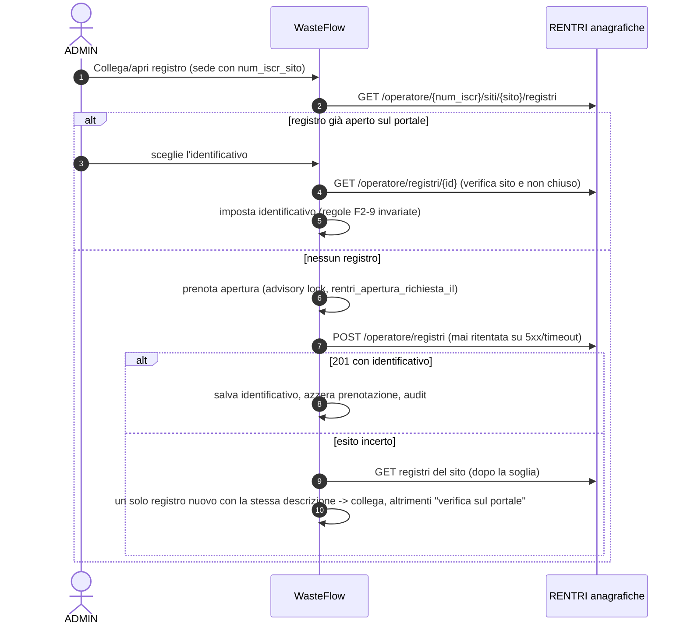
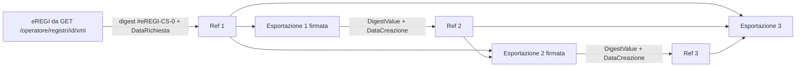
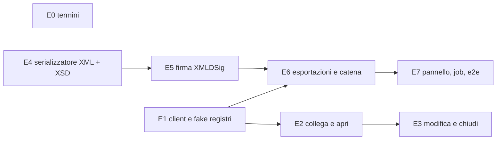

# Piano: registro cronologico verso RENTRI, gestione dei registri ed eREGI (18/11/2026)

> Piano di lavoro, non ancora eseguibile: servono prima le risposte alle domande del §7.
> Master verificato: `e9a61ae5` (merge #109). Percorsi relativi a `apps/backend/` salvo
> indicazione; `fe/` = `apps/frontend/src/app/`.

## 1. Obiettivo e perimetro

**Scoperta principale.** La trasmissione dei movimenti del registro a RENTRI (F2-9) **è già fatta
e in produzione**: tabella `movimenti_trasmissione_rentri`, traduzione fail-closed, lotti, esiti,
ripresa, verifica delle incerte, rettifiche e annullamenti trasmessi come tali, esclusione,
interruttore di emergenza, job ogni 10 minuti, pannello e marcatori sul movimento. Questo piano
**non la rifà**. Copre le tre lacune che restano rispetto a WinWaste e alla norma:

| # | Lacuna | Stato su master |
|---|---|---|
| A | **Registri cronologici su RENTRI** (`anagrafiche /operatore/registri`): elenco per unità locale, apertura, dati, modifica, chiusura. Oggi l'ADMIN copia a mano l'identificativo `R…` dal portale (`PUT /rentri/registro/registri/:id`) | ASSENTE (solo l'inserimento manuale) |
| B | **XML del registro (`reg:Registro`)**: `eREGI` scaricato da RENTRI, `RiferimentiPrecedenti` (catena dei digest fra esportazioni), `Registrazioni`, firma XMLDSig; validazione con `POST /valida` | ASSENTE (il client `validaRegistro` esiste, senza chiamanti) |
| C | **Termini di trasmissione**: cadenza mensile, entro la fine del mese successivo a quello dell'annotazione (DM 59/2023 art. 15 c. 2, fonti secondarie) | ASSENTE (nessuna scadenza calcolata, F2-9 Q2) |

**Chiarimento sul "formato e firma".** I due canali sono diversi e il piano li tiene separati:

- **Trasmissione dei movimenti** = JSON (`MovimentoModel`/`AnnullamentoMovimentoModel`) in
  `POST dati-registri/v1.0/operatore/{id}/movimenti`, con integrità JWS `Agid-JWT-Signature` +
  `Digest` sul corpo. **Già fatto** (`rentri-registri.client.ts:620` `postNonIdempotente`).
- **XML del registro** = documento di tenuta (XSD `rentri-registri-1.0` + `rentri-movimenti-1.0`),
  firmato XMLDSig *enveloped*. **Non si trasmette** a RENTRI: si valida con `/valida` e si conserva
  (è l'oggetto che andrà al conservatore, decisioni dell'01/11). Nessun XAdES qui (l'XAdES è dei FIR).

**Fuori perimetro:** conservazione a norma e versamento (pezzo futuro, modulo opzionale);
`/soggetto-delegato/*`; DigitalHub/Zucchetti o qualunque servizio esterno di firma (decisione: nessun
dato del cliente a terzi); stampa vidimata/chiusura d'anno del registro (R6/R11, altro piano);
modifiche al ciclo d'invio F2-9; verifiche sull'ambiente demo RENTRI (rimandate dal 31/10, vedi Q6).

## 2. Stato attuale verificato su master

**Trasmissione dei movimenti (F2-9, completa).**
- Piano: `docs/superpowers/plans/2026-10-31-fase2-9-rentri-registro.md` (D1-D14, Q1-Q10).
- Migration `prisma/migrations/20261101500000_trasmissione_registro_rentri` (tabella 1:1, trigger
  di immutabilità, RLS), `20261114140000_import_valori_trasmissione` (stato `DA_RICONCILIARE`).
- Client `src/infrastructure/rentri/rentri-registri.client.ts`: `inviaMovimenti` `:157` (mai
  ritentata su esito incerto, `:150-154`), `contaMovimenti` `:223`,
  `dettaglioMovimentoPerAnnoProgressivo` `:239`, `validaRegistro` `:278` (**nessun chiamante**),
  `ultimaTransazioneId` `:312`, `attendiEsito` `:368`, POST firmata `:555-620`.
- Applicazione `src/application/rentri/registro/`: `mappa-registrazione-rentri.ts`
  (`traduciAnnotazione` `:355`), `lettore-annotazioni-rentri.ts`, `riferimenti-carico-rentri.ts`,
  `selezione-lotto-rentri.ts`, `esito-movimenti-rentri.ts`, `trasmetti-lotto-registro.use-case.ts`
  (`trasmettiRegistro` `:118`, interruttore `:120`, `riprendiAttese` `:232`),
  `verifica-trasmissione-rentri.use-case.ts`, `accoda-trasmissione-rentri.use-case.ts`,
  `avviso-rentri-correzione.service.ts` (rettifica/annullamento di un'annotazione già trasmessa).
- Job `src/infrastructure/jobs/rentri-registro-trasmissione.job.ts:51` (`EVERY_10_MINUTES`).
- API `src/api/rentri/rentri-registro.controller.ts`: `GET registri` `:264`, `PUT registri/:id`
  `:281`, `GET registri/:id/allineamento` `:303`, `POST trasmetti` `:317`, `trasmetti-storico`
  `:339`, coda/esclusione/verifica `:358-414`, `dichiara-gia-trasmessi` `:427`, dettaglio `:453`.
- Marcatore sul movimento: `application/registro/queries/list-movimenti.handler.ts:60,144,217-220`
  (stato + identificativo `M…`); FE `fe/features/registro/stato-rentri.ts`,
  `rentri-registro-pannello.component.ts`, `rentri-registro-impostazioni-dialog.component.ts`.

**Registro e identificativo RENTRI.**
- `prisma/schema.prisma:2295-2331` `RegistroRifiuti`: `unitaLocaleId` (→ `RentriUnitaLocale`, che
  ha `numIscrSito` `:2229`), `identificativoRentri` `:2305` (CHECK `^R[0-9A-Z]{10}$`, unico per
  azienda), `invioRentriAutomaticoDal` `:2309`. Nessuna colonna per attività, chiusura o eREGI.
- `impostazioni-rentri-registro.service.ts:134` `imposta`: l'identificativo si cambia solo se
  nessuna annotazione è già partita (`STATI_GIA_PARTITI`); **non verifica su RENTRI** che
  l'identificativo esista e appartenga all'unità locale del registro.

**Anagrafiche.** `src/infrastructure/rentri/rentri-anagrafiche.client.ts:11-17`: il commento
dichiara `/registri` "fuori dall'ambito"; metodi solo `elencaSiti` `:85`, `dettaglioSito` `:124`,
`controlloIscrizione` `:143`. Il contratto ha tutto: `docs/contracts/rentri/anagrafiche.yaml`
`/operatore/{num_iscr}/siti/{num_iscr_sito}/registri` GET `:458`, `/operatore/registri` POST `:569`
(`CreateRegistroRequest`: `num_iscr_sito`, `attivita[]` ≥1 fra CentroRaccolta/Produzione/Recupero/
Smaltimento/Trasporto/IntermediazioneSenzaDetenzione, `descrizione` ≤250, `attivita_rec_smalt[]`
R1..R13/D1..D15 se Recupero/Smaltimento), `/operatore/registri/{identificativo}` GET/PUT/DELETE
`:616` (PUT `UpdateRegistroOperatoreRequest`: `attivita_rec_smalt`, `forza_salvataggio_…`,
`descrizione`; DELETE = "Chiudi registro"), `/operatore/registri/{identificativo}/xml` `:756`
(vidimazione virtuale `eREGI`). La fake `tools/rentri-fake/src/routes/anagrafiche.ts` non ha
nessuna rotta `registri` (solo operatore/siti/status, `:179-310`).

**XML e firma.**
- XSD: solo nella cartella WinWaste (`~/Progetti/winwaste/docs/rentri/xsd/rentri-{common,enum,
  movimenti,registri}-1.0.xsd`), non nel repo. `xmllint-wasm 5.3.0` è già dipendenza (validatore
  XSD di FatturaPA, `src/infrastructure/fatturapa/valida-xsd.ts`, con `xmldsig-core-schema.xsd`).
- Nessuna canonicalizzazione C14N nel repo. `src/infrastructure/rentri/xfir/costruisci-asice.ts`
  firma una sottostringa grezza di `SignedInfo` (solo TEST, nessun valore legale, `:15-35`, `:66-68`)
  ma porta il dettaglio giusto per ECDSA: firma in formato IEEE P1363 r||s (`:138-171`).
- Chiave del tenant disponibile: `RentriCredentialResolver.resolve()` →
  `{ certificatePem, privateKeyPem, algorithm: 'RS256'|'ES256' }`
  (`rentri-credential.resolver.ts:9-16`, `:74`), EC P-256 supportati dal pezzo B4.
- Catena interna già esistente ma **diversa**: `entryHash`/`hashAnnotazioneV2` (vidimazione interna
  per riga, concatenata, `verifica-catena-registro.service.ts`). Non è la catena RENTRI: quella lega
  **esportazioni XML firmate**, non righe. Le due restano indipendenti.

**Termini.** Nessun calcolo di scadenza (F2-9 Q2 "nessuna scadenza in questo pezzo"); il pannello
mostra solo i conteggi per stato (`ImpostazioniRegistro.perStato`, `nonTrasmessi`).

**RLS.** `src/infrastructure/persistence/rls-catalogo.postgres.spec.ts:83` `toBe(88)`; ultima
migration `20261118100000_movimenti_sede_controparte`.

## 3. Comportamento WinWaste da replicare

Fonti: `~/Progetti/winwaste/docs/rentri.md` §3-5, `rentri/02-endpoint-e-flussi.md` §1.4 e §2a,
`rentri/04-confronto-con-rifiuti.md` righe 5, 6, 11, `conservazione-documenti.md` §2.1.

1. **Registri** (`RentriService.cs:40-323`): elenco per sito (`uso_locale`, `chiuso`), apertura
   `POST /operatore/registri` → `identificativo`, dettaglio, modifica `PUT`, chiusura `DELETE`,
   download `GET …/xml` dell'`eREGI` (ne estrae `DigestValue` del `Reference URI="#eREGI-CS-0"` e
   `DataRichiesta`).
2. **XML di tenuta** (`CreaFileXmlPerFirma` `:1335-1459`): radice `reg:Registro` con, in ordine,
   `reg:eREGI` copiato **verbatim** (firma RENTRI inclusa), `reg:RiferimentiPrecedenti/Ref[]`
   (`DigestValue`, `DataCreazione`: il primo è il digest dell'`eREGI` + `DataRichiesta`, poi i
   digest delle esportazioni precedenti), `reg:Registrazioni` (attributi `Anno`, `ProgressivoDa`,
   `ProgressivoA`, `NumeroRegistrazioni`, `DataCreazione`; figli `mov:Movimento` /
   `mov:AnnullamentoMovimento` con `Autore` e `IdentificativoTemporale`), infine `ds:Signature`.
   Nome file `REN{IdRegistro}_{ProgDa:000000}_{ProgA:000000}_{yyyyMMdd}.ToSign.xml` →
   `.SignedR.xml`.
3. **Validazione** `POST …/valida` (XML in base64) → polling → esito; WinWaste considera non
   bloccanti `firmaNonPresente`, `registrazioniDaEsportare` e gli `avvertimento`.
4. **Firma "R"**: XMLDSig enveloped `ecdsa-sha256` con la chiave del certificato RENTRI; il chiamante
   conserva `Hash` (DigestValue del `Reference URI=""`) e `DataCreazione` come prossimo `Ref` della
   catena. Firma "Z" (default) = registro in chiaro a Zucchetti DigitalHub: **da non replicare**.
5. **Da non ripetere**: copia di ogni invio a Nica (`rentri.md` §4.1), registro in chiaro a terzi
   (§4.3), esiti non letti e ritrasmissioni (§5, già evitati da F2-9).

**Norma (fonti secondarie, da verificare su Normattiva):** registro = documento informatico XML
secondo gli XSD RENTRI, con "firma tecnica" a chiusura di ogni esportazione, meglio se riconducibile
al titolare o qualificata, sigillo RENTRI ammesso in subordine; la frequenza delle esportazioni la
decide l'impresa (anche "contestualmente alla trasmissione"); trasmissione dei dati del registro
**mensile, entro la fine del mese successivo** a quello dell'annotazione, non dovuta nei mesi senza
annotazioni (slide ANCE su DM 59/2023 art. 15 c. 2; Certifico, scheda informativa RENTRI).

## 4. Design

### 4.1 Modello dati

**M1 — colonne su `registri_rifiuti`** (pezzo E2, migration additiva, `SET LOCAL lock_timeout = '5s'`):
- `rentri_attivita varchar(40)[] NULL`, `rentri_attivita_rec_smalt varchar(4)[] NULL` (CHECK sui
  valori ammessi del contratto; CHECK: se contiene `Recupero`/`Smaltimento` allora
  `rentri_attivita_rec_smalt` non vuoto);
- `rentri_apertura_richiesta_il timestamptz(3) NULL` (prenotazione dell'apertura: impedisce due POST;
  azzerata a esito noto);
- `rentri_chiuso_il timestamptz(3) NULL` (chiuso su RENTRI: niente più invii né esportazioni);
- `rentri_sincronizzato_il timestamptz(3) NULL`.
- CHECK `registri_rifiuti_chiuso_con_identificativo_check`: `rentri_chiuso_il IS NULL OR
  identificativo_rentri IS NOT NULL`.
- Nessuna tabella nuova: RLS invariata (88).

**M2 — tabella `esportazioni_registro_rentri`** (pezzo E6, RLS 88 → 89), modello
`EsportazioneRegistroRentri`:
- `id uuid`, `tenant_id`, `registro_id` (FK composta `(registro_id, tenant_id)` →
  `registri_rifiuti(id, tenant_id)`), `anno smallint`, `progressivo_da int`, `progressivo_a int`,
  `numero_registrazioni int`, `data_creazione timestamptz(3)` (quella scritta nell'XML),
  `precedente_id uuid NULL` (FK su sé stessa, UNIQUE: una sola successiva per esportazione),
  `digest_value varchar(100)` (DigestValue del `Reference URI=""`, base64), `sha256_file char(64)`,
  `xml bytea` (compresso gzip; un anno di registro sta in pochi MB), `firmato boolean`,
  `certificato_sha256 char(64)` (impronta del certificato usato, mai la chiave),
  `stato` enum `stato_esportazione_registro_rentri` (`GENERATA`, `IN_VALIDAZIONE`, `VALIDATA`,
  `VALIDATA_CON_AVVISI`, `RIFIUTATA`, `VALIDAZIONE_NON_DISPONIBILE`), `transazione_validazione_id
  uuid NULL`, `messaggi jsonb NOT NULL default '[]'` (solo `{codice, tipo, campo}` dell'esito),
  `creata_da uuid`, `created_at`, `updated_at`.
- Vincoli: UNIQUE (`registro_id`, `anno`, `progressivo_a`) (idempotenza: la stessa esportazione non
  nasce due volte); CHECK `progressivo_da <= progressivo_a`; CHECK `numero_registrazioni =
  progressivo_a - progressivo_da + 1`; CHECK `firmato = (digest_value IS NOT NULL)`.
- **Trigger di immutabilità**: `xml`, `digest_value`, `sha256_file`, `data_creazione`,
  `progressivo_*`, `precedente_id`, `registro_id`, `tenant_id` mai modificabili; cambiano solo
  `stato`, `transazione_validazione_id`, `messaggi`, `updated_at`. DELETE vietato salvo cascata
  dell'azienda (`pg_trigger_depth() > 1`, stessa forma di F2-9 D1).
- **eREGI**: colonne `ereg_xml text`, `ereg_digest varchar(100)`, `ereg_data_richiesta
  timestamptz(3)`, `ereg_scaricato_il timestamptz(3)` su `registri_rifiuti` (si scarica una volta,
  si riusa a ogni esportazione; ri-scaricabile se manca).
- RLS ENABLE + FORCE, `isolamento_azienda`, `sola_lettura TO wasteflow_lettura` (forma di
  `20261028100000_giacenze_iniziali` sez. 4); voce in `TENANT_SCOPED_MODELS`; catalogo RLS 89 e
  `README-tenant-transazione.md` aggiornati.

### 4.2 Flussi

Ogni esportazione porta **tutti** i `Ref` precedenti (come WinWaste: `RiferimentiPrecedenti` è una
sequenza), copre le registrazioni da `progressivo_a` della precedente + 1 fino all'ultima annotazione
dell'anno, ed è immutabile. Rettifiche e annullamenti di annotazioni già esportate **non riscrivono**
un'esportazione: entrano nella successiva come `mov:Movimento` con
`NumeroRegistrazioneRettifica` o `mov:AnnullamentoMovimento` (stessa regola di F2-9 D7).

### 4.3 Contenuto dell'XML

- Le registrazioni dell'XML si costruiscono **dagli stessi dati della trasmissione**:
  `LettoreAnnotazioniRentri` → `traduciAnnotazione` (corpo JSON già validato dal contratto) →
  serializzatore puro JSON → XML (`mov:` in PascalCase, ordine degli elementi dell'XSD). Una sola
  traduzione di dominio, due rappresentazioni: niente divergenze fra ciò che si trasmette e ciò che
  si conserva.
- `Autore` = nome visualizzato dell'utente che ha creato l'annotazione (o "WasteFlow" per gli import),
  `IdentificativoTemporale` = `created_at` dell'annotazione (da confermare, Q-aperto R3).
- Un'annotazione `NON_TRASMISSIBILE` blocca l'esportazione (l'XML deve essere completo e valido):
  l'esportazione si ferma a `progressivo_a` = ultima annotazione traducibile **contigua** e il
  pannello mostra il motivo.
- Validazione locale contro gli XSD (copiati nel repo `src/infrastructure/rentri/xsd/` con
  `VERSIONI.md`) **prima** della firma; fallita → nessuna riga, errore all'utente.

### 4.4 Firma

- XMLDSig enveloped su `reg:Registro`: `Reference URI=""` con transform `enveloped-signature` + C14N
  (inclusive 1.0, da confermare con `/valida`), `DigestMethod` sha256, `SignatureMethod`
  `xmldsig-more#ecdsa-sha256` (chiave EC, valore P1363 r||s) o `rsa-sha256`; `KeyInfo/X509Data` col
  certificato. Chiave: quella del certificato RENTRI del tenant via `RentriCredentialResolver` (Q2),
  mai fuori dal processo, mai in log.
- La canonicalizzazione si affida a una libreria (Q3), non a sottostringhe grezze come
  `costruisci-asice.ts` (accettabile per la fake, non per un documento con l'`eREGI` firmato da
  RENTRI dentro).
- Verifica indipendente in test: ricalcolo del digest e verifica della firma con `crypto.verify`
  dopo una C14N fatta da un secondo strumento (`xmllint --c14n` via wasm o libreria diversa).

### 4.5 API (tutte sotto `rentri/registro`, `@RichiedeModulo('rentri')`, guardia del tenant selezionato)

| Rotta | Ruolo | Note |
|---|---|---|
| `GET registri/:id/rentri/candidati` | scrittura RENTRI | registri RENTRI del sito della sede, non chiusi, già collegati evidenziati |
| `POST registri/:id/rentri/collega` | ADMIN | `{ identificativo }`, verifica GET dettaglio (sito coincide, non chiuso) poi `imposta` |
| `POST registri/:id/rentri/apri` | ADMIN | `{ attivita[], attivitaRecSmalt[], descrizione }`; 202 se incerto |
| `PUT registri/:id/rentri` | ADMIN | descrizione, `attivitaRecSmalt`, `forza` |
| `POST registri/:id/rentri/chiudi` | ADMIN | `{ conferma: identificativo }`; 409 se righe `IN_INVIO`/`ATTESA_ESITO`/`INCERTA`/`DA_TRASMETTERE` |
| `GET registri/:id/esportazioni` | lettura | elenco con stato, intervallo, digest abbreviato |
| `POST registri/:id/esportazioni` | scrittura RENTRI | genera, firma, salva, avvia `/valida`; idempotente sul `progressivo_a` |
| `GET esportazioni/:id/file` | lettura | `application/xml`, nome file come WinWaste (`.SignedR.xml`) |
| `POST esportazioni/:id/rivalida` | scrittura RENTRI | solo `VALIDAZIONE_NON_DISPONIBILE`/`IN_VALIDAZIONE` |
| `GET registri` (esistente) | — | aggiunge `scadenzaTrasmissione` (E0) e `rentriChiuso` |

Errori RENTRI con `traduciErroreRentri`/`rentri-error-presentation.ts`; 422 per certificato mancante
(pezzo B6); messaggi in italiano senza CF né id.

### 4.6 Job

- **Termini (E0)**: nessun job nuovo per il calcolo (query alla lettura); avviso email solo se Q5 lo
  sceglie, nel job F2-9 esistente una volta al giorno per registro (stato in tabella, mai doppioni).
- **Esportazione (E7)**: secondo Q4. Proposta: dopo che il job F2-9 ha confermato tutte le
  annotazioni di un mese, l'esportazione del mese si genera da sola il giorno dopo (prima del
  termine di fine mese successivo); rivalidazione delle `IN_VALIDAZIONE` nel giro del job F2-9.
  Rispetta l'interruttore `RENTRI_REGISTRO_INVII_ATTIVI` e i moduli (`@SenzaModulo` dove serve).

### 4.7 Sicurezza

- POST di apertura **mai ritentata** su 5xx/timeout (`postNonIdempotente`), prenotazione sotto
  `pg_advisory_xact_lock(hashtext('rentri-registro-apertura|' || registro_id))`; esito incerto
  risolto solo per lettura (elenco del sito), mai con una seconda POST automatica.
- Chiusura irreversibile su RENTRI: doppia conferma (digitare l'identificativo), audit prima/dopo,
  nessuna chiusura da job.
- XML conservato nel DB dell'azienda (RLS), nessun invio a terzi; il log non contiene XML, CF,
  denominazioni, chiavi.
- Firma solo con la credenziale del tenant risolta per tenant esplicito (pezzo B5); credenziale env
  vale solo per `RENTRI_ENV_TENANT_ID`.
- Sessione unica e ruoli invariati; ADMIN per collegamento/apertura/modifica/chiusura, ruoli di
  scrittura RENTRI per esportare.

## 5. Pezzi (una PR ciascuno, CI verde, TDD)

Ordine: **E0** (indipendente) · **E1 → E2 → E3** (registri) · **E4 → E5 → E6 → E7** (XML).
Le due catene sono indipendenti fra loro, tranne E6 che usa il download `eREGI` di E1.

### E0 — Scadenza della trasmissione mensile (piccolo, solo lettura)
- **T0** funzione pura `scadenzaTrasmissione(annotazioniNonConfermate: Date[], oggi) → { mese, entro,
  scaduta }` (fine del mese successivo, fuso `Europe/Rome`); test: annotazione del 31/01 → entro
  28/02 o 29/02 bisestile, 31/12 → 31/01 anno dopo, nessuna annotazione → null, confermate ignorate.
- **T1** `ImpostazioniRentriRegistroService.leggi` aggiunge `scadenzaTrasmissione` (più vecchia
  annotazione senza riga o in `DA_TRASMETTERE`/`RIFIUTATA`/`NON_TRASMISSIBILE`/`INCERTA`, esclusi i
  movimenti importati `DA_RICONCILIARE`); test postgres con tenant isolato.
- **T2** pannello FE: tag "Da trasmettere entro il …" / "Termine superato" (severità warning/danger);
  spec di componente.
- **T3** (solo se Q5 = email) avviso giornaliero nel job F2-9, una mail per registro e mese.
- **Fatto quando**: il pannello mostra il termine giusto per registro; nessuna chiamata a RENTRI.

### E1 — Client e fake dei registri RENTRI
- **T0** fake: stato `registri` per operatore/sito, rotte `GET …/siti/{sito}/registri`,
  `POST /operatore/registri`, `GET|PUT|DELETE /operatore/registri/{id}`, `GET …/{id}/xml`
  (eREGI di test con `ds:Signature` e `Reference URI="#eREGI-CS-0"`), validazione con gli schemi del
  contratto (`validatore-contratto.ts`), canali `/__controllo/` per forzare 5xx/timeout dopo
  l'elaborazione; guardia rotte ↔ contratti aggiornata; `ACCERTAMENTI.md`/`FEDELTA.md`.
- **T1** `RentriAnagraficheClient`: `elencaRegistriSito`, `dettaglioRegistro`, `apriRegistro`
  (non idempotente: 5xx/timeout → `TrasmissioneRentriIncertaError`, solo 429/423 ritentati),
  `modificaRegistro`, `chiudiRegistro`, `scaricaVidimazioneXml`; commento di testata aggiornato.
  Test unitari (risposte, errori, nessun retry sulla POST) + oracolo contro la fake.
- **T2** funzione pura `leggiEregi(xml) → { digest, dataRichiesta, identificativo, numIscrSito }`
  con `@xmldom` o il parser scelto in Q3; fail-closed su XML senza la `Reference` attesa.
- **Fatto quando**: oracolo verde su tutte le rotte; nessun chiamante applicativo ancora.

### E2 — Collegare o aprire il registro da WasteFlow (migration M1)
- **T0** migration M1 + test di schema (CHECK, valori ammessi, lock_timeout); `schema.prisma`.
- **T1** use case `CollegaRegistroRentriUseCase`: verifica sede con `numIscrSito`, GET dettaglio,
  sito coincide, non chiuso, poi `imposta` esistente (regole F2-9 invariate); test: sito diverso →
  409, chiuso → 409, 404 → 400 "identificativo non trovato su RENTRI".
- **T2** use case `ApriRegistroRentriUseCase`: prenotazione sotto lock (seconda richiesta → 409
  "apertura già in corso"), POST, salvataggio; incerto → resta prenotato, risoluzione per elenco dopo
  `SOGLIA_STALLO_RENTRI_MS` (un solo candidato nuovo con stessa descrizione → collega con audit;
  altrimenti messaggio "verifica sul portale e collega a mano"); test di concorrenza con due chiamate.
- **T3** API `candidati`, `collega`, `apri` + DTO + test http (ruoli, tenant selezionato, modulo).
- **T4** FE: il dialog impostazioni diventa "Registro su RENTRI" con tre strade (scegli
  dall'elenco, apri nuovo, inserisci a mano come oggi); multiselect attività coerente col contratto.
- **T5** e2e Playwright con la fake: apri → identificativo mostrato; collega da elenco.
- **Fatto quando**: un ADMIN apre o collega senza passare dal portale; l'inserimento manuale resta.

### E3 — Modificare e chiudere
- **T0** `ModificaRegistroRentriUseCase` (descrizione, `attivitaRecSmalt`, `forza`), audit.
- **T1** `ChiudiRegistroRentriUseCase`: guardie (righe in volo o da trasmettere → 409 con conteggi),
  DELETE, `rentri_chiuso_il`; incerto → rilettura del dettaglio (`data_chiusura`).
- **T2** job F2-9 e accodamento saltano i registri chiusi (test sul job e su `accoda`); nuova
  annotazione su registro chiuso: registrata (il registro locale è nostro) ma con avviso "registro
  chiuso su RENTRI: non sarà trasmessa".
- **T3** API + FE (doppia conferma) + test http/componente.
- **Fatto quando**: nessun invio parte verso un registro chiuso.

### E4 — Serializzatore XML puro e validazione XSD
- **T0** XSD nel repo (`src/infrastructure/rentri/xsd/` + `VERSIONI.md` con origine e data) e
  validatore `validaXmlRegistro` con `xmllint-wasm` (stesso schema di `fatturapa/valida-xsd.ts`).
- **T1** `serializzaMovimento(corpoJson, autore, identificativoTemporale) → string` per ogni forma
  prodotta da `traduciAnnotazione` (DT, NP, RE, I, T*, aT con esito, rettifica, annullamento,
  riferimenti di carico): test golden + validazione XSD di ognuno.
- **T2** `serializzaRegistro({ eregXml, riferimenti[], registrazioni{anno, da, a, dataCreazione,
  voci[]} }) → string` (eREGI inserito verbatim, ordine dell'XSD, escape); test XSD + eREGI
  byte-per-byte invariato.
- **Fatto quando**: un registro di test di 50 annotazioni miste passa l'XSD; nessuna I/O.

### E5 — Firma XMLDSig enveloped
- **T0** spike della libreria (Q3) in test: C14N + ecdsa-sha256 P1363 + rsa-sha256 con chiavi
  generate; verificatore indipendente.
- **T1** `firmaXmlRegistro(xml, { certificatePem, privateKeyPem, algorithm }) → { xml, digestValue }`
  (algoritmo dalla chiave, mai dall'utente); test: verifica ok, una virgola cambiata → verifica
  fallita, firma dell'eREGI interno ancora valida dopo l'inserimento.
- **T2** fake: `/valida` verifica la firma enveloped (coerenza interna, come `validatore-xades.ts`) e
  la catena (`Ref[0]` = digest dell'eREGI rilasciato), con `avvertimento` `firmaNonPresente` se manca.
- **Fatto quando**: XML firmato verificabile da strumento terzo; nessuna chiave nei log (test sul
  logger).

### E6 — Esportazioni con catena dei digest (migration M2, RLS 89)
- **T0** migration M2 (tabella, enum, trigger, RLS, colonne eREGI) + test di schema, RLS, trigger
  (UPDATE vietati, DELETE vietato, cascata ammessa) + catalogo 89.
- **T1** `GeneraEsportazioneRegistroUseCase`: lock per registro, intervallo (dalla precedente + 1
  all'ultima annotazione contigua traducibile), eREGI (scaricato e salvato se manca), `Ref[]`
  (eREGI + tutte le precedenti in ordine), lettura e traduzione (riuso F2-9), serializza, valida XSD,
  firma, salva; idempotente (seconda chiamata con stesso `progressivo_a` → restituisce l'esistente).
  Test: prima esportazione con solo `Ref` eREGI; seconda con due `Ref`; rettifica di una riga già
  esportata finisce nella successiva; `NON_TRASMISSIBILE` ferma l'intervallo; cambio d'anno.
- **T2** validazione: `validaRegistro` → `attendiEsito` → stato e messaggi (errore → `RIFIUTATA`,
  solo avvertimenti → `VALIDATA_CON_AVVISI`, errore tecnico → `VALIDAZIONE_NON_DISPONIBILE`, mai
  `RIFIUTATA`); test con la fake.
- **T3** API elenco/genera/scarica/rivalida + test http.
- **Fatto quando**: la catena di 3 esportazioni è valida per la fake e ricostruibile dal DB.

### E7 — Pannello, job ed e2e
- **T0** FE: scheda "Esportazioni XML" nel pannello RENTRI del registro (elenco, stato, scarica,
  rivalida, genera) + spec.
- **T1** job secondo Q4 + test (interruttore, modulo, certificato mancante, nessun doppione).
- **T2** e2e Playwright: trasmissione → esportazione → validazione → download; rettifica → nuova
  esportazione con catena.
- **T3** documentazione operativa (`docs/` del repo) e aggiornamento `docs/contracts/rentri/*`.
- **Fatto quando**: un utente scarica l'XML firmato e validato del mese senza passi manuali.

## 6. Rischi e punti aperti

- **R1. Catena dei digest non verificata su fonte primaria.** Il significato di `Ref`
  (digest del `Reference URI="#eREGI-CS-0"` + `DataRichiesta`, poi `DigestValue` del
  `Reference URI=""` delle esportazioni) viene dal codice WinWaste e da note di rilascio, non dalla
  documentazione RENTRI (`docs.rentri.gov.it` non raggiungibile da qui). La fake lo replicherà come
  ipotesi: va provato con `/valida` sul demo prima dei clienti (Q6).
- **R2. C14N.** Inclusive vs exclusive e trattamento dei namespace dell'eREGI incorporato: errore
  silenzioso fino alla prova sul demo. Mitigazione: verificatore indipendente nei test, prova demo.
- **R3. `Autore` e `IdentificativoTemporale`.** Semantica non documentata nel contratto; proposta:
  utente e `created_at`. Da confermare col demo.
- **R4. Apertura doppia su RENTRI.** Mitigata (POST non ritentata, prenotazione, risoluzione per
  lettura), ma un registro aperto a vuoto è possibile in caso di incerto + intervento manuale: si
  chiude dal portale.
- **R5. Chiusura irreversibile.** Doppia conferma e guardie; nessuna chiusura automatica.
- **R6. Termini su fonte secondaria.** Il testo dell'art. 15 c. 2 va riletto su Normattiva prima di
  mostrarlo come "termine di legge"; fino ad allora la UI scrive "termine indicativo".
- **R7. Dimensione dell'XML.** Impianti con migliaia di annotazioni al mese: gzip in DB e
  esportazioni mensili; se serve, limite per esportazione (XSD ammette più `Registrazioni`).
- **R8. Firma col sigillo RENTRI** è "ammessa in subordine": per il valore probatorio pieno servirà
  la firma qualificata del titolare o del responsabile della conservazione (pezzo conservazione).
- **R9. API registri "non esposta" su `openapi.json`** (`docs/contracts/rentri/ACCERTAMENTI.md:15-19`)
  ma presente in `anagrafiche.yaml`: confermare sul demo che `/operatore/registri` risponda.

## 7. Domande per Graziano

1. **Gestione dei registri su RENTRI da WasteFlow** (lacuna A).
   - **Completa: collega da elenco, apri, modifica, chiudi (consigliata)** — come WinWaste, niente
     portale per l'utente; chiusura con doppia conferma.
   - Solo collega da elenco + inserimento manuale (niente scritture su RENTRI).
   - Lasciare com'è (identificativo copiato dal portale).
2. **Chi firma l'XML del registro.**
   - **Certificato RENTRI dell'azienda, automatico (consigliata)** — come la modalità "R" di
     WinWaste, nessun terzo; firma qualificata rimandata al pezzo conservazione.
   - Firma remota qualificata via CA RENTRI (PIN/OTP a ogni esportazione).
   - XML non firmato, solo validato (avviso `firmaNonPresente`).
3. **Strumento per canonicalizzazione e firma XMLDSig.**
   - **Libreria esterna matura, scelta con uno spike nel T0 di E5 (consigliata)** — es. `xml-crypto`
     con ECDSA registrato o `xmldsigjs`; una dipendenza nuova.
   - Implementazione interna della C14N.
4. **Quando si produce l'XML.**
   - **Automatico ogni mese, dopo la conferma delle annotazioni del mese, più "Genera ora"
     (consigliata)**.
   - Solo su richiesta manuale.
   - A ogni lotto trasmesso.
5. **Avviso del termine di trasmissione mensile.**
   - **Nel pannello e email giornaliera quando mancano ≤ 5 giorni o è superato (consigliata)**.
   - Solo nel pannello.
   - Nessun avviso.
6. **Prova sull'ambiente demo RENTRI** (catena dei digest, C14N, `/operatore/registri`).
   - **Costruire tutto sulla fake e tenere il job di E7 spento finché la prova demo non conferma
     (consigliata)** — E0-E3 possono andare in produzione subito.
   - Fare prima la prova demo, poi E4-E7.
   - Andare in produzione senza prova demo.

## Decisioni di Graziano (18/11)

Approvate il 18/11/2026 sera, tutte le opzioni consigliate:

- Gestione completa dei registri RENTRI da WasteFlow (collega, apri, modifica, chiudi), con doppia conferma alla chiusura.
- Firma dell'XML col certificato RENTRI dell'azienda, in automatico.
- XML mensile automatico dopo la conferma delle annotazioni del mese, più «Genera ora».
- Tutto costruito sulla fake; E0-E3 possono andare in produzione subito, il job XML (E7) resta spento fino alla prova sul demo RENTRI.
- Libreria esterna per la firma XMLDSig, scelta con uno spike.
- Avviso del termine di trasmissione mensile: nel pannello e email giornaliera quando mancano 5 giorni o meno, o il termine è superato (quindi il T3 di E0 è incluso).
- F2-9 (trasmissione dei movimenti) è già completa.
