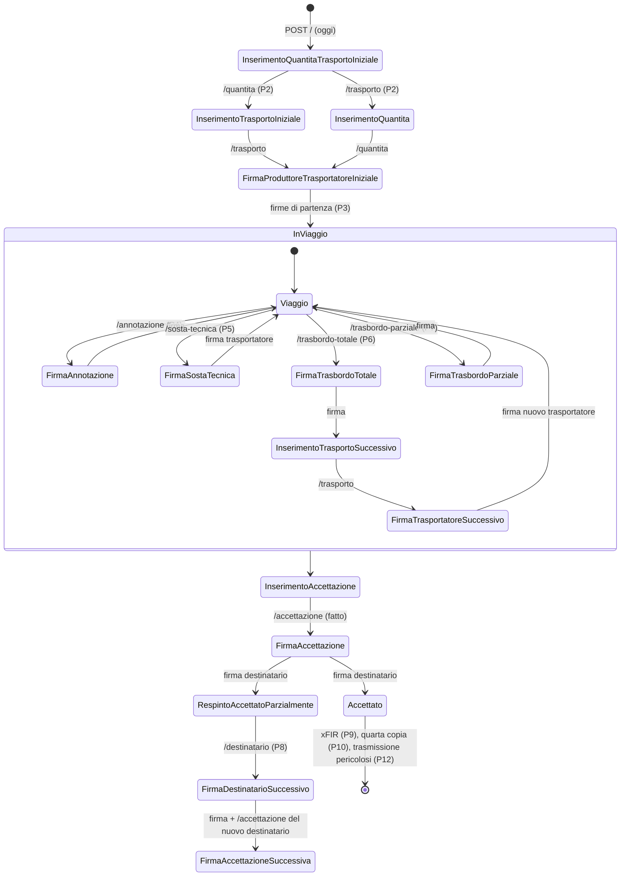
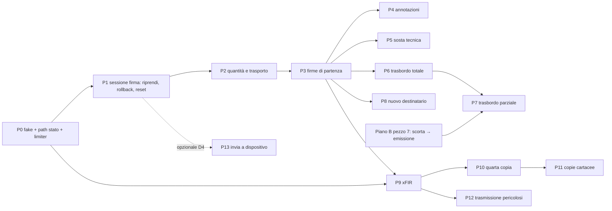

# Piano: FIR digitale RENTRI «in viaggio» (R3-bis + copie, xFIR, trasmissioni)

Redatto il 2026-11-18 sera. Base: `origin/master` @ `e9a61ae5` (letto con `git show`, sola lettura).
Contratto: `docs/contracts/rentri/formulari.yaml` del repo (OpenAPI scaricato da `demoapi.rentri.gov.it`, versioni 1.0.20260707–20260909). Le righe del contratto citate sotto sono quelle del file su master.

Fonti WinWaste: `~/Progetti/winwaste/docs/rentri/02-endpoint-e-flussi.md` (WW-02), `03-aggancio-a-winwaste.md` (WW-03), `04-confronto-con-rifiuti.md` (WW-04). Piani precedenti: `docs/superpowers/plans/2026-07-26-r3-ciclo-completo.md` (R3, che rimanda queste operazioni a un «R3-bis» mai scritto), `docs/audits/rentri-divario-2026-09-10.md`.

---

## 1. Obiettivo e perimetro

**Obiettivo.** Un FIR digitale nato in WasteFlow e trasmesso a RENTRI deve poter **partire, viaggiare e chiudersi** senza che l'utente apra il portale RENTRI. Oggi il formulario si crea sull'ente, ma resta fermo al primo stato: non riceve quantità, dati di trasporto né le firme di partenza. Le operazioni del viaggio (annotazioni, soste, trasbordi, nuovo destinatario) e la chiusura documentale (xFIR, quarta copia, trasmissione dei pericolosi) mancano.

**Dentro il perimetro**
- Quantità e dati di trasporto (`/quantita`, `/trasporto`), anche alla creazione (`dati_partenza.rifiuto.quantita`, `dati_trasporto_partenza`).
- Firme di partenza su RENTRI (produttore, trasportatore, produttore+trasportatore). Sono un prerequisito: senza di loro il FIR non arriva mai alla fase di viaggio. Vedi la domanda D1.
- Infrastruttura comune: ripresa di una firma rimasta `IN_ATTESA`, `rollback-firma`, `reset`.
- Annotazioni, sosta tecnica, trasbordo totale, trasbordo parziale, nuovo destinatario dopo un respingimento, con le firme relative.
- Invio a dispositivo (`invia-a-dispositivo`), solo se Graziano lo vuole (domanda D4).
- xFIR: download, validazione e archivio locale collegati al flusso.
- Quarta copia digitale (`copia-digitale/caricamento` + `conferma`) e copie cartacee (`copia-cartacea/*`).
- Trasmissione dei dati dei FIR pericolosi (`trasmissioni/operatore/*` + `estrai`).
- Rotte e stato corrispondenti nella fake (`tools/rentri-fake`), con schemi generati dal contratto.

**Fuori dal perimetro**
- Prova sull'ambiente demo RENTRI. È rimandata per decisione del 31/10 (`rifiuti-decisioni-31-10.md`). Ogni pezzo chiude contro la fake, poi una checklist demo unica in fondo alla catena (§6).
- Collegamento scorta → emissione (`ConsumaNumeroVidimatoUseCase` senza chiamanti) e QR vidimato nel PDF. Appartengono al Piano B (raccomandazione 7 di WW-04). Qui servono solo come **dipendenza** del trasbordo parziale.
- Conservazione a norma dell'xFIR. È il modulo opzionale deciso il 01/11 (`rifiuti-conservazione-decisioni.md`). Qui l'xFIR si archivia in locale e basta.
- Gestione dei dispositivi e delle credenziali CA in app (boarding, PIN). Il `credentials_id` resta inserito a mano, come oggi.
- Registro cronologico eREGI XML (è un altro piano).
- Varianti marittima e ferroviaria del trasporto: solo il terrestre. Le altre due si aggiungono quando un cliente le chiede. Il modello dati è già pronto (`TipoTratta`).
- Il canale `trasmissioni/soggetto-delegato/*` (consulente delegato). È un seguito: oggi il tenant trasmette solo per sé.

---

## 2. Stato attuale verificato su master

Legenda: **FATTO** = raggiungibile da HTTP o da un job; **PARZIALE**; **SOLO CLIENT** = classe scritta ma non registrata nel DI di Nest, senza chiamanti; **ASSENTE**.

| # | Funzione | Stato | Evidenza su `origin/master` |
|---|---|---|---|
| 1 | Creazione FIR su RENTRI (`POST /`) | PARZIALE | `rentri-api.client.ts:157` `creaFormulario`. Il payload (`mappatura/mappa-nuovo-formulario.ts`, funzione `mappaNuovoFormulario`) contiene solo `num_iscr_sito` + `dati_partenza{produttore, destinatario, trasportatori, rifiuto}`. Mancano `numero_fir`, `dati_trasporto_partenza`, `intermediari` e `annotazioni`. Nel rifiuto mancano `quantita`, `caratteristiche_pericolo`, `numero_colli`, `rinfusa` e `verificato_in_partenza` (`mappa-rifiuto.ts`, `mappaRifiuto` restituisce solo `codice_eer`, `provenienza`, `stato_fisico`, `descrizione`). Va un solo trasportatore (`costruisci-payload-rentri.ts:67`) |
| 2 | Quantità (`POST /{fir}/quantita`, contratto r. 1789) | ASSENTE | Nessun metodo nel client. Nella fake non c'è la rotta |
| 3 | Dati di trasporto (`POST /{fir}/trasporto`, r. 2518) | ASSENTE | Come sopra. Nel modello FIR mancano conducente (nome e cognome, **obbligatori** in `ConducenteModel`), percorso, rimorchio e `verificato_in_partenza`. C'è `Automezzo.targaRimorchio` nelle pese (`schema.prisma:2806`), non sul FIR |
| 4 | Firme di partenza (produttore/trasportatore) su RENTRI | ASSENTE | `CompletaOperazioneConFirmaUseCase` (`completa-operazione-con-firma.use-case.ts`) è generico, ma lo chiamano solo `accetta-o-respingi-fir.use-case.ts` e `annulla-fir-rentri.use-case.ts`. Le firme `emetti`/`presaInCarico` di `fir.aggregate.ts:728,744` sono firme **locali** WasteFlow, non arrivano all'ente |
| 5 | Ripresa di una firma `IN_ATTESA` | ASSENTE | Limite dichiarato nel commento della classe (`completa-operazione-con-firma.use-case.ts:185-211`): `execute()` riparte sempre da `/hash`. Il FE riceve `IN_ATTESA` (`rentri-fir-lifecycle.service.ts:32`) ma non ha un modo per riprendere |
| 6 | `rollback-firma` (r. 2079), `reset` (r. 1888) | ASSENTE | Nessun metodo. Solo il tipo `Operazione` li elenca (`rentri-api.client.ts:1959-1990`) |
| 7 | Annotazione (`POST /{fir}/annotazione`, r. 1037) | ASSENTE | C'è solo l'etichetta in `operazione-rentri-traduzione.ts:22-57`. Il campo locale `wasteNotes` non viene inviato |
| 8 | Sosta tecnica (r. 2164) | ASSENTE | Solo l'etichetta |
| 9 | Trasbordo totale (r. 2414) / parziale (r. 2313) | ASSENTE | Solo le etichette e gli stati `FirmaTrasbordo*` in `fir.aggregate.ts:69-70`. Il trasbordo parziale richiede un **secondo FIR già vidimato** (`DatiTrasbordoParzialeModel.numero_fir` obbligatorio) |
| 10 | Nuovo destinatario (r. 1393) | ASSENTE | Il contratto lo ammette «a seguito del respingimento o della parziale accettazione». La fake tratta `RespintoAccettatoParzialmente` come terminale (`tools/rentri-fake/src/dominio/operazione.ts`, `STATI_TERMINALI_SENZA_SEGUITO`) e mette `NuovoDestinatario` fra le operazioni iniziali: va corretto |
| 11 | Invia a dispositivo (r. 1583) | ASSENTE, per scelta | R3 (`2026-07-26-r3-ciclo-completo.md`, nota su `invia-a-dispositivo`): «usare la sequenza ca-rentri, non invia-a-dispositivo, finché l'ente non chiarisce» |
| 12 | Accettazione / respingimento | FATTO | `POST rentri/fir/:id/accettazione` (`rentri-fir-lifecycle.controller.ts:147`) → `accetta-o-respingi-fir.use-case.ts` + firma |
| 13 | Annullamento + note | FATTO | `rentri-fir-lifecycle.controller.ts:206`, `annulla-fir-rentri.use-case.ts` |
| 14 | Allegati | FATTO (POST/DELETE/GET elenco) | `rentri-fir-lifecycle.controller.ts:255,283,334`. `scaricaAllegato` (`rentri-api.client.ts:800`) è solo client |
| 15 | Azioni disponibili, stato, PDF | FATTO | `:111`, `:393`; `get-azioni-disponibili.use-case.ts` chiama `/azioni` con il CF del tenant |
| 16 | xFIR download/upload/valida | SOLO CLIENT | `infrastructure/rentri/xfir/rentri-xfir.client.ts:82` (valida), `:104` (upload), `:138` (download). La classe non è in `rentri.module.ts` (che registra solo `RentriRegistriClient`, r. 18/67/85). C'è anche `costruisci-asice.ts`, usato solo dal client. La fake ha `POST /xfir/valida` e `/:id/xfir` (`routes/xfir.ts:80,101`) |
| 17 | Quarta copia digitale | SOLO CLIENT | `rentri-copie.client.ts:82-212` (carica, elenca, conferma; il path di conferma è in minuscolo, come nel contratto). Non è registrata nel DI. La fake ha le rotte (`routes/copie.ts:229-403`) |
| 18 | Copie cartacee | SOLO CLIENT | `rentri-copie.client.ts:229-360` |
| 19 | Trasmissione dati FIR pericolosi | SOLO CLIENT | `rentri-trasmissioni.client.ts:92` (invia), `:116` (elenca), `:192` (annulla), `:215` (estrai). Non è registrata nel DI. Fake: `routes/trasmissioni-dati.ts` |
| 20 | Path di stato dedicati per copie e trasmissioni | DIFETTO APERTO | I client interrogano `/formulari/v1.0/{tid}/status` generico (`rentri-copie.client.ts:22-34`, `rentri-trasmissioni.client.ts:299`). Il contratto ha `/copia-digitale/{tid}/status` (r. 3677), `/copia-cartacea/{tid}/status` (r. 2947) e `/trasmissioni/{tid}/status` (r. 5095). È la raccomandazione 11 di WW-04 |
| 21 | Rate limiter sui client copie/trasmissioni/xFIR | DIFETTO APERTO | Non passano dal limiter per tenant (WW-04 §3 riga 1) |
| 22 | Frontend | PARZIALE | `fir-detail.component.ts` mostra Accetta il carico (`:520`), Annulla (`:533`), Allegati (`:576`) e le azioni locali Emetti/Presa in carico/Conferma consegna (`:388-410`). Le operazioni di viaggio non esistono |

**Conteggio**: delle 13 funzioni del tema, **0 fatte**, **1 parziale** (creazione), **4 solo client** (xFIR, copia digitale, copia cartacea, trasmissioni), **8 assenti**. Sono fatte le funzioni vicine (accettazione, annullamento, allegati, azioni, PDF): forniscono l'infrastruttura da riusare.

**Infrastruttura già pronta da riusare**
- Ciclo «scrivi → firma»: `CompletaOperazioneConFirmaUseCase` (hash → authorize → polling `authorize-check` → `sign-hash` → `acquisizione-firma` → rilettura dello stato). Firma remota RENTRI con la chiave custodita dall'ente (ADR `docs/adr/2026-07-26-firma-fir-firma-remota-rentri.md`). Certificati EC e path `sign-hash` sono corretti dai pezzi B2–B4.
- Guardia `/azioni` prima di ogni scrittura (schema di `accetta-o-respingi-fir.use-case.ts`).
- `verificaFirNonBloccato` (FIR importati), `assertRuoloScritturaRentri` (`verifica-ruolo-scrittura-rentri.ts`: SUPER_ADMIN/ADMIN/OPERATOR).
- Stato ente in sola lettura: `FIR.rentriStatoFormulario` + `applyRentriStato` (`fir.aggregate.ts:1246`), 22 valori (`schema.prisma:662`).
- Fake: `registraOperazioneAsincrona(<nome>, validatore, <Operazione>)` in `tools/rentri-fake/src/routes/formulari.ts:244-297`. Aggiungere un'operazione costa poche righe.
- Catalogo RLS: **88** tabelle (`rls-catalogo.postgres.spec.ts:83`).

---

## 3. Comportamento WinWaste da replicare

| Funzione | WinWaste | Riferimento |
|---|---|---|
| Quantità | `WW_AggiungiQuantita` → `POST /{fir}/quantita` `{quantita{valore,unita_misura}, verificato_in_partenza, numero_colli, rinfusa}`. I m³ vengono moltiplicati per 1000 e inviati in litri | WW-02 §1.7 e §2b.3; WW-03 §3.2 (riga `netto`/`volu`+`um`) |
| Trasporto | `WW_AggiungiDatiTrasportoTerreste`: targhe e percorso in maiuscolo → `POST /{fir}/trasporto`. Nome e cognome del conducente si separano sull'**ultimo spazio** della descrizione autista. Data locale → UTC | WW-02 §2b.3; WW-03 §3.2 (riga `autist`/`mez`/`rim`) |
| Partenza completa alla creazione | `FirDigitale{num_iscr_sito, dati_partenza{..., rifiuto{... quantita ...}, annotazioni}, dati_trasporto_partenza}` | WW-03 §3.2 |
| Firme | Produttore, ogni trasportatore, destinatario: `/hash` → `ca-rentri sign-hash` → `/acquisizione-firma`. Annullamento dell'ultima firma con `WW_RollBackFirma` | WW-02 §2b.4; form `FirmeFirDigitali` (WW-03 §1.2) |
| Annotazioni | `WW_AggiungiAnnotazioneFirDigitale` → `POST /{fir}/annotazione` `{annotazione, identificativo_soggetto}` | WW-02 §2b.6 |
| Soste, trasbordi, nuovo destinatario | Metodi presenti nel client (`PostSostaTecnica`, `PostTrasbordoParziale/Totale`, `PostNuovoDestinatarioFirDigitale`); non c'è un'orchestrazione WW dedicata | WW-02 §1.7, §2b.6 |
| Reset stato | `POST /{fir}/reset` | WW-02 §1.7 |
| Invia a dispositivo | `InviaFirDigitaleADispositivo` → `POST /{fir}/invia-a-dispositivo?credentials_id=` (la firma si delega all'app su smartphone) | WW-02 §1.7, §2b.4 |
| xFIR | `WW_DownloadXFir_01`: ZIP in base64, salvato in `%TEMP%`; `POST /xfir/valida`; allegati estratti dallo ZIP | WW-02 §2b.8 |
| Quarta copia | Destinatario: `WW_CaricaCopiaXFir_03`. Se RENTRI risponde 400 «già caricata», cerca la copia esistente e la considera OK. Produttore/trasportatore/intermediario: `Ww_ConfermaCopiaXFIR` per ogni ruolo in cui compare il CF | WW-02 §2b.9 |
| Copie cartacee | Solo CRUD, nessun flusso | WW-02 §2b.11 |
| Trasmissione pericolosi | `WW_TrasmettiFir_04`: prima `estrai` dall'xFIR, poi `POST trasmissioni/operatore/{sito}`. Risposta sincrona `{identificativo}`. Elenco e annullamento | WW-02 §2b.10; form `InviaXFIR` «Trasmissione xFIR (art. 15 c.3 DM 59/2023) e quarta copia» (WW-03 §1.2) |
| Dove salva | Non salva la transazione del FIR. Rilegge lo stato ogni volta. Tiene una cache in `XRENTRIFORMULARI` (con `QUARTACOPIA`, `INVIATORENTRI`) e `XRENTRIFIRTRASMESSI` (id della trasmissione, `XSEANNULLATO`) | WW-03 §4.1-4.2 |

**Difetti di WinWaste da non copiare** (WW-02 §5, WW-03 §6)
- `WW_AttendiEsitoFir` non legge `/result`.
- Path di conferma della copia digitale in maiuscolo.
- Ogni invio di quarta copia e di trasmissione parte anche verso `service.nica.it` (call-home).
- `SettaRentriFIR` costruisce un SQL senza virgole (`InviaXFIR.cs:3323`).
- Nessun salvataggio del `transazione_id`.

**Differenze volute rispetto a WinWaste**
- Ogni operazione del viaggio si registra in uno storico locale con la transazione e l'esito.
- La disponibilità di un'operazione la decide sempre `/azioni`, mai una deduzione locale.

---

## 4. Design

### 4.1 Ciclo degli stati RENTRI coperto dal piano

Le transizioni esatte fra gli stati `Inserimento*` e `Firma*` della fase iniziale **non sono documentate** dal contratto: il diagramma è una deduzione dai nomi degli stati, confidenza media. Il codice non le deve dare per certe. Dopo ogni scrittura rilegge lo stato (`/stato`) e le azioni (`/azioni`), come già fa `CompletaOperazioneConFirmaUseCase` al passo 9. La fake modella una macchina plausibile, dichiarata come tale nei commenti.

### 4.2 Ruoli

- **Ruolo applicativo**: ogni scrittura verso l'ente richiede `assertRuoloScritturaRentri` (SUPER_ADMIN/ADMIN/OPERATOR). VIEWER ha sola lettura, anche sullo storico.
- **Ruolo sul FIR** (produttore, trasportatore, destinatario): si ricava dal CF del tenant (`risolvi-cf-tenant.ts`) confrontato con `producerCodiceFiscale`/`carrierCodiceFiscale`/`receiverCodiceFiscale` del FIR e con i CF dei `FIRTransporter`. Serve **solo all'interfaccia**, per mostrare i verbi giusti («Dichiara una sosta» al trasportatore, «Indica il nuovo destinatario» a produttore e trasportatore). L'autorità resta `/azioni`, chiamato con `identificativo_soggetto` = CF del tenant. Se `/azioni` non contiene l'operazione, il backend risponde 409 `OPERAZIONE_NON_DISPONIBILE` **senza** chiamare l'ente.
- **Annotazione**: `identificativo_soggetto` è il CF del tenant. Se il tenant non compare nel FIR, si rifiuta prima di chiamare l'ente.

### 4.3 Modello dati (migration additive, timestamp `202611190…` o successivi al momento del merge)

**Colonne nuove (tutte nullable, nessun default che riscriva le righe)**

| Tabella | Colonna | Uso |
|---|---|---|
| `fir_transporters` | `conducente_nome`, `conducente_cognome` VARCHAR(100), `targa_rimorchio` VARCHAR(15), `percorso` VARCHAR(250), `data_ora_inizio_trasporto` TIMESTAMPTZ(3) | Dati di trasporto per tratta. Vanno sulla tratta, non sul FIR: il trasbordo totale aggiunge una tratta con un altro conducente |
| `firs` | `verificato_in_partenza` BOOLEAN, `rinfusa` BOOLEAN | Campi di `QuantitaRifiutoModel` |
| `firs` | `rentri_trasbordo_origine_fir_id` UUID (FK composta `(id, tenant_id)` su `firs`), `rentri_trasbordo_origine_numero` VARCHAR(50), `rentri_trasbordo_causale` VARCHAR(1000) | FIR figlio di un trasbordo parziale (`trasbordo_parziale_origine` nel payload di creazione) |

Nessuna colonna entra nell'hash di integrità o di vidimazione: è lo stesso criterio di `counterpart_sede_id`.

**Tabelle nuove (ognuna con `tenant_id`, ENABLE+FORCE RLS, policy per tenant, grant al ruolo applicativo, voce nel catalogo)**

| Pezzo | Tabella | Contenuto | Catalogo RLS |
|---|---|---|---|
| P1 | `fir_sessioni_firma_rentri` | Sessione di firma in corso: `fir_id`, `tipo_operazione`, `handle`, `token_hash`, `digest_to_sign`, `scadenza`, `stato` (IN_ATTESA/COMPLETATA/SCADUTA/RIFIUTATA/ANNULLATA), `utente_id`. Una sola sessione aperta per FIR (indice unico parziale `WHERE stato='IN_ATTESA'`) | 88 → 89 |
| P2 | `fir_eventi_rentri` | Storico delle operazioni del viaggio: `fir_id`, `operazione` (enum = `Operazione` del contratto), `payload` JSONB (inviato, senza dati di firma), `transazione_id`, `esito` (INVIATA/ACCETTATA/RIFIUTATA/INCERTA), `dettaglio_ente`, `stato_formulario_dopo`, `utente_id`, `creato_il`. Solo INSERT dal ruolo applicativo, niente UPDATE/DELETE (trigger o grant) | 89 → 90 |
| P9 | `fir_xfir_rentri` | Archivio xFIR: `fir_id`, `numero_fir`, `contenuto` BYTEA (ZIP), `sha256`, `dimensione`, `scaricato_il`, `stato_formulario` al download, `esito_validazione` JSONB. Più versioni per FIR (l'xFIR cambia a ogni firma) | 90 → 91 |
| P10 | `fir_copie_rentri` | Copie digitali e cartacee: `fir_id` nullable (una copia cartacea può riguardare un FIR non in WasteFlow), `numero_fir`, `tipo` (DIGITALE/CARTACEA), `verso` (CARICATA/RICEVUTA), `identificativo_ente`, `transazione_id`, `stato` (IN_CORSO/CARICATA/CONFERMATA/RESPINTA/ERRORE), `ruolo`, `num_iscr_sito` | 91 → 92 |
| P12 | `fir_trasmissioni_rentri` | Trasmissioni dei pericolosi: `fir_id`, `numero_fir`, `num_iscr_sito`, `num_iscr_sito_produttore` (per conto di), `identificativo_ente`, `transazione_estrazione_id`, `stato` (ESTRATTA/TRASMESSA/ANNULLATA/ERRORE), `sostituita_da_id` (una nuova trasmissione annulla e sostituisce la precedente, r. 5149) | 92 → 93 |

Tutte le FK sono composte `(fir_id, tenant_id)`, come `FIRAllegatoRentri`. Ogni migration aggiorna `rls-catalogo.postgres.spec.ts` e `prisma/sql/ruoli-db.sql`. Il numero va riallineato al merge se nel frattempo entrano altre tabelle.

### 4.4 Backend

**Client** (`rentri-api.client.ts`, stesso schema di `inviaAccettazione`: POST asincrona + `attendiEsito` su `/result`, resilienza, limiter)
- `inviaQuantita`, `inviaTrasporto`, `inviaAnnotazione`, `inviaSostaTecnica`, `inviaTrasbordoTotale`, `inviaTrasbordoParziale`, `inviaNuovoDestinatario`, `rollbackFirma`, `resetStato`.
- Opzionale (D4): `inviaADispositivo`, sincrona.
- Registrazione nel DI di `RentriXfirClient`, `RentriCopieClient` e `RentriTrasmissioniClient` in `rentri.module.ts`, **dopo** la correzione dei path di stato dedicati e il passaggio dal rate limiter (P0).

**Use case** (`application/rentri/viaggio/`, uno per operazione; schema di `AccettaORespingiFIRUseCase`)
1. Precondizioni locali: FIR del tenant, `verificaFirNonBloccato`, FIR legato, ruolo applicativo, validazione dei campi.
2. `GetAzioniDisponibiliUseCase`: l'operazione deve esserci, altrimenti 409 senza chiamate all'ente.
3. POST di dominio → evento `fir_eventi_rentri` (INVIATA → ACCETTATA/RIFIUTATA/INCERTA).
4. Se lo stato riletto è `Firma*`: `CompletaOperazioneConFirmaUseCase`, che da P1 apre o riprende una sessione.
5. Aggiorna i dati locali **solo dopo** l'esito positivo dell'ente. Esempi: la quantità sul FIR, una nuova `FIRTransporter` col trasbordo totale, il destinatario successivo come snapshot.

**Conversioni**
- `t` → kg (×1000), m³ → litri (×1000). Oggi il dominio ha `kg/litri/t` (`domain/fir/value-objects/quantita.ts`), il contratto solo `kg/l` (WW-04 §3 riga 13).
- Massimo 4 decimali (`QuantitaKgModel`). Arrotondamento esplicito, nessun troncamento silenzioso.
- Date in ISO 8601 UTC.
- Nome e cognome del conducente in campi separati, **non** spezzati sull'ultimo spazio come fa WinWaste: è ambiguo con i cognomi composti.

**Controller**: estende `rentri-fir-lifecycle.controller.ts` (`rentri/fir/:id/...`). Rotte nuove:
- `POST quantita`, `POST trasporto`, `POST firma-partenza`.
- `POST firme/:sessioneId/riprendi`, `POST rollback-firma`, `POST reset`.
- `POST annotazioni`, `POST soste`, `POST trasbordo-totale`, `POST trasbordo-parziale`, `POST nuovo-destinatario`.
- `GET eventi`.
- `GET xfir`, `POST xfir/valida`.
- `POST quarta-copia`, `GET copie`, `POST copie/:id/conferma`, `POST copie-cartacee`.
- `POST trasmissione`, `GET trasmissioni`, `DELETE trasmissioni/:id`.

Più `GET rentri/copie/da-confermare` (lista per soggetto). Tutte sotto `@Roles('SUPER_ADMIN','ADMIN','OPERATOR')`; le GET anche VIEWER. Codici di errore stabili per il FE (`rentri-error-presentation.ts`).

**Modulo**: le rotte stanno nel modulo RENTRI esistente (`@RichiedeModulo` già usato da quel controller). I moduli del backend restano in modalità `registra`.

**Job**
- Nessun job nuovo per le operazioni di viaggio: sono tutte interattive.
- P10: la riconciliazione esistente (`riconcilia-stato-rentri.use-case.ts`, ogni 6 h) si estende alle copie da confermare e segnala quelle in attesa. Nessuna conferma automatica.
- P12: avviso nello scadenzario per i FIR pericolosi accettati senza trasmissione. Termine da confermare (§6).

### 4.5 Frontend (`features/fir/fir-detail.component.ts` + servizio `rentri-fir-lifecycle.service.ts`)

- Sezione **«Viaggio»** nel dettaglio FIR. I pulsanti nascono **solo** dalle azioni restituite da `/azioni`, con i verbi del mestiere già in `TRADUZIONE_OPERAZIONE_RENTRI`. Un dialog per operazione: quantità, trasporto, annotazione, sosta, trasbordo totale, trasbordo parziale, nuovo destinatario.
- **Banner della firma in attesa** (P1): «In attesa della tua conferma sull'app RENTRI FIR Digitale, scade alle hh:mm», con «Ho confermato, controlla» (riprendi) e «Annulla la richiesta». Nessun nuovo tentativo automatico.
- **Storico** delle operazioni (da `fir_eventi_rentri`) in una tabella.
- Campi numerici con il parser e il formatter condivisi (virgola obbligatoria, decisione del 02/11).
- Dati del conducente nel form FIR, sulla tratta. Precompilati dall'ultima tratta dello stesso automezzo, se c'è.
- **Documenti RENTRI** (P9-P11): scarica xFIR, valida, carica la quarta copia, elenco delle copie da confermare.
- Pagina **«Trasmissioni pericolosi»** sotto RENTRI (P12): elenco, trasmetti, annulla.

### 4.6 Sicurezza e privacy

- Nessun dato verso servizi diversi da RENTRI (nessun call-home). L'xFIR resta nel DB del tenant, con RLS.
- Gli eventi non contengono `sad`, token di firma né certificati: solo il payload di dominio.
- Le dimensioni seguono i limiti del contratto: copia cartacea 5 MB e solo PDF/JPG/PNG (r. 3001); xFIR 3 MB come già annotato nel client (`rentri-api.client.ts:687`). `client_max_body_size` di nginx è già a 6 MB su `/api`.
- La validazione dell'xFIR caricato da terzi passa solo da `/xfir/valida` dell'ente. Il parsing locale si limita a ZIP e hash: nessuna esecuzione di contenuti.
- Audit: ogni operazione scrive l'evento con l'utente.

---

## 5. Pezzi (una PR ciascuno, CI verde, TDD)

Ordine e dipendenze:

Regole comuni a ogni pezzo:
- Prima i test (unit sul use case con i client mock, oracolo contro la fake, spec Postgres per migration e RLS, e2e Playwright per il percorso utente principale).
- Nessuna chiamata all'ente prima delle precondizioni locali.
- Messaggi in italiano, termini tecnici in inglese.
- Migration additive con `lock_timeout`.
- Fatto = CI verde, revisione pulita, deploy verde, health ok e nessuna riga toccata in produzione (che oggi non ha FIR legati attivi).

### P0 — Fake e client pronti per il viaggio (S-M)
- **T0** Test di allineamento della fake al contratto per i modelli nuovi: generare gli schemi (`genera-schema:*`) di `QuantitaRifiutoModel`, `DatiTrasportoTerrestreModel`, `DatiAnnotazioneModel`, `DatiSostaTecnicaModel`, `DatiTrasbordo{Totale,Parziale}Model`, `DatiDestinatarioFormulario{,Sito}Model`. Test rosso.
- **T1** Rotte asincrone nella fake con `registraOperazioneAsincrona`: `quantita`, `trasporto`, `annotazione`, `sosta-tecnica`, `trasbordo-totale`, `trasbordo-parziale`, `destinatario`, `reset`, `rollback-firma`. Più `invia-a-dispositivo`, sincrona.
- **T2** Macchina degli stati della fake estesa (§4.1): fase iniziale Inserimento/Firma, `RespintoAccettatoParzialmente` **non** terminale (ammette `NuovoDestinatario`), `NuovoDestinatario` tolto dalle operazioni iniziali. Test su `operazioniPerStato`.
- **T3** Path di stato dedicati in `RentriCopieClient` e `RentriTrasmissioniClient` (`/copia-digitale/{tid}/status`, `/copia-cartacea/…`, `/trasmissioni/…`). La fake deve rispondere solo lì: un test dimostra che il path generico dà 404.
- **T4** Rate limiter per tenant sui tre client (xFIR, copie, trasmissioni). Oracolo con 429 iniettato.
- **T5** Registrazione dei tre client in `rentri.module.ts`. Test di composizione del modulo.
- **Fatto**: fake allineata, client registrati ma ancora senza use case. Nessun cambiamento visibile all'utente.

### P1 — Sessione di firma riprendibile, rollback, reset (M)
- **T0** Migration `fir_sessioni_firma_rentri` + RLS (catalogo 89). Spec Postgres: isolamento fra tenant, indice unico della sessione aperta.
- **T1** `CompletaOperazioneConFirmaUseCase`: con una sessione `IN_ATTESA` valida per lo stesso FIR e la stessa operazione **riprende il polling** dello stesso `handle`, invece di ripartire da `/hash`. Test: due invocazioni → una sola `authorize`.
- **T2** Sessione scaduta (ente 400 oppure orologio): stato SCADUTA, poi una nuova sessione solo su richiesta esplicita.
- **T3** `rollbackFirma` / `resetStato` nel client + use case con guardia `/azioni` (`RollbackFirma`, `Reset`) + evento.
- **T4** Rotte `POST rentri/fir/:id/firme/:sessioneId/riprendi`, `POST …/rollback-firma`, `POST …/reset`. Spec del controller, ruoli.
- **T5** FE: banner di firma in attesa con «Ho confermato, controlla» e «Annulla la richiesta» (= reset). Il banner vale anche per accettazione e annullamento esistenti, che oggi si fermano su `IN_ATTESA`. E2E con la fake.
- **Fatto**: nessuna doppia richiesta di autorizzazione; il vincolo scritto nel commento della classe è chiuso.

### P2 — Quantità e dati di trasporto (M)
- **T0** Migration colonne `fir_transporters` (conducente, rimorchio, percorso, inizio trasporto) e `firs` (`verificato_in_partenza`, `rinfusa`). Spec di migration.
- **T1** Conversioni di unità e decimali (`t`→kg, m³→l, 4 decimali). Test a tabella.
- **T2** Payload di creazione completo **quando i dati ci sono** (D2): `rifiuto.quantita`, `numero_colli`, `rinfusa`, `verificato_in_partenza`, `caratteristiche_pericolo` (da `wasteHazardClasses`, normalizzate in `HPnn`), `dati_trasporto_partenza` della prima tratta, tutti i trasportatori (oggi uno solo). Oracolo: la fake valida contro lo schema.
- **T3** `inviaQuantita` / `inviaTrasporto` + use case (guardie `DatiQuantita`/`DatiQuantitaUpdate`, `Trasporto`/`TrasportoUpdate`). La quantità locale si aggiorna solo dopo l'esito positivo. Migration `fir_eventi_rentri` + RLS (catalogo 90). Evento per ogni invio.
- **T4** Rotte + `GET eventi`. Validazione DTO: conducente obbligatorio per il terrestre, targa al massimo 10 caratteri (limite del contratto).
- **T5** FE: campi del conducente nella tratta del form FIR; dialog «Indica la quantità» e «Indica i dati del trasporto»; storico. E2E.
- **Fatto**: un FIR creato con tutti i dati arriva sull'ente nello stato di firma iniziale; uno creato senza quantità la riceve dal dialog.

### P3 — Firme di partenza su RENTRI (M)
- **T0** Use case `FirmaPartenzaRentriUseCase`: dal FIR in `Firma{ProduttoreTrasportatoreIniziale|Produttore|TrasportatoreIniziale}` sceglie l'operazione (`AcquisizioneFirmaProduttore`, `…Trasportatore`, `…ProduttoreTrasportatore`) fra quelle restituite da `/azioni` e chiama `CompletaOperazioneConFirmaUseCase` (con la ripresa di P1).
- **T1** Legame con le azioni locali (D1): «Emetti» (firma produttore) e «Presa in carico» (firma trasportatore) **propongono** la firma RENTRI quando il FIR è legato. Se la firma RENTRI fallisce, l'azione locale **non** si annulla: resta l'avviso «firma RENTRI da completare». Test sui due esiti.
- **T2** Rotta `POST rentri/fir/:id/firma-partenza` + FE (pulsante «Firma la partenza su RENTRI» + banner). E2E: creazione → quantità/trasporto → firma → stato di viaggio riletto.
- **Fatto**: il FIR digitale nato in WasteFlow parte davvero sull'ente.

### P4 — Annotazioni (S)
- **T0** `inviaAnnotazione` + use case: `identificativo_soggetto` = CF del tenant, che deve comparire nel FIR; al massimo 10.000 caratteri.
- **T1** Firma (`AcquisizioneFirmaAnnotazione`) tramite il ciclo comune.
- **T2** Rotta + dialog «Aggiungi un'annotazione» + evento. E2E.

### P5 — Sosta tecnica (S)
- **T0** `inviaSostaTecnica`: luogo (max 1000), sospensione < ripresa, date UTC. Test di validazione.
- **T1** Firma del trasportatore. Rotta, dialog «Dichiara una sosta tecnica», evento. E2E come trasportatore.

### P6 — Trasbordo totale (M)
- **T0** `inviaTrasbordoTotale`: nuovo trasportatore (da anagrafica, `DatiTrasportatoreFormulario{,Sito}Model`) + `presa_in_carico` (dati di trasporto terrestre del nuovo mezzo).
- **T1** Dopo l'esito positivo: nuova `FIRTransporter` (ordine+1) con lo snapshot. Test: nessuna tratta locale se l'ente rifiuta.
- **T2** Firma, poi eventuale `/trasporto` successivo + `FirmaTrasportatoreSuccessivo` (stati letti dall'ente). Rotta, dialog, E2E.

### P7 — Trasbordo parziale (M-L) — dipende dal Piano B pezzo 7
- **T0** Precondizione: il collegamento scorta → emissione (`ConsumaNumeroVidimatoUseCase` chiamato all'emissione, `numero_fir` nel payload) è in master. Senza, il pezzo non parte (D6).
- **T1** Use case: crea il **FIR figlio** in locale (stesso rifiuto, quantità trasbordata, nuovo trasportatore, `rentri_trasbordo_origine_*`), consuma un numero vidimato e lo trasmette con `trasbordo_parziale_origine`. Poi `POST /{origine}/trasbordo-parziale` `{numero_fir: figlio, trasportatore, quantita_residua, causale}` sul FIR d'origine.
- **T2** Ordine e compensazione: se il figlio non si crea, l'origine non si tocca. Se l'origine rifiuta, il figlio resta in bozza legata con l'avviso «trasbordo non dichiarato». Test sui tre casi.
- **T3** Firma, rotta, dialog «Dichiara un trasbordo parziale», collegamento visibile fra origine e figlio, E2E.

### P8 — Nuovo destinatario (M)
- **T0** `inviaNuovoDestinatario` dopo `RespintoAccettatoParzialmente`. Solo produttore o trasportatore (vincolo del contratto, r. 1393; il controllo lo fa `/azioni`).
- **T1** Snapshot locale del destinatario successivo (non sostituisce quello originale: il FIR conserva entrambi). Firma (`AcquisizioneFirmaDestinatarioSuccessivo`).
- **T2** L'accettazione esistente funziona anche come «accettazione successiva» (`AcquisizioneFirmaAccettazioneSuccessiva`). Test sul percorso respinto → nuovo destinatario → accettato.
- **T3** Mappatura `FIRStato`: oggi `RespintoAccettatoParzialmente` diventa CONSEGNATO (`fir.aggregate.ts`, `mapStatoFormularioToFIRStato`). Con un destinatario successivo il FIR deve tornare IN_TRANSITO, finché l'ente non legge un esito finale. Test sull'aggregate.
- **T4** Rotta, dialog «Indica il nuovo destinatario», E2E.

### P9 — xFIR collegato al flusso (S-M)
- **T0** Migration `fir_xfir_rentri` + RLS (catalogo 91).
- **T1** Use case `ScaricaXfirUseCase`: `GET /{fir}/xfir` (con `identificativo_destinatario` quando il tenant è destinatario successivo), salva una versione con sha256, dedup sull'hash.
- **T2** `ValidaXfirUseCase`: `POST /xfir/valida` + polling, esito salvato.
- **T3** Download automatico all'esito finale (`Accettato`/`RespintoAccettatoParzialmente`) letto dalla riconciliazione o dalla firma. Rotte `GET xfir` (scarica l'ultimo) e `POST xfir/valida`. FE: «Scarica xFIR».
- **Fatto**: il FIR chiuso ha il suo xFIR in archivio, pronto per il modulo di conservazione quando arriverà.

### P10 — Quarta copia digitale (M)
- **T0** Migration `fir_copie_rentri` + RLS (catalogo 92).
- **T1** Destinatario: `CaricaQuartaCopiaUseCase` = ultimo xFIR (P9) → `copia-digitale/caricamento/{numero_fir}`. Precondizioni del contratto (r. 3731): FIR `Accettato`/`RespintoAccettatoParzialmente`, unità locale R/D/centro di raccolta, tenant destinatario. Un 400 «già caricata» → cerca la copia esistente (come WinWaste) e la registra, senza errore.
- **T2** Produttore/trasportatore: elenco `copia-digitale/conferma/{cf}` + `PUT copia-digitale/conferma/{sito}/{id}?ruolo=`, uno per ogni ruolo in cui il CF compare.
- **T3** Riconciliazione: copie da confermare segnalate (nessuna conferma automatica). Rotte, FE («Restituisci la copia» / «Conferma la copia ricevuta»), E2E.

### P11 — Copie cartacee (S-M)
- **T0** Trasportatore: carica la scansione (PDF/JPG/PNG, max 5 MB) con i dati minimi (`numero_fir`, data di emissione, produttore, trasportatori). Le condizioni del contratto (r. 3001) si controllano prima dell'invio.
- **T1** Altri soggetti: elenco + conferma o respingimento (`copia-cartacea/conferma/{cf}`). Documento scaricabile.
- **T2** Rotte, FE nella pagina RENTRI (non nel dettaglio FIR: la copia cartacea può riguardare FIR cartacei senza dettaglio digitale), E2E.

### P12 — Trasmissione dei dati dei FIR pericolosi (M)
- **T0** Migration `fir_trasmissioni_rentri` + RLS (catalogo 93).
- **T1** `TrasmettiFirPericolosoUseCase`: xFIR (P9) → `estrai` (async, `/trasmissioni/{tid}/status`) → `POST trasmissioni/operatore/{sito}`. La risposta `{identificativo}` è sincrona. Con «per conto del produttore» passa `num_iscr_sito_produttore`, solo se il numero FIR è vidimato al trasportatore (r. 5149). Una nuova trasmissione sostituisce la precedente (`sostituita_da_id`).
- **T2** Annullamento (`DELETE …/{id}/annulla`) ed elenco con filtri. Solo FIR con almeno un HP o un EER pericoloso (`*` nel catalogo).
- **T3** Scadenzario: avviso per i FIR pericolosi accettati senza trasmissione (D7). Pagina «Trasmissioni pericolosi», E2E.

### P13 — Invia a dispositivo (S, solo se D4 = sì)
- **T0** `inviaADispositivo(numeroFir, credentialsId)`: credenziale del tenant o, se modellata, del conducente.
- **T1** Pulsante «Invia all'app del conducente» con guardia: la credenziale deve essere associata all'unità locale che ha creato il FIR o che ne ha la visibilità (r. 1583). Evento. E2E con la fake.

**Totale: 14 pezzi** (P0-P12 più P13 opzionale). Dimensione indicativa: 4 S, 8 M, 1 M-L.

---

## 6. Rischi e punti aperti

1. **Transizioni della fase iniziale non documentate.** Il contratto dà i nomi degli stati, non la macchina. Si mitiga così: si rilegge sempre stato e azioni dall'ente, e la fake dichiara la propria macchina come plausibile. Va verificato sulla demo (checklist sotto).
2. **Demo rimandata.** Ogni pezzo chiude solo contro la fake. Resta aperto il rischio già visto con `ca-rentri` (fake ricostruita male): per questo P0 genera gli schemi dal contratto. Checklist demo unica da fare quando Graziano la sblocca:
   - stati iniziali dopo `POST /` con e senza quantità e trasporto;
   - quale firma chiede l'ente quando produttore e trasportatore coincidono;
   - `NuovoDestinatario` dopo un respingimento;
   - formato ES256 della firma;
   - risposta di `copia-digitale/caricamento` per un FIR nato nell'AVI;
   - obbligo di trasmissione per un FIR pericoloso già nell'AVI (vedi punto 3);
   - path di stato dedicati.
3. **Trasmissione dei pericolosi per FIR già nell'area di interscambio.** Non è chiaro se l'obbligo valga anche per FIR creati con `POST /`, i cui dati l'ente ha già. WinWaste trasmette comunque (form `InviaXFIR`). Fonti secondarie indicano che produttori, trasportatori e destinatari trasmettono i dati dei FIR digitali dei pericolosi, e che le sanzioni risulterebbero sospese; date e termini sono cambiati più volte ([Orizzonte Scuola](https://www.orizzontescuola.it/rentri-fir-digitale-obbligatorio-dal-16-settembre-2026-cosa-devono-fare-le-scuole-9-guide/), [Assolombarda](https://www.assolombarda.it/servizi/ambiente/documenti/presentazione-fir-digitale-albo-nazionale-gestori-ambientali), [CCIAA Bologna](https://www.bo.camcom.gov.it/sites/default/files/ambiente/20241022%20slide%20registr_fir_servizi_supporto.pdf)). Il termine dell'avviso P12 va preso dal D.M. 59/2023 e dai decreti direttoriali, non da queste fonti.
4. **Quarta copia per FIR nati nell'AVI.** Stessa incertezza: il contratto la descrive come «chiusura del ciclo di vita mediante invio dell'xFIR». P10 segue WinWaste e prevede la conferma sulla demo.
5. **Doppio ciclo di vita locale/ente.** P3 e P8 toccano il collegamento fra azioni locali (`emetti`, `presaInCarico`, CONSEGNATO) e stato ente. Rischio di regressione sul flusso cartaceo e sui FIR non legati: test di non regressione obbligatori in P3 e P8.
6. **Trasbordo parziale bloccato** dal collegamento scorta → emissione, che oggi non esiste. Se il Piano B pezzo 7 non entra prima, P7 slitta. Gli altri pezzi no.
7. **Firma in attesa con l'utente lontano dal telefono.** P1 la rende riprendibile, ma una sessione che scade richiede di ripartire. Il FE deve dirlo chiaramente.
8. **Volume dell'xFIR in DB** (BYTEA, più versioni per FIR). Con pochi tenant non è un problema. Se cresce, si sposta su storage a oggetti insieme al modulo di conservazione.
9. **Nessun FIR legato attivo in produzione**: le migration non toccano dati reali. Va confermato con una query di censimento prima di P2 e P8 (`rentri_numero_fir IS NOT NULL`).

---

## 7. Domande per Graziano

Ognuna ha l'opzione consigliata per prima.

**D1 — Firme di partenza su RENTRI (P3): dentro questo piano?** Senza, il FIR digitale creato da WasteFlow non parte mai sull'ente.
- (Consigliata) Sì, come P3, con «Emetti» e «Presa in carico» che propongono la firma RENTRI quando il FIR è legato.
- Sì, ma come pulsante separato, indipendente dalle azioni locali.
- No, resta nel Piano B.

**D2 — Quantità e trasporto: quando si inviano?**
- (Consigliata) Alla creazione se sono già noti, poi `/quantita` e `/trasporto` per completare o correggere.
- Sempre dopo la creazione, con i due endpoint (come i passi separati di WinWaste).
- Solo alla creazione: un FIR senza quantità non si trasmette.

**D3 — Conducente: come si registra?**
- (Consigliata) Nome e cognome come testo sulla tratta del FIR, precompilati dall'ultima tratta dello stesso automezzo.
- Anagrafica degli autisti per trasportatore (come la tabella `autisti` di WinWaste), con scelta da elenco.
- Un campo unico «conducente», spezzato sull'ultimo spazio come WinWaste.

**D4 — Invio a dispositivo (`invia-a-dispositivo`).**
- (Consigliata) Non ora: si resta sulla firma remota `ca-rentri` decisa in R3, e P13 si fa dopo la prova demo.
- Sì, come pulsante opzionale «Invia all'app del conducente».
- Mai.

**D5 — Ordine rispetto alla demo RENTRI.**
- (Consigliata) Costruire P0-P6 contro la fake, poi la checklist demo, poi P7-P12.
- Tutto contro la fake, demo a fine catena.
- Prima la demo, poi P2.

**D6 — Trasbordo parziale e numero vidimato.**
- (Consigliata) P7 parte solo dopo il collegamento scorta → emissione del Piano B.
- Il numero del FIR figlio si inserisce a mano (vidimato fuori da WasteFlow).
- Il trasbordo parziale non si fa.

**D7 — Trasmissione dei pericolosi (P12): manuale o automatica?**
- (Consigliata) Manuale, con avviso nello scadenzario per i FIR pericolosi accettati e non trasmessi.
- Automatica con un job dopo l'accettazione, rispettando l'esclusione per movimento e l'interruttore di emergenza (come F2-9).
- Non farla finché la demo non chiarisce l'obbligo per i FIR già nell'area di interscambio.

**D8 — Copie cartacee (P11).**
- (Consigliata) Ultimo pezzo della catena, dopo la quarta copia.
- Insieme alla quarta copia, nello stesso pezzo.
- Non farle: in WinWaste non hanno un flusso.

---

## Decisioni di Graziano (18/11)

- **FIR RENTRI in viaggio** (P0-P13): firme di partenza da «Emetti»/«Presa in carico»; quantità e trasporto alla creazione se noti + endpoint di correzione; conducente nome/cognome sulla tratta precompilato dall'automezzo; niente «invia a dispositivo» per ora; P0-P6 su fake, poi checklist demo, poi P7-P12; trasbordo parziale dopo scorta→emissione; pericolosi trasmissione manuale con avviso; copie cartacee ultime.

Tutte le opzioni consigliate del piano (D1-D7) sono state accettate: D1 firme di partenza dentro il piano (P3); D2 quantita e trasporto alla creazione se noti, poi endpoint di correzione; D3 conducente nome/cognome sulla tratta; D4 niente invia-a-dispositivo ora; D5 P0-P6 sulla fake, poi checklist demo, poi P7-P12.
