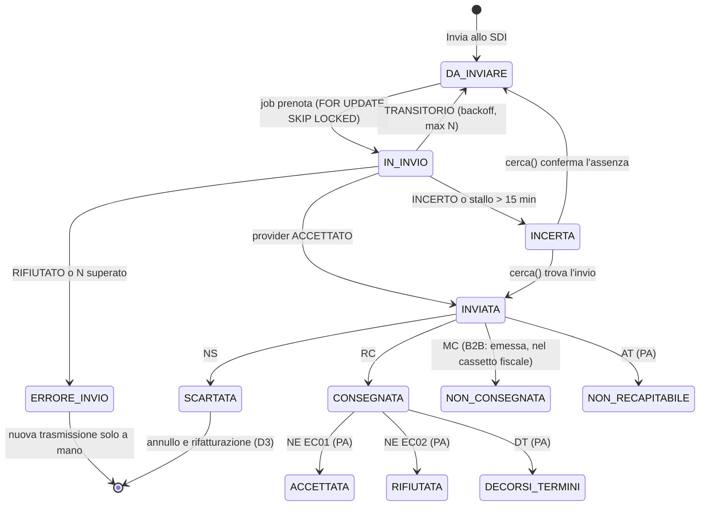
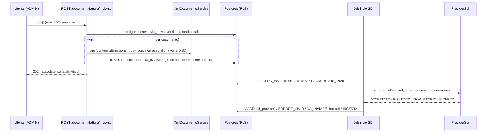
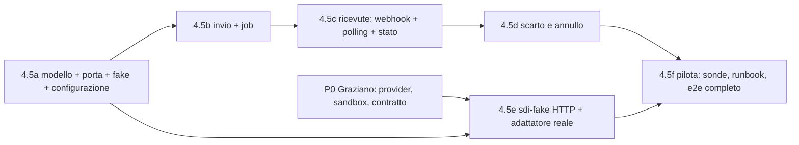

# Piano 4.5 — Emissione SDI tramite provider

Data: 18/11/2026. Base: `origin/master` `e9a61ae5` (produzione `sha-e9a61ae`). Solo piano: nessun branch, nessuna modifica al repo.

Fonti: roadmap §4.5 (`~/Progetti/winwaste/docs/roadmap-fasi3-4-import-gestori.md:457-485`), confronto provider (`~/Progetti/winwaste/docs/fatturazione-provider-sdi.md`), WinWaste `~/Progetti/winwaste/docs/fatturazione.md` §5, decisioni in memoria (`rifiuti-decisioni-strategia.md`, `rifiuti-conservazione-decisioni.md`), mancanze al 18/11 (`2026-11-18-funzioni-winwaste-mancanti.md:13,16`). Documentazione pubblica letta il 18/11: pagina prodotto Openapi e pagina webhook di Invoicetronic (sezione 3.3).

---

## 1. Obiettivo e perimetro

**Obiettivo.** Un documento `DEFINITIVO` di WasteFlow arriva allo SDI tramite un provider esterno. WasteFlow riceve le notifiche SDI, le conserva, mostra lo stato all'utente e gestisce lo scarto. Il provider sta dietro una porta (`ProviderSdi`). Oggi esistono un adattatore fake (CI) e uno reale. Il secondo provider reale si aggiunge in seguito senza toccare il dominio.

**Cosa sì**
- Configurazione SDI per azienda: provider, ambiente (sandbox/produzione), credenziali cifrate, segreto del webhook, interruttore `invio_attivo` (spento di default), lista dei passi di onboarding.
- Invio singolo e multiplo («Invia allo SDI», «Invia selezionati») di documenti `DEFINITIVO`, TD01, TD04 e TD24, FPR12 e FPA12. FPA12 dipende dalla domanda D4.
- Una trasmissione per tentativo, con stati, idempotenza, ritentativi con backoff, stato `INCERTA` più riconciliazione, e interruttore di emergenza via env.
- Ricevute e notifiche SDI: RC, NS, MC, NE (EC01/EC02), DT, AT, più gli errori del provider. Arrivano via webhook (inbox idempotente) e, come ripiego, via polling.
- Stato SDI del documento calcolato dall'insieme delle notifiche. È robusto all'ordine di arrivo e ai duplicati.
- Gestione dello scarto (NS): il documento scartato si annulla e si rifattura (domanda D3).
- Conserviamo noi XML, file firmato (se il provider firma) e notifiche, in tabelle di solo inserimento. È la base del futuro modulo di conservazione.
- Fake: adattatore in-process per i test unitari e `tools/sdi-fake` HTTP (stesso schema di `tools/rentri-fake`) per i test di contratto e gli e2e. Sandbox del provider solo in un workflow manuale.
- Frontend: scheda «Invio SDI» nelle impostazioni di fatturazione, colonna e filtro «Stato SDI» nella lista documenti, cronologia delle notifiche nel dettaglio, azioni di invio e di nuovo tentativo.

**Cosa no (in questo piano)**
- **Fatture passive**: fuori, pezzo successivo 4.5p (domanda D5). Il modello lascia il posto (enum `direzione`).
- **Conservazione a norma**: no. Vale la decisione dell'01/11: conservatore unico, contratto diretto del cliente, modulo opzionale. **Non si attiva la conservazione del provider SDI** (per esempio `/invoices_legal_storage` di Openapi). Qui prepariamo solo i dati da versare.
- Spesometro e liquidazione IVA via canale (`frmInvioDigitalHUB` di WinWaste): fuori.
- Accensione delle definitive in produzione: **`definitive_attive` resta false**. Il pilota la accende solo su decisione di Graziano, fuori da questo piano.
- Firma QES nostra (`SIGNATURE_PROVIDER=qes` è uno stub): non si completa qui.

---

## 2. Stato attuale verificato su master

| Cosa | Dove | Nota per la 4.5 |
|---|---|---|
| Testata `documenti_fattura` con `stato` BOZZA/DEFINITIVO/ANNULLATO, `emesso_il`, `xml` BYTEA, `xml_sha256`, `xml_generato_il`, `progressivo_file`, `formato_trasmissione`, `codice_destinatario`, `pec_destinatario` | `prisma/migrations/20261105100000_fatturazione_modello/migration.sql:141-198` | Lo stato SDI **non** può stare qui (riga sotto). |
| Trigger `documenti_fattura_immutabile`, **fail-closed**: su un non-BOZZA ogni colonna fuori da `v_permesse` è immutabile; `emesso_il`/`xml*`/`progressivo_file` si scrivono una volta sola; un documento **emesso non si annulla** | stessa migration `:395-481` (`:436-437` per «emesso non si annulla») | Una colonna nuova sulla testata sarebbe immutabile. Lo stato SDI va in tabelle figlie. Lo scarto (D3) richiede di cambiare la regola `:436`. |
| Interruttore `impostazioni_fatturazione.definitive_attive` default false | stessa migration `:54-55` | Non si tocca. |
| Generazione XML in due transazioni (progressivo, poi documento `FOR UPDATE`, generazione, **validazione XSD**, scrittura una tantum), `confermaEmissione` | `apps/backend/src/application/fatturazione/xml-documento.service.ts:1-12`, `:170-220` | L'invio riusa questo percorso: stessi byte, stesso nome file. |
| «Segna come emesso» (Q22) | `xml-documento.service.ts:224-280`; rotta `documenti-fattura.controller.ts` `POST /:id/emesso` | Un documento segnato emesso a mano potrebbe essere già stato caricato altrove: va gestito all'invio (§4.4). |
| Nome file `IT<piva>_<progressivo>` | `xml-documento.service.ts:676` | È la chiave naturale verso lo SDI (unicità del nome file). |
| Validazione XSD FPR12 1.2.3 (xmllint-wasm) | `apps/backend/src/infrastructure/fatturapa/valida-xsd.ts`, `xsd/Schema_VFPR12_v1.2.3.xsd` | Basta. Nessuna validazione a pagamento del provider. |
| Annullabilità (`EMESSO` blocca) | `apps/backend/src/application/fatturazione/documenti-fattura.service.ts:154`; `annullo-storno.service.ts:72,234` | Va estesa con «scartato dallo SDI» (D3). |
| Avvisi `FPA_DA_FIRMARE`, `DESTINATARIO_ASSENTE` | migration 4.4a `:197` | FPA richiede firma (D4). |
| Rotte documenti con `@RichiedeModulo('contratti')` | `apps/backend/src/api/fatturazione/documenti-fattura.controller.ts:45` | Chiave del modulo SDI: D6. |
| Catalogo dei moduli | `apps/backend/src/application/admin/feature-catalog.ts:15-30`, piani `:63-79` | Chiave nuova `sdi` (D6). |
| Moduli in modalità `registra` | `apps/backend/src/core/interceptors/modulo-attivo.interceptor.ts:21-26` | Le rotte nuove dichiarano il modulo. In produzione restano in `registra`. |
| Rotte senza utente: risoluzione dell'azienda da un hash col client di sistema (unico punto BYPASSRLS), poi lavoro in contesto azienda | `apps/backend/src/application/pese/agenti/risoluzione-agente.service.ts:22-34`; `api/agenti-pesa/agente-pesa.guard.ts`; roadmap §9 punto 8 (`roadmap-fasi3-4…:728`) | Stesso schema per il webhook SDI. |
| Cifratura AES-256-GCM `iv:tag:ct` | `apps/backend/src/infrastructure/rentri/rentri-crypto.util.ts:26-46` (chiave da `RENTRI_CREDENTIAL_ENC_KEY`) | Da spostare in `infrastructure/crypto/` con una chiave dedicata `SDI_CREDENTIAL_ENC_KEY`. |
| Job di trasmissione RENTRI: cron, flag anti-sovrapposizione, prenotazione, `IN_INVIO`→`INCERTA`, interruttore env `RENTRI_REGISTRO_INVII_ATTIVI`, filtro per modulo in una sola query | `apps/backend/src/infrastructure/jobs/rentri-registro-trasmissione.job.ts:20-80`; enum `stato_trasmissione_rentri` in `migrations/20261101500000_trasmissione_registro_rentri/migration.sql:25-28` | Modello da copiare per il job SDI. |
| Fake HTTP di un servizio esterno, in compose e nel deploy | `tools/rentri-fake/`, `docker-compose.yml:97-100`, `.gitea/workflows/deploy.yml:141-149` | Modello di `tools/sdi-fake`. |
| Catalogo RLS: 88 tabelle con `tenant_id` | `migrations/20261118100000_movimenti_sede_controparte/migration.sql:22`; `rls-catalogo.postgres.spec.ts` | Questo piano aggiunge 4 tabelle: 88 → 92. |
| Frontend documenti | `apps/frontend/src/app/features/fatturazione/documenti/{documenti-lista,documento-dettaglio,conferma-emissione-dialog}.component.ts`; impostazioni in `features/fatturazione/impostazioni/` | Punti di aggancio della UI. |
| Connettore provider | **assente** (`2026-11-18-funzioni-winwaste-mancanti.md:13`) | — |

---

## 3. Comportamento WinWaste da replicare

Da `fatturazione.md` §5 (righe 194-197):
- L'XML FatturaPA 1.2 (FPR12/FPA12) è salvato in `PEDANA`. L'invio parte dalla form `FrmFatturaPA` (F9) con **F7 «Invia documento a DigitalHub»**: login a Zucchetti DigitalHub (utente, password, azienda dalla configurazione), **invio dei selezionati** (massimo 1.000, non futuri, non barrati), **lettura degli stati**, cancellazione del documento remoto, **nuovo invio solo se scartato**. L'URL del servizio è configurabile. WinWaste non parla con lo SDI direttamente.
- Difetti da non copiare: il file XML non è legato in modo vincolante alla registrazione (`PEDANA`, difetto 10). Le nature IVA generiche sono già risolte nella 4.4.

Cosa replichiamo: selezione multipla con tetto, lettura stati, nuovo invio solo dopo uno scarto, canale configurabile per azienda.
Cosa miglioriamo: notifiche via webhook con polling di ripiego, stato calcolato e conservato, idempotenza, XML legato al documento in modo immutabile.
Cosa non portiamo: la «cancellazione del documento remoto». Lo SDI non la prevede dopo l'invio. Si cancella solo un invio rimasto presso il provider e non ancora trasmesso, se il provider lo consente (punto aperto R6).

---

## 4. Design

### 4.1 Porta e adattatori

`apps/backend/src/application/fatturazione/sdi/provider-sdi.port.ts` (application, nessuna dipendenza da Nest o Prisma):

```ts
export type CodiceProviderSdi = 'fake' | 'openapi' | 'invoicetronic'
export interface ContestoProvider { ambiente: 'SANDBOX' | 'PRODUZIONE'; credenziali: CredenzialiSdi; idConfigurazioneProvider: string | null }

export interface ProviderSdi {
  readonly codice: CodiceProviderSdi
  /** Prova le credenziali e la configurazione della P.IVA; nessun invio. */
  verifica(ctx: ContestoProvider, cedente: { partitaIva: string; codiceFiscale: string }): Promise<EsitoVerifica>
  /** Invio idempotente: chiaveIdempotenza = id della trasmissione. */
  invia(ctx: ContestoProvider, f: { nomeFile: string; xml: Buffer; firma: boolean; chiaveIdempotenza: string }): Promise<EsitoInvio>
  /** Riconciliazione dopo un esito incerto: cerca per chiave o nome file. */
  cerca(ctx: ContestoProvider, q: { chiaveIdempotenza: string; nomeFile: string }): Promise<InvioTrovato | null>
  /** Polling di ripiego: notifiche note al provider per un invio. */
  notifiche(ctx: ContestoProvider, idProvider: string): Promise<NotificaSdiGrezza[]>
  /** Verifica (firma/segreto) e interpreta un webhook; nessun accesso al DB. */
  interpretaWebhook(h: Record<string, string>, corpoGrezzo: Buffer, segreto: string, ora: Date): EsitoWebhook
}
export type EsitoInvio =
  | { tipo: 'ACCETTATO'; idProvider: string; idSdi: string | null; fileFirmato: Buffer | null }
  | { tipo: 'RIFIUTATO'; codice: string; messaggio: string }      // errore permanente (4xx di validazione, P.IVA non configurata)
  | { tipo: 'TRANSITORIO'; codice: string; ritentaDopoMs?: number } // 5xx, 429, rete: si ritenta
  | { tipo: 'INCERTO' }                                              // timeout dopo l'invio dei byte
```

- `infrastructure/sdi/fake/provider-sdi-fake.ts`: in memoria e deterministico. L'esito dipende dalla P.IVA del cessionario (per esempio, finale `1` = NS, `2` = MC, `3` = INCERTO). Serve ai test unitari e Postgres.
- `infrastructure/sdi/http-fake/`: adattatore HTTP verso `tools/sdi-fake`. Il fake imita l'API del provider scelto (sottoinsieme), così il test di contratto esercita il vero adattatore. Si può anche puntare l'adattatore reale all'URL del fake.
- `infrastructure/sdi/openapi/` (o `invoicetronic/`, D1): adattatore reale. Gli errori HTTP si mappano in `RIFIUTATO`/`TRANSITORIO`/`INCERTO` con una tabella esplicita e testata.
- `RegistroProviderSdi`: sceglie l'adattatore dal codice salvato in configurazione. Lo stesso schema esiste già per gli adattatori dell'export (`application/fatturazione/adattatori/registro-adattatori.ts`). In produzione `fake` è rifiutato (stessa regola di `SIGNATURE_PROVIDER=sandbox`, `digital-signature.service.ts:48-62`).

### 4.2 Modello dati (una migration additiva, nel pezzo 4.5a)

Quattro tabelle con `tenant_id`, **RLS ENABLE + FORCE**, le due policy standard copiate da `20261103200000_legami_movimento`, GRANT come `ops/db-ruoli.sh`. Catalogo 88 → 92. Le tabelle di solo inserimento entrano in `v_solo_inserimento` di `prisma/sql/ruoli-db.sql`, con REVOKE anche in migration se i ruoli esistono.

1. **`configurazioni_sdi`** (una per azienda, unico su `tenant_id`)
   - `provider` VARCHAR CHECK in (`fake`,`openapi`,`invoicetronic`), `ambiente` CHECK (`SANDBOX`,`PRODUZIONE`).
   - `credenziali_cifrate` TEXT NULL. Formato `iv:tag:ct`. NULL = account di piattaforma (D2). Mai restituite dall'API: si possono solo sostituire.
   - `id_configurazione_provider` VARCHAR NULL (per esempio l'id di `IT-configurations` di Openapi).
   - `webhook_token_sha256` CHAR(64) UNIQUE. Hash del token nell'URL del webhook, generato alla creazione e rigenerabile.
   - `webhook_segreto_cifrato` TEXT NULL. Segreto HMAC del provider (Invoicetronic `wh_sec_…`).
   - `firma_dal_provider` BOOLEAN default false (D4).
   - `invio_attivo` BOOLEAN NOT NULL default **false**.
   - `onboarding` JSONB: passi spuntati, con data e utente.
   - `verificata_il`, `ultimo_esito_verifica`, `versione`, timestamp.
2. **`trasmissioni_sdi`** (una per tentativo di invio di un documento)
   - `documento_id` FK composta (documento, tenant), `direzione` enum `EMESSA` (riserva `RICEVUTA` per la 4.5p), `provider`, `ambiente`, `nome_file`, `xml_sha256` (copia, per il controllo).
   - `stato` enum `stato_trasmissione_sdi`: `DA_INVIARE`, `IN_INVIO`, `INVIATA`, `INCERTA`, `ERRORE_INVIO`, `CONSEGNATA`, `NON_CONSEGNATA` (MC), `SCARTATA` (NS), `ACCETTATA` (NE EC01), `RIFIUTATA` (NE EC02), `DECORSI_TERMINI` (DT), `NON_RECAPITABILE` (AT).
   - `id_provider`, `id_sdi`, `file_firmato` BYTEA NULL, `file_firmato_sha256`, `tentativi`, `prossimo_tentativo_il`, `ultimo_errore_codice`, `ultimo_errore_messaggio` (testo del provider troncato, senza dati personali), `richiesta_da`, `inviata_il`, `chiusa_il`, `versione`, timestamp.
   - CHECK: `INVIATA` e gli stati successivi hanno `id_provider`. `ERRORE_INVIO` ha il codice di errore.
   - **Unico parziale**: una sola trasmissione «viva» per documento, `UNIQUE (tenant_id, documento_id) WHERE stato NOT IN ('ERRORE_INVIO','SCARTATA')`. È il presidio contro il doppio invio.
   - Indice `(tenant_id, stato, prossimo_tentativo_il)` per il job.
   - Trigger di transizione (stessa eccezione dichiarata alla regola «niente trigger» della 4.4a): rifiuta le transizioni fuori dalla macchina a stati (§4.3) e ogni modifica di `nome_file`, `xml_sha256`, `documento_id`.
3. **`notifiche_sdi`** (**solo inserimento**)
   - `trasmissione_id`, `tipo` CHECK (`RC`,`NS`,`MC`,`NE`,`DT`,`AT`,`SE`,`ERRORE_PROVIDER`), `esito_committente` (`EC01`/`EC02`, solo NE), `codici_errore` TEXT[] (per esempio `00404`), `data_ricezione_sdi`, `ricevuta_il`.
   - `file` BYTEA (XML della ricevuta, quando il provider lo dà), `file_sha256`, `fonte` (`WEBHOOK`/`POLLING`/`INVIO`).
   - `chiave_dedup` UNIQUE `(tenant_id, trasmissione_id, chiave_dedup)`. La chiave è l'id SDI della notifica, o lo sha del file, o tipo+data.
4. **`eventi_sdi_ricevuti`** (inbox del webhook, solo inserimento più una colonna di elaborazione)
   - `provider`, `id_evento_provider`, `corpo` JSONB (grezzo, già verificato), `ricevuto_il`, `elaborato_il`, `esito_elaborazione`.
   - UNIQUE `(tenant_id, provider, id_evento_provider)`: idempotenza sulla consegna «almeno una volta» (Invoicetronic lo dichiara esplicitamente).
   - Conservazione 90 giorni. Le notifiche restano in `notifiche_sdi`.

**Perché tabelle separate e non colonne su `documenti_fattura`:** il trigger della testata è fail-closed (`:425-426`). Una colonna di stato aggiunta lì sarebbe immutabile sul `DEFINITIVO`. Allargare `v_permesse` aprirebbe una scrittura ripetuta su un documento fiscale. La 4.4a l'ha evitato di proposito.

**Unica modifica alla testata (pezzo 4.5d, D3):** il trigger ammette `DEFINITIVO → ANNULLATO` anche con `emesso_il` valorizzato, **solo se** esiste una `trasmissioni_sdi` del documento in `SCARTATA` e nessuna trasmissione viva. La SELECT non è `SECURITY DEFINER` e passa dalla RLS, come gli altri trigger del progetto. `annullabilita()` riceve `scartatoSdi` e `trasmissioneViva`.

### 4.3 Stati e regole (dominio puro, `domain/fatturazione/sdi/`)



- **Stato calcolato, non incrementale.** `statoDaNotifiche(notifiche[], statoInvio)` è una funzione pura con precedenza: NS > (NE/DT/AT) > RC/MC > INVIATA. Ogni notifica nuova ricalcola lo stato dall'insieme. Una RC arrivata dopo l'NE, o un duplicato, non fanno tornare indietro lo stato. Le combinazioni impossibili (NS dopo RC) producono l'avviso `NOTIFICHE_INCOERENTI`, senza eccezione.
- **Esito fiscale per la UI**:
  - `EMESSA` per CONSEGNATA, NON_CONSEGNATA, ACCETTATA, DECORSI_TERMINI, NON_RECAPITABILE.
  - `RIFIUTATA_DAL_COMMITTENTE` per EC02, che si gestisce con una nota di credito.
  - `NON_EMESSA` per SCARTATA ed ERRORE_INVIO.
  - `IN_CORSO` per gli altri stati.
- **NS con codice `00404` (fattura duplicata) o `00002` (nome file duplicato)**: la trasmissione resta `SCARTATA` con l'avviso `PROBABILMENTE_GIA_INVIATA`. La UI **non** propone l'annullo ma una verifica manuale: il documento potrebbe essere già passato da un altro canale.
- **Termini**: avviso `INVIO_OLTRE_TERMINE` se l'invio parte oltre 12 giorni dalla data documento (TD01/TD04), o oltre il 15 del mese successivo (TD24). È solo un avviso.

### 4.4 Flusso di invio



- **Pre-condizioni** (409 con codice; saltati elencati nel 202 dell'invio multiplo):
  - `MODULO`: modulo `sdi` attivo (D6).
  - `SDI_NON_CONFIGURATO`: configurazione verificata.
  - `INVIO_SDI_NON_ATTIVO`: `invio_attivo` spento.
  - `NON_DEFINITIVO`: documento non `DEFINITIVO`.
  - `TRASMISSIONE_IN_CORSO`: esiste una trasmissione viva.
  - `FIRMA_NON_DISPONIBILE`: FPA12 senza firma disponibile (D4).
  - `DATA_FUTURA`: data documento nel futuro (come WinWaste).
- **Documento già emesso** (XML scaricato o «Segna come emesso»): l'invio richiede `confermaGiaEmesso: true`. La UI dice «Se l'hai già caricato su un altro canale, lo SDI lo scarterà come duplicato».
- **XML**: si riusano i byte di `documenti_fattura.xml`, scritti una sola volta. Non si rigenera. `xml_sha256` viene copiato nella trasmissione e ricontrollato dal job prima di inviare.
- **Idempotenza**:
  - lato nostro, l'unico parziale e la prenotazione `SKIP LOCKED`;
  - lato provider, la chiave di idempotenza se esiste (domanda 7 ai provider), altrimenti `cerca()` per nome file prima di ogni nuovo tentativo dopo un `INCERTO`;
  - lato SDI, il nome file è unico, quindi un doppione viene scartato (00002) e non diventa una doppia fattura.
- **Ritentativi**: backoff 1, 5, 15, 60, 240 minuti, al massimo 5. Poi `ERRORE_INVIO` con notifica in-app agli ADMIN.
- **Job**: `infrastructure/jobs/sdi-invio.job.ts`, cron ogni minuto, sul modello di `rentri-registro-trasmissione.job.ts`. Ha il flag anti-sovrapposizione, una sola query per le aziende col modulo, e lavora azienda per azienda nel suo contesto. Interruttore d'emergenza `SDI_INVII_ATTIVI=false`: si saltano gli invii, polling e riconciliazione proseguono. Logga solo id e conteggi, mai l'XML o le credenziali.

### 4.5 Ricevute: webhook e polling

- **Rotta pubblica** `POST /sdi/webhook/:provider/:token` (`@Public`, `@SkipThrottle` globale, throttler dedicato per token come per l'agente di pesa).
  1. Esce subito con 404 se il token non è ben formato.
  2. `RisoluzioneTenantSdiService.daToken(sha256(token))` interroga col client di sistema la sola `configurazioni_sdi.webhook_token_sha256`. È l'unico uso del client di sistema nel modulo, come `risoluzione-agente.service.ts:22-34`.
  3. Nel contesto dell'azienda: `adattatore.interpretaWebhook(headers, rawBody, segreto, ora)`. Invoicetronic: header `Invoicetronic-Signature: t=…,v1=…`, HMAC-SHA256 su `t.corpo`, finestra 5 minuti, confronto a tempo costante (pagina webhook Invoicetronic, letta il 18/11). Openapi: autenticazione dei callback **non documentata** sulla pagina prodotto (R2). Fino a risposta: token segreto nell'URL più verifica incrociata con `notifiche()` prima di applicare l'evento.
  4. INSERT in `eventi_sdi_ricevuti` (unico = idempotenza), poi **200 subito**. L'elaborazione avviene in un job (`sdi-eventi.job.ts`, ogni 30 secondi, e subito dopo l'INSERT con `setImmediate` nello stesso processo): `notifiche_sdi` (dedup), poi ricalcolo dello stato della trasmissione.
  5. Il raw body serve per l'HMAC: va abilitato `rawBody: true` in `NestFactory.create` solo per questa rotta.
  - Un account con un solo webhook per tutta la piattaforma (Invoicetronic, se D2 = contratto quadro) non ha il token per azienda nell'URL. In quel caso si usa un token di piattaforma, e l'azienda si risolve da `id_provider` della trasmissione con una seconda funzione mirata del client di sistema (`daIdProvider`).
- **Polling di ripiego**: `sdi-riconciliazione.job.ts` ogni 15 minuti. Gestisce le trasmissioni `INVIATA` senza notifiche da più di 2 ore e le `CONSEGNATA` FPA senza esito da più di 15 giorni (il DT arriva a 15 giorni), più tutte le `INCERTA`. Chiama `notifiche()` o `cerca()`.
- **Sonda di salute**: in `application/admin/system-health/probes/` conta per azienda `INCERTA`, `ERRORE_INVIO`, `SCARTATA` non gestite ed eventi non elaborati da più di 10 minuti. Gli errori dei job passano da `segnala-errore-job.ts` (Bugsink).

### 4.6 Credenziali e sicurezza

- `infrastructure/crypto/segreti.ts`: si sposta lì `encryptSecret`/`decryptSecret` di `rentri-crypto.util.ts`. RENTRI re-esporta, quindi nessun cambiamento di comportamento.
- Chiave nuova `SDI_CREDENTIAL_ENC_KEY`, separata da RENTRI, nel `.env` del VPS (600). Il backend non parte con il modulo `sdi` attivo su un'azienda e la chiave assente: fail-closed, messaggio chiaro.
- Le credenziali si decifrano solo nel job o nella verifica. Non finiscono mai in log, audit o risposte API (`credenzialiImpostate: true/false`). Si cambiano solo con PUT, che scrive nell'audit «credenziali SDI sostituite» senza valore.
- Ruoli: configurazione e invio solo ADMIN (`RUOLI_AMMINISTRATORI`); lettura dello stato a `RUOLI_LETTURA`. Si applica la sessione unica per utente già esistente.
- Dati verso l'esterno: l'XML contiene dati del cliente dell'azienda. Inviarlo al provider è la **finalità dichiarata** del modulo, quindi è una decisione esplicita (D1/D2) con DPA del provider (domanda 11). Nient'altro va al provider. Il fake gira in locale e in CI.

### 4.7 API (nuove, additive)

| Rotta | Ruolo | Note |
|---|---|---|
| `GET /fatturazione/sdi/configurazione` | ADMIN | Senza credenziali. Include l'URL del webhook da comunicare al provider, mostrato una volta alla rigenerazione. |
| `PUT /fatturazione/sdi/configurazione` | ADMIN | Provider, ambiente, credenziali (write-only), firma, passi di onboarding; `versione`. |
| `POST /fatturazione/sdi/configurazione/verifica` | ADMIN | `verifica()` del provider, salva l'esito. |
| `POST /fatturazione/sdi/configurazione/token-webhook` | ADMIN | Rigenera il token. |
| `PATCH /fatturazione/sdi/configurazione/invio-attivo` | ADMIN | Acceso solo se verificata. |
| `POST /documenti-fattura/invio-sdi` | ADMIN | `{ ids[], confermaGiaEmesso? }`, 202 con accodate e saltate. |
| `POST /documenti-fattura/:id/invio-sdi/riprova` | ADMIN | Solo da `ERRORE_INVIO`: nuova trasmissione. |
| `GET /documenti-fattura/:id/sdi` | lettura | Trasmissioni e notifiche (senza i file). |
| `GET /documenti-fattura/:id/sdi/notifiche/:nid/file` | lettura | Scarica la ricevuta XML. |
| `GET /documenti-fattura?statoSdi=` | lettura | Filtro additivo. `DocumentoRiga` acquista `statoSdi` ed `esitoFiscale` (aggiornare `CHIAVI_*` del modello FE, Q21 della 4.4). |
| `POST /sdi/webhook/:provider/:token` | pubblica | §4.5 |

### 4.8 Frontend

- **Impostazioni → Fatturazione → «Invio SDI»** (`features/fatturazione/impostazioni/sdi-scheda.component.ts`):
  - provider e ambiente;
  - campi credenziali con «impostate ✓ / sostituisci»;
  - checklist di onboarding (per Openapi: configurazione P.IVA creata, firma attivata; per le passive, quando ci saranno: codice destinatario `PIC7CPS` registrato in AdE);
  - pulsante «Verifica connessione» ed esito;
  - URL del webhook da copiare;
  - interruttore «Invio attivo» disabilitato finché la verifica non passa.
- **Lista documenti**: colonna «SDI» con badge (In coda, Inviata, Consegnata, Non consegnata, Scartata, Accettata, Rifiutata, Decorsi termini, Errore), filtro, selezione multipla con «Invia allo SDI», dialog di conferma con conteggio e motivi di salto.
- **Dettaglio**: sezione «Trasmissioni SDI» con la cronologia delle notifiche (data SDI, tipo, codici di errore con descrizione italiana da tabella statica dei codici SDI, file scaricabile). Azioni: «Riprova» (ERRORE_INVIO); «Annulla e rifattura» (SCARTATA, D3, porta all'annullo esistente con il motivo precompilato «Scarto SDI n. …»).
- Polling della pagina finché ci sono trasmissioni `IN_CORSO`, riusando `polling-transitorio.ts`.
- Stile della direzione B «Libro mastro». Termini tecnici in inglese (webhook, token), testo in italiano.

---

## 5. Pezzi (ognuno una PR con CI verde)



Regole comuni: TDD (test che fallisce, poi codice); `npm run test:cov` completo prima della PR (lezione del 07/11: tsc esclude gli spec); spec Postgres con ruolo `wasteflow_app`; migration additive con `NOT VALID` + `VALIDATE` dove serve; nessun dato reale; `definitive_attive` mai toccato.

### 4.5a — Modello dati, porta, fake in-process, configurazione per azienda
- **T0** Linea di base: master verde, conteggio RLS 88, `migrate diff` vuoto.
- **T1** Spostamento della cifratura in `infrastructure/crypto/segreti.ts` con re-export RENTRI. Test: round-trip, tag alterato rifiutato, chiave vuota → errore; spec RENTRI invariate.
- **T2** Migration `2026112x100000_sdi_trasmissioni`: 4 tabelle, enum, CHECK, unico parziale, trigger di transizione, RLS, GRANT, `ruoli-db.sql`. Test Postgres:
  - RLS senza tenant e con altro tenant → 0 righe;
  - seconda trasmissione viva → 23505; una `SCARTATA` più una nuova → ammessa;
  - UPDATE/DELETE su `notifiche_sdi` → negato;
  - transizione `CONSEGNATA → DA_INVIARE` → respinta;
  - cambio di `nome_file` → respinto;
  - catalogo 92;
  - **nessuna colonna nuova su `documenti_fattura`** (elenco scritto nel test).
- **T3** Dominio `domain/fatturazione/sdi/`: tipi, `statoDaNotifiche`, `esitoFiscale`, avvisi (`INVIO_OLTRE_TERMINE`, `PROBABILMENTE_GIA_INVIATA`, `NOTIFICHE_INCOERENTI`), tabella dei codici di errore SDI. Test di proprietà: ogni permutazione di un insieme di notifiche dà lo stesso stato; i duplicati non cambiano nulla; NS vince.
- **T4** Porta `ProviderSdi`, `RegistroProviderSdi` (fake rifiutato in produzione), `ProviderSdiFake` deterministico. Test del fake per ogni esito.
- **T5** Chiave modulo `sdi` in `feature-catalog.ts` (D6), API configurazione (GET/PUT/verifica/token/invio-attivo), audit senza segreti. Test: le credenziali non compaiono mai nella risposta, nei log o nell'audit (spy sul logger); `invio-attivo` senza verifica → 409; VIEWER → 403; `versione` superata → 409.
- **T6** FE scheda «Invio SDI» più unit test del componente; e2e: configurazione col provider `fake` in ambiente di test.
- **Fatto quando:** CI verde, catalogo 92, nessun invio possibile (manca il pezzo b), in produzione nessuna azienda configurata.

### 4.5b — Invio e job
- **T1** `InvioSdiService.accoda(ids, confermaGiaEmesso)`: pre-condizioni, riuso di `XmlDocumentoService.xml(confermaEmissione=true)`, INSERT `DA_INVIARE`, 202 con le saltate. Test Postgres: due richieste parallele sullo stesso documento → una trasmissione; documento ANNULLATO/BOZZA → saltato col motivo; già emesso senza conferma → saltato `GIA_EMESSO`; tetto 500 → 400.
- **T2** `SdiInvioJob`: prenotazione `SKIP LOCKED`, controllo `xml_sha256`, mappatura degli esiti, backoff, stallo → `INCERTA`, interruttore `SDI_INVII_ATTIVI`. Test con il fake: ACCETTATO → INVIATA; TRANSITORIO ×5 → ERRORE_INVIO; INCERTO → INCERTA → `cerca()` trovato → INVIATA; non trovato → DA_INVIARE; due istanze del job in parallelo → un solo `invia()` (contato).
- **T3** Rotte `invio-sdi` e `riprova`, `statoSdi` nella lista documenti (numero di query costante con 1 e 100 documenti).
- **T4** FE: colonna, filtro, selezione multipla, dialog. e2e col fake: invio di un documento definitivo con interruttore acceso nel DB di test (come la 4.4, `clientDbLocale()`), attesa di `INVIATA`.
- **Fatto quando:** CI verde; con `SDI_INVII_ATTIVI` assente in produzione il default è **false** (si accende solo al pilota).

### 4.5c — Ricevute: webhook, inbox, polling, stato
- **T1** `RisoluzioneTenantSdiService` (client di sistema, due funzioni, nient'altro). Test: token sconosciuto → null; nessun'altra query di sistema (spy).
- **T2** Rotta webhook con raw body, throttler, `interpretaWebhook` del fake (HMAC come Invoicetronic, così il codice di verifica è già esercitato). Test: firma errata → 401; timestamp vecchio → 401; stesso evento due volte → un INSERT, due 200; token di un'azienda senza modulo → 404 (in `registra`: avviso e passa, come la guard dell'agente).
- **T3** `SdiEventiJob`: inbox → `notifiche_sdi` → ricalcolo dello stato. Test: NE prima di RC → stato finale ACCETTATA; NS dopo RC → avviso NOTIFICHE_INCOERENTI, stato non regredito.
- **T4** `SdiRiconciliazioneJob` (polling di ripiego). Test con webhook perso: dopo 2 ore il polling porta a CONSEGNATA.
- **T5** FE: cronologia nel dettaglio, download delle ricevute, polling della pagina.
- **Fatto quando:** CI verde; e2e col fake: invio → RC via webhook → badge «Consegnata».

### 4.5d — Scarto e annullo
- **T1** Migration: il trigger `documenti_fattura_immutabile` ammette l'annullo dell'emesso solo con una trasmissione `SCARTATA` e nessuna viva (D3). Test Postgres: emesso senza scarto → respinto (come oggi); scartato → ammesso; scartato con una nuova trasmissione viva → respinto; gara annullo contro nuovo invio → uno dei due.
- **T2** `annullabilita()` con `SCARTATO_SDI` e le regole del numero secondo D3; avviso `PROBABILMENTE_GIA_INVIATA` che blocca l'azione proposta. Test unitari sull'ordine dei motivi.
- **T3** FE: «Annulla e rifattura» con motivo precompilato; e2e col fake (P.IVA che genera NS): scarto → annullo → nuova definitiva → invio → RC.
- **Fatto quando:** CI verde; nessun cambio di comportamento per i documenti senza trasmissioni.

### 4.5e — `tools/sdi-fake` e adattatore reale (parte dopo P0)
- **T1** `tools/sdi-fake` (Node, come `tools/rentri-fake`): sottoinsieme dell'API del provider scelto (invio, lettura, configurazione P.IVA), esiti guidati dalla P.IVA del cessionario, chiamata del webhook firmato verso l'URL configurato. Servizio in `docker-compose.yml` e nel job e2e della CI.
- **T2** Adattatore reale (D1) con la tabella di mappatura degli errori. Test di contratto contro `tools/sdi-fake`: risposte registrate dalla documentazione ufficiale, nessuna chiamata esterna in CI.
- **T3** Workflow manuale `sdi-sandbox.yml` (`workflow_dispatch`, secret `SDI_SANDBOX_*`): invio di 3 fatture di prova alla sandbox del provider, attesa delle notifiche, rapporto. **Non** gira a ogni push.
- **Fatto quando:** contratto verde in CI; un giro sandbox riuscito annotato nel rapporto (richiede P0).

### 4.5f — Pilota
- **T1** Sonda di salute e notifiche in-app agli ADMIN per `ERRORE_INVIO`, `SCARTATA`, `INCERTA` oltre un'ora.
- **T2** Runbook in `docs/` (accensione per azienda, interruttore d'emergenza, rotazione di `SDI_CREDENTIAL_ENC_KEY` e del token del webhook, cosa fare con una `INCERTA`). Il runbook è parte del pezzo, non un report.
- **T3** e2e completo (definitiva → invio → RC; FPA → NE EC01; NS → annullo → rifattura) e test UAT con la skill `uat-e2e-entity-testing`.
- **Fatto quando:** pronto per 2-3 aziende pilota. Accensione di `definitive_attive` e `invio_attivo` in produzione **solo su decisione di Graziano**.

**Dimensione stimata:** a M, b M, c M-L, d S-M, e M, f S. Totale in linea con M-L della roadmap.

---

## 6. Rischi e punti aperti

- **R1 Modello multi-P.IVA del provider non chiarito** (domande 1-3 del confronto). Impatta D2 e la forma di `configurazioni_sdi`. Mitigazione: la tabella supporta sia l'account di piattaforma sia le credenziali per azienda.
- **R2 Autenticazione dei callback Openapi non documentata** sulla pagina prodotto (letta il 18/11; la sandbox non è citata). Se resta così: token segreto nell'URL più verifica via `notifiche()` prima di applicare l'evento. Invoicetronic invece documenta HMAC, retry fino a 7 volte in 24 ore e consegna «almeno una volta».
- **R3 Firma FPA**: senza firma una FPA12 viene scartata. Finché D4 non è deciso, le FPA12 si bloccano all'invio (`FIRMA_NON_DISPONIBILE`).
- **R4 Scarto e numerazione**: la prassi AdE (riemissione entro 5 giorni con stesso numero e data, oppure con numero e data nuovi e riferimento) va verificata con il commercialista prima della 4.5d. D3 sceglie la via meno invasiva per i trigger.
- **R5 Documenti già emessi a mano** (XML scaricato e caricato altrove): rischio di doppio invio. Mitigato da conferma esplicita, scarto 00404/00002 e avviso.
- **R6 Cancellazione di un invio presso il provider prima della trasmissione allo SDI**: dipende dal provider; non in perimetro.
- **R7 Costi**: ogni nuovo tentativo e ogni lettura possono essere transazioni a pagamento (Invoicetronic conta invio, ricezione e validazione). Il polling usa letture gratuite dove possibile (Openapi: consultazione gratuita). Non si usa la validazione del provider (abbiamo l'XSD).
- **R8 Tetto dei volumi** (Invoicetronic 403 al cap, Aruba 429): mappati come `TRANSITORIO` con avviso amministrativo, non come errore del documento.
- **R9 Conservazione**: i dati da versare (XML, firmato, notifiche) stanno nelle nostre tabelle a sola aggiunta. Il connettore del conservatore del cliente è un pezzo separato (decisione 01/11). Va verificato che il conservatore accetti le ricevute SDI come metadati.
- **R10 Passive**: con Openapi richiedono la registrazione del codice destinatario `PIC7CPS` in AdE da parte di ogni cliente. È un passo fuori API che va guidato nell'onboarding (4.5p).

---

## 7. Cosa serve da Graziano per partire

1. **Le risposte dei provider** alle 12 domande comuni e alle specifiche (`fatturazione-provider-sdi.md`, sezione finale). Le più urgenti: modello multi-P.IVA, sandbox, autenticazione dei webhook, chiave di idempotenza, firma FPA. Bloccano solo 4.5e; 4.5a-d si costruiscono col fake.
2. **Account sandbox** del provider scelto (Invoicetronic: chiave `ik_test_…` gratuita; Openapi: chiedere se esiste un ambiente di test) e le chiavi come secret Gitea `SDI_SANDBOX_*` (le carica Graziano o le dà in modo sicuro).
3. **Contratto** (D2) e **DPA** del provider prima di qualunque invio reale.
4. **Generazione di `SDI_CREDENTIAL_ENC_KEY`** sul VPS al deploy della 4.5a (posso farlo io su autorizzazione).
5. **Due o tre aziende pilota** con P.IVA reale e un cliente disposto a ricevere fatture di prova (o fatture vere, a bassa frequenza), e il via libera per accendere su di loro `definitive_attive` e `invio_attivo`.
6. Una verifica del commercialista su R4 (scarto e numerazione) e sui ruoli (WasteFlow intermediario o canale).

---

## 8. Domande per Graziano

**D1. Provider del primo adattatore reale.**
1. **Openapi (consigliata)**: primo nel confronto (configurazione per P.IVA via API, webhook per emesse e passive, prezzo più basso a volume). Da chiarire: sandbox e autenticazione dei callback.
2. Invoicetronic: sandbox gratuita subito e webhook HMAC documentati. Da chiarire: chiave live per P.IVA (5 €/mese) e multi-azienda.
3. Rimandare: si costruisce tutto col fake (4.5a-d) e si sceglie quando arrivano le risposte.

**D2. Chi ha il contratto con il provider SDI.**
1. **Contratto quadro WasteFlow, una configurazione per P.IVA (consigliata)**: onboarding automatico, un solo DPA, costo rivendibile nel modulo.
2. Ogni cliente ha il suo account e ci dà le sue credenziali, cifrate per azienda (come la conservazione).
3. Entrambe le strade, a scelta del cliente.

**D3. Fattura scartata dallo SDI (NS).**
1. **Annullo dello scartato e nuova fattura con il numero successivo (consigliata)**. Il numero dello scartato resta «annullato per scarto SDI», documentato. Basta cambiare la regola del trigger.
2. Riemissione con lo stesso numero e la stessa data entro 5 giorni: serve un'eccezione all'unicità del numero e all'immutabilità del documento.
3. Come la 1, ma riuso del numero se lo scartato è ancora l'ultimo del registro.

**D4. Firma delle fatture verso la PA (FPA12).**
1. **Firma del provider (consigliata)**: Openapi 0,09 €, Invoicetronic 0,02 € per firma.
2. Firma QES nostra: da completare lo stub `qes`, con un QTSP da contrattualizzare.
3. FPA12 esclusa dal primo rilascio: si inviano solo le FPR12.

**D5. Fatture passive (ricevute dai fornitori).**
1. **Fuori dalla 4.5, pezzo 4.5p dopo il pilota (consigliata)**: ricezione, archivio e consultazione, con la registrazione di `PIC7CPS` guidata.
2. Dentro la 4.5.
3. Non previste: WasteFlow solo per le emesse.

**D6. Modulo commerciale.**
1. **Nuovo modulo `sdi`, aggiuntivo a pagamento e nel piano ENTERPRISE (consigliata)**: le transazioni hanno un costo vivo per WasteFlow.
2. Dentro `contratti` (PROFESSIONAL), come il resto della fatturazione.
3. Nuovo modulo `sdi` anche in PROFESSIONAL.

**D7. Quando parte l'invio.**
1. **Manuale, con «Invia selezionati» dalla lista documenti (consigliata)**: come WinWaste F7, con controllo umano nel pilota.
2. Automatico alla conferma della definitiva (impostazione per azienda).
3. Manuale nel pilota, automatico attivabile dopo.

---

## Decisioni di Graziano (18/11)

Approvate tutte le opzioni consigliate:

- Provider reale deciso dopo (P0): intanto adattatore fake.
- Contratto quadro WasteFlow con configurazione per P.IVA.
- Scarto SDI = annullo del documento e nuova fattura col numero successivo.
- PA (FPA12) esclusa al primo rilascio.
- Fatture passive dopo il pilota.
- Nuovo modulo `sdi`.
- Invio manuale («Invia allo SDI», «Invia selezionati»).
- Stato SDI in tabelle separate (il trigger di immutabilità del definitivo vieta colonne nuove sulla testata).
- Vincolo di produzione: `definitive_attive` resta false; nessuna azienda con «Fatturazione da».
