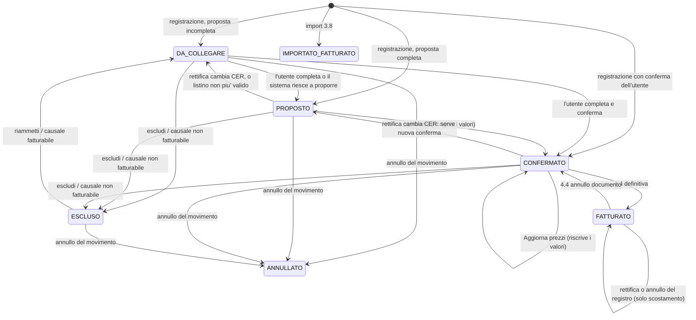
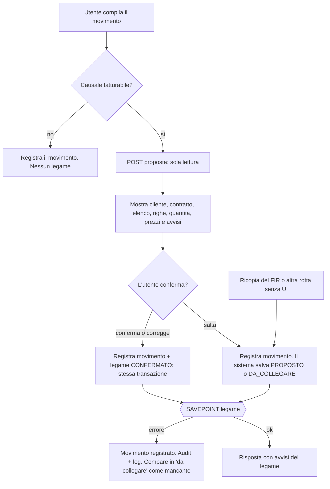

# Fase 4.3 — Legame movimento, cliente e prezzo

**Data**: 2026-11-03
**Stato**: design da approvare, da pianificare
**Base**: master `01790cf`, worktree `rifiuti-wt-rentri-registro`
**Origine**: roadmap `winwaste/docs/roadmap-fasi3-4-import-gestori.md` §4.3 (con §4.4, §4.5, §9) e dossier `.superpowers/sdd/2026-11-03-seguiti-4-2b/dossier-4-3.md`.

Convenzioni del documento. «Decisione di Graziano» = presa il 03/11/2026, vincolante. «Scelta dell'orchestratore» = scelta di progetto da confermare in revisione. I riferimenti `file:riga` sono verificati su `01790cf`. `schema` = `apps/backend/prisma/schema.prisma`; i percorsi `src/...` sono sotto `apps/backend/`.

---

## 1. Intento e perché

Un gestore di impianto registra un carico di rifiuti. Quel carico è anche un ricavo: va fatturato al cliente, al prezzo del suo contratto. Oggi WasteFlow non lo sa. Il movimento non ha cliente, contratto, elenco, prezzo né stato «fatturato» (`schema:1884-2010`). Ha solo `counterpartName` e `counterpartAddress` come testo libero (`schema:1923-1925`).

In WinWaste il legame registro → ricavo è il cuore della fatturazione. Il movimento porta cliente, contratto, elenco e il «foglio» delle voci di addebito con quantità, prezzo e sconto già scritti. La fattura legge quel foglio. Un mese passato non cambia se il listino cambia dopo.

La 4.3 costruisce questo legame. Non fattura nulla: prepara i dati che la 4.4 (valorizzazione per periodo) leggerà. Senza la 4.3 la 4.4 non ha niente da valorizzare.

Perché ora: la 4.1 (cliente e contratto) e la 4.2 (listino con elenchi e righe) sono in produzione o integrate. La 4.2 ha già preparato le funzioni di scelta (`elencoProposto`, `elenchiValidiAl`, `quantitaDaMovimento`) e ha annunciato il vincolo che blocca l'eliminazione di elenchi e righe usati.

## 2. Obiettivi, non-obiettivi, anti-obiettivi

### Obiettivi

1. Ogni movimento con causale fatturabile può avere un legame con un cliente, un contratto, un elenco e una o più righe di listino.
2. Il legame è **proposto** dal sistema alla registrazione e **confermato** dall'utente.
3. Alla conferma il legame **congela** quantità, prezzo, sconto e IVA delle righe a prezzo singolo. L'utente può correggere a mano prezzo e sconto di una riga finché il legame non è fatturato (decisione 16).
4. Una lista «da collegare» raccoglie i movimenti senza legame confermato.
5. Un'azione esplicita «Aggiorna prezzi» riscrive i prezzi sui movimenti non ancora fatturati, tranne le righe con prezzo modificato a mano.
6. Elenchi e righe del listino usati da un legame non si eliminano (vincolo nel database).
7. Il legame segue la catena di annotazioni e rettifiche del movimento.
8. La 4.4 trova tutto ciò che le serve in tabelle sue, senza ricalcolare dal listino vigente.

### Non-obiettivi

- Nessuna fattura, numerazione, XML, export, nota di credito: è la 4.4.
- Nessun calcolo del prezzo speciale (`S`: scaglioni, progressivi, conguagli, minimi): è la 4.4. La 4.3 lega la riga e basta.
- Nessun «cliente di riferimento X» di WinWaste (decisione 6).
- Nessun campo «riferimento rifiuto» (`RIFER`) sul registro o sul FIR. Si usano le righe con riferimento vuoto o `?` (decisione 12) e la scelta manuale della riga.
- Nessun lordo e nessun volume dal registro: il movimento ha solo `quantity` e `unit`. Lordo da pesate è 4.8a.
- Nessuna importazione del marcatore «fatturato» dalle installazioni WinWaste: è la 3.8. La 4.3 prevede solo lo stato.
- Nessuna sovrascrittura del flag `fatturabile` di una causale di sistema da parte dell'azienda (decisione 14).
- Nessuna modifica alle regole di giacenza, abbinamento carichi-scarichi, RENTRI, MUD.

### Anti-obiettivi (cosa non deve mai succedere)

- **Mai bloccare il registro per un problema commerciale.** Mancano contratto, riga o prezzo? Il movimento si registra lo stesso. Il registro è un obbligo di legge.
- **Mai cambiare un mese già fatturato.** Né il listino, né «Aggiorna prezzi», né una rettifica riscrivono un legame `FATTURATO`.
- **Mai toccare `waste_movements`.** Nessuna colonna nuova, nessun UPDATE, nessun effetto su `entryHash` e trasmissione RENTRI.
- **Mai fatturare due volte** lo stesso movimento: un solo legame per catena, con vincolo unico.
- **Mai un prezzo zero per dimenticanza.** Un prezzo zero è valido solo se scritto in modo esplicito sulla riga di listino (la 4.2 lo impone: il prezzo della riga è obbligatorio, anche se zero).
- **Mai perdere il legame per una rettifica.** La rettifica crea un nuovo `id` di movimento: il legame non può puntare al vigente come unica chiave.

## 3. Decisioni

### 3.1 Decisioni di Graziano (03/11/2026, vincolanti)

| # | Decisione |
|---|---|
| 1 | **Cliente del movimento**: PROPOSTO dal FIR (produttore → ditta → cliente). L'utente conferma o cambia. Senza FIR lo sceglie l'utente. |
| 2 | **Prezzo**: CONGELATO sul legame alla conferma (prezzo, sconto, IVA delle righe a prezzo singolo, come il FOGLIO di WinWaste). Cambiare il listino non tocca i movimenti già collegati. Un'azione esplicita «Aggiorna prezzi» li riscrive sui movimenti non ancora fatturati. Il prezzo speciale (S) si calcola in 4.4. |
| 3 | **Momento**: alla REGISTRAZIONE, come proposta che l'utente conferma; più una lista «da collegare». |
| 4 | **Fatturabilità**: nuovo flag `fatturabile` sulla CAUSALE del registro (catalogo e causali aziendali). Solo i movimenti con causale fatturabile entrano nel legame. |
| 5 | **Mancanze** (contratto, riga o prezzo): il movimento si registra COMUNQUE. Il legame resta «da collegare» con un avviso. La 4.4 lo esclude e lo elenca come errore. |
| 6 | **Cliente di riferimento X** di WinWaste: NON nella prima uscita. |
| 7 | **Data che decide il periodo**: la DATA DEL MOVIMENTO (`movementDate`). |
| 8 | **Elenchi e righe del listino usati da legami**: NON eliminabili (vincolo nel DB). Si disattivano o se ne chiude la validità. |

Risposte di Graziano del 03/11/2026 (dopo la prima stesura, vincolanti):

| # | Decisione |
|---|---|
| 9 | **Rettifica o annullo di un movimento GIÀ FATTURATO**: NON si blocca. Il legame segna lo scostamento fra il fatturato e il nuovo valore. La nota di credito o l'integrazione si decidono in 4.4. |
| 10 | **Contratto per SEDE**: prima il contratto con la stessa sede del FIR (`producerSedeId`); se non c'è, il contratto senza sede (vale per tutte le sedi); se esistono solo contratti per altre sedi, il legame resta «da collegare» con il motivo `SEDE_SENZA_CONTRATTO`. |
| 11 | **Data di partenza**: impostazione per azienda «fatturazione da» (data). Solo i movimenti con data del movimento ≥ quella data entrano nel legame e nella lista. Senza data impostata la fatturazione è SPENTA e nessun movimento entra. I movimenti importati restano fuori finché la 3.8 non li marca. L'impostazione è nella 4.3a. |
| 12 | **Riga CER per un movimento senza riferimento**: prima la riga con riferimento VUOTO (`null`), poi quella con `?`; la più specifica vince. Stessa regola per `cerProposta` delle righe V (`CER/` prima di `CER/*`). |
| 13 | **«Escludi dalla fatturazione»** in PRIMA uscita: motivo obbligatorio, reversibile. Toglie il movimento dalla lista e dalla 4.4 (come `CLIE = 0` di WinWaste). |
| 14 | **Flag `fatturabile` delle causali di SISTEMA**: non si cambia per azienda. Chi vuole fatturare un altro caso crea una causale aziendale. |
| 15 | **Valori iniziali del flag**: solo `INGRESSO_ESTERNO` nasce fatturabile. Tutte le altre causali di sistema sono spente. |

Decisioni di Graziano del 03/11/2026 (dopo la revisione del piano, vincolanti):

| # | Decisione |
|---|---|
| 16 | **Prezzo e sconto modificabili a mano nel «foglio».** Nella riga del legame l'utente PUÒ modificare prezzo e sconto, oltre alla quantità, finché il legame non è fatturato. La modifica lascia traccia: audit, avviso `PREZZO_MANUALE` e la colonna `prezzo_manuale` sulla riga. «Aggiorna prezzi» NON sovrascrive le righe con prezzo manuale: le mostra nell'anteprima come «escluse, prezzo modificato a mano». Le regole dei campi numerici valgono (virgola, punto vietato, direttiva `appNumeroIt`). Permessi: come la modifica della quantità. |
| 17 | **Quantità inserita a mano**: solo maggiore di 0, con al massimo 3 decimali. |

### 3.2 Scelta dell'orchestratore: opzione A del dossier

Del dossier (§4) si sceglie l'**opzione A**:

- una **testata** del legame, separata da `WasteMovement`, una per catena di annotazioni;
- **righe figlie** con i valori congelati (il «foglio» di WinWaste, in forma tipizzata);
- il legame **segue la catena** di rettifiche e annullamenti del movimento.

Motivi. Il registro è append-only e vidimato: i dati commerciali devono poter cambiare, il registro no. C'è già il precedente nell'esclusione RENTRI, scritta «sulla riga di trasmissione e non su `waste_movements`, tabella calda e immutabile» (`prisma/migrations/20261102100000_rentri_esclusione_invio_automatico/migration.sql:7`). Le opzioni B (nessun prezzo salvato: un mese passato cambia col listino) e C (prezzo congelato in un secondo passo: due stati da spiegare) non rispettano la decisione 2. L'opzione D (legame sul FIR) lascia scoperti i movimenti senza FIR; il FIR resta solo **fonte della proposta** del cliente.

### 3.3 Altre scelte dell'orchestratore

- **O1. Rettifica o annullo dopo la fattura: il registro non si blocca** (decisione 9 di Graziano). Il legame resta `FATTURATO` e immutato. Si segna lo scostamento (§4.2) e si mostra un avviso. La nota di credito o l'integrazione sono della 4.4. Motivo di fondo: correggere un errore del registro è un obbligo di legge.
- **O2. Stati del legame**: `DA_COLLEGARE`, `PROPOSTO`, `CONFERMATO`, `ESCLUSO`, `ANNULLATO`, `FATTURATO`, `IMPORTATO_FATTURATO` (§4.4).
- **O3. La causale decide a ogni correzione**: se una rettifica porta a una causale fatturabile, il legame nasce; se porta a una non fatturabile, il legame passa a `ESCLUSO`.
- **O4. Azione «Escludi dalla fatturazione»** (decisione 13 di Graziano): stato `ESCLUSO`, con motivo obbligatorio (testo da 1 a 200 caratteri dopo trim, salvato sul legame in `motivo_esclusione`). Reversibile finché non è fatturato. Il movimento esce dalla lista «da collegare» e dalla 4.4.
- **O6. Avvisi separati dai motivi.** Le mancanze che impediscono la conferma stanno in `motivi`. Gli avvisi non bloccanti (per esempio `CLIENTE_NON_DA_FIR`) stanno in un campo `avvisi` separato, conservato anche dopo la conferma. `motivi` è vuoto per `CONFERMATO` e il CHECK lo garantisce.
- **O7. Regola del prezzo nel dominio, non nel database.** «Riga non a prezzo speciale in un legame confermato ⇒ prezzo presente» si verifica nel dominio, alla conferma e in «Aggiorna prezzi». Non è un CHECK di riga, perché lo stato sta sulla testata. Nessun trigger.
- **O8. Impostazione «fatturazione da»** in una tabella propria per azienda, con RLS (§4.9).
- **O5. Il legame non si crea per i movimenti importati**: i movimenti dell'import 3.x non ricevono una proposta automatica (§10).

## 4. Modello dati proposto

Principio: **nessuna colonna nuova su `waste_movements`**. Tre tabelle nuove, una colonna nuova su `causali_registro` e `causali_registro_azienda`, tre unici additivi su tabelle del listino.

### 4.1 Flag `fatturabile` sulla causale

- `causali_registro`: `fatturabile boolean NOT NULL DEFAULT false` (`schema:2409-2423`, catalogo globale, senza `tenant_id`, lo scrive solo la migration).
- `causali_registro_azienda`: `fatturabile boolean NULL`. Vale solo per `natura = PROPRIA`; per `DISATTIVAZIONE` resta `NULL`. CHECK: `natura = 'PROPRIA'` ⇒ `fatturabile IS NOT NULL`.
- Valori iniziali del catalogo (la migration li imposta): `INGRESSO_ESTERNO` (CARICO) = `true`; tutte le altre = `false` (decisione 15). Motivo: il ricavo di un impianto nasce dal rifiuto ricevuto da terzi. Le uscite verso fornitori sono costi, non ricavi. Il flag di una causale di sistema non si cambia per azienda (decisione 14): chi fattura un altro caso, per esempio `CONFERIMENTO_TRASPORTATORE`, crea una propria causale aziendale con il flag acceso.
- Le causali storiche di un'azienda (nate prima del flag) ricevono `fatturabile = false`: nessun comportamento cambia finché l'azienda non sceglie.
- **Non entra nell'`entryHash`.** La formula dell'hash resta quella di `schema:1943`. Il flag è letto al momento della registrazione e della correzione, non conservato sul movimento.
- La risoluzione della causale esiste già (`application/registro/valida-dati-movimento.ts`, esito `DefinizioneCausale` con `origine`, `versioneId`, `validaDal/Al`, `domain/waste-movement/catalogo-causali.ts:44-58`). `DefinizioneCausale` guadagna il campo `fatturabile`.

### 4.2 Tabella `legami_movimento` (testata)

Una riga per **catena** di annotazioni (per radice).

| Colonna | Tipo | Note |
|---|---|---|
| `id` | uuid PK | |
| `tenant_id` | uuid | RLS |
| `registro_id` | uuid | copia, serve alle FK composte |
| `verso` | `waste_movement_type` | copia di `type`, per le FK composte |
| `movimento_originale_id` | uuid | radice della catena (la ORDINARIA) |
| `movimento_vigente_id` | uuid | l'annotazione vigente al momento dell'ultimo allineamento |
| `stato` | enum `stato_legame_movimento` | §4.4 |
| `data_movimento` | date | copia di `movementDate` del vigente, ricalcolata a ogni correzione fino a `FATTURATO`. È la data che decide il periodo (decisione 7). Indice per la 4.4 |
| `cliente_id` | uuid null | |
| `fonte_cliente` | enum `FIR` / `UTENTE` null | da dove viene la proposta del cliente |
| `contratto_id` | uuid null | |
| `elenco_id` | uuid null | |
| `motivi` | text[] | codici delle mancanze che impediscono la conferma (§4.5); vuoto se completo |
| `avvisi` | text[] | avvisi non bloccanti (§4.5); si conservano dopo la conferma |
| `motivo_esclusione` | varchar(200) null | obbligatorio se `stato = ESCLUSO` per scelta dell'utente |
| `confermato_il`, `confermato_da` | timestamp, uuid null | |
| `fatturato_il` | timestamp null | scritto dalla 4.4 (o dall'import 3.8) |
| `riferimento_fattura` | varchar(50) null | testo libero; la 4.4 aggiungerà la FK al documento con una colonna nuova |
| `scostamento_dopo_fattura` | boolean default false | O1: il registro è stato corretto dopo la fattura |
| `scostamento_il` | timestamp null | |
| `versione` | int default 1 | lock ottimistico, come `Cliente`, `ElencoAddebiti` |
| `creato_da` | uuid null | |
| `created_at`, `updated_at` | timestamp | |

Vincoli:

- **Unico** `(tenant_id, movimento_originale_id)`: un solo legame per catena. Impedisce il doppio conteggio.
- **FK composta** `(movimento_originale_id, registro_id, tenant_id, verso)` → `waste_movements (id, registro_id, tenant_id, type)`, `NoAction`. È lo stesso unico già presente (`schema:1988`) e lo stesso schema di `CollegamentoAccesso`. Una seconda FK uguale per `movimento_vigente_id`.
- **FK composta** `(cliente_id, tenant_id)` → `clienti`; `(contratto_id, cliente_id, tenant_id)` → `contratti_cliente`; `(elenco_id, contratto_id, tenant_id)` → `elenchi_addebiti`. Tutte `NoAction`. Le due ultime richiedono due **unici additivi** (`contratti_cliente (id, cliente_id, tenant_id)` e `elenchi_addebiti (id, contratto_id, tenant_id)`). Garantiscono nel database che elenco e contratto appartengano al cliente scelto. Il cliente è quello del **contratto** (`clienteId`); l'eventuale `clienteFatturazioneId` lo applica la 4.4.
- **CHECK di coerenza**:
  - `stato IN ('CONFERMATO','FATTURATO','IMPORTATO_FATTURATO')` ⇒ `cliente_id`, `contratto_id`, `elenco_id` non nulli e `motivi` vuoto (gli `avvisi` possono restare);
  - `stato = 'ESCLUSO'` per scelta dell'utente ⇒ `motivo_esclusione` non vuoto (la causale non fatturabile dopo una correzione scrive un testo fisso);
  - `(stato IN ('FATTURATO','IMPORTATO_FATTURATO')) = (fatturato_il IS NOT NULL)`;
  - `stato = 'PROPOSTO'` ⇒ `cliente_id`, `contratto_id`, `elenco_id` non nulli;
  - `scostamento_dopo_fattura` vero ⇒ stato fatturato.
- Il tipo `verso` non può cambiare nella catena: lo garantiscono già le FK di `waste_movements`.
- `ON DELETE` verso `tenants`: `CASCADE`, come ogni tabella con `tenant_id` (il tema di conservazione resta quello aperto in roadmap §9.11). Verso `waste_movements`: `NoAction`.

Indici: `(tenant_id, stato, data_movimento)` per la lista e per la 4.4; `(tenant_id, cliente_id)`; `(tenant_id, contratto_id)`; `(tenant_id, elenco_id)`.

### 4.3 Tabella `righe_legame_movimento` (il «foglio»)

| Colonna | Tipo | Note |
|---|---|---|
| `id` | uuid PK | |
| `tenant_id` | uuid | RLS, proprio (roadmap §9, regola 3) |
| `legame_id` | uuid | |
| `elenco_id` | uuid | copia dell'elenco del legame, per la FK composta |
| `riga_addebito_id` | uuid | la riga di listino da cui nasce |
| `ordine` | int | |
| `origine` | enum `PRINCIPALE` / `PROPOSTA` / `MANUALE` | riga CER trovata, riga V proposta, riga V aggiunta a mano |
| `tipo` | varchar(4) | copia di `righe_addebito.tipo` |
| `descrizione` | varchar(45) null | copia |
| `tipo_quantita` | enum `tipo_quantita_addebito` | copia |
| `unita_misura` | varchar(3) | copia |
| `quantita` | numeric(14,3) null | vedi §6.4 |
| `quantita_origine` | enum `DA_MOVIMENTO` / `MANUALE` null | `NULL` se la quantità manca |
| `prezzo_speciale` | boolean | copia: se vero, `prezzo` resta nullo |
| `prezzo` | numeric(14,6) null | congelato; nullo solo se `prezzo_speciale` |
| `sconto` | varchar(20) null | formula a cascata congelata |
| `prezzo_manuale` | boolean not null default false | vero se l'utente ha scritto a mano prezzo o sconto (decisione 16). «Aggiorna prezzi» salta la riga. Si azzera solo se la riga viene tolta e riaggiunta dal listino |
| `codice_iva_id` | uuid | congelato |
| `aliquota_iva` | numeric(5,2) | copia di `codici_iva.aliquota` al momento del congelamento |
| `natura_iva` | varchar(4) null | copia di `codici_iva.natura` |
| `congelata_il` | timestamp null | quando i valori sono stati congelati (alla conferma o a «Aggiorna prezzi») |
| `created_at`, `updated_at` | timestamp | |

Vincoli:

- **FK composta** `(riga_addebito_id, elenco_id, tenant_id)` → `righe_addebito`, `NoAction`. Richiede un **unico additivo** `righe_addebito (id, elenco_id, tenant_id)`. È il vincolo della decisione 8: una riga usata non si elimina, e la riga appartiene all'elenco del legame.
- **FK composta** `(legame_id, elenco_id, tenant_id)` → `legami_movimento`, `CASCADE` (le righe nascono e muoiono con la testata; la testata non si cancella mai in pratica). Richiede un unico su `(id, elenco_id, tenant_id)`. Se il legame cambia elenco, le righe si rigenerano nella stessa transazione.
- **FK** `(codice_iva_id, tenant_id)` → `codici_iva`, `NoAction`: un codice IVA usato non si elimina (si disattiva).
- **Unico** `(legame_id, riga_addebito_id)`: la stessa riga non compare due volte.
- **CHECK**: `prezzo_speciale` ⇒ `prezzo IS NULL`; `quantita IS NULL` ⇔ `quantita_origine IS NULL`; `prezzo_manuale` ⇒ (`NOT prezzo_speciale` e `prezzo IS NOT NULL`): il prezzo manuale esiste solo su una riga a prezzo singolo. La regola «riga non a prezzo speciale in un legame confermato ⇒ prezzo presente (anche zero)» sta nel **dominio** (O7), verificata alla conferma e in «Aggiorna prezzi»: lo stato sta sulla testata e un CHECK di riga non lo vede. Nessun trigger.
- Niente `importo` salvato. L'importo di riga si calcola con `importoRiga` (`src/domain/listino/importi-riga.ts:83`) e `scontoCascata` (`:72`) dai valori congelati. Salvarlo duplicherebbe un dato derivato.

### 4.4 Stati e macchina a stati

| Stato | Significato | Esce dalla 4.4? |
|---|---|---|
| `DA_COLLEGARE` | Manca qualcosa (cliente, contratto, elenco, riga, prezzo, quantità) o la scelta è ambigua. Avviso visibile. | Escluso e **elencato come errore** |
| `PROPOSTO` | Proposta completa, non ancora confermata dall'utente. | Escluso |
| `CONFERMATO` | L'utente ha confermato. Valori congelati. | Incluso |
| `ESCLUSO` | Causale non fatturabile dopo una correzione, o scelta esplicita dell'utente (O4). | Escluso, non è un errore |
| `ANNULLATO` | La catena è stata annullata nel registro. | Escluso, non è un errore |
| `FATTURATO` | La 4.4 ha fatturato (definitiva). | Già fatto |
| `IMPORTATO_FATTURATO` | Il pregresso WinWaste era già fatturato (3.8). Nessun documento. | Già fatto |

Regole di transizione:

- `FATTURATO` e `IMPORTATO_FATTURATO` non cambiano mai per effetto di listino, «Aggiorna prezzi», rettifica o annullo. Cambiano solo per scelta della 4.4 (annullo del documento; vale solo per `FATTURATO`).
- Il passaggio da `FATTURATO` a `CONFERMATO` (annullo del documento) lo scrive la 4.4. La 4.3 prevede lo stato e il CHECK; non scrive questa transizione.

### 4.5 Codici dei motivi (`motivi`) e degli avvisi (`avvisi`)

**Motivi** (campo `motivi`, impediscono la conferma): `SENZA_CLIENTE`, `SENZA_CONTRATTO`, `SEDE_SENZA_CONTRATTO`, `CONTRATTO_AMBIGUO`, `CONTRATTO_NON_ATTIVO`, `SENZA_ELENCO`, `ELENCO_SCADUTO`, `SENZA_RIGA_CER`, `RIGA_AMBIGUA`, `SENZA_PREZZO`, `SENZA_QUANTITA`.

**Avvisi** (campo `avvisi`, non bloccano): `CLIENTE_NON_DA_FIR` (il FIR c'è ma non porta a un cliente: la ditta non è censita come cliente), `QUANTITA_MANUALE_NON_DERIVATA` (rettifica del movimento dopo una quantità scritta a mano), `CAMBIO_CER_DA_CONFERMARE`, `PREZZO_MANUALE` (almeno una riga del legame ha prezzo o sconto scritto a mano, decisione 16). `PREZZO_MANUALE` sta sul **legame**, perché `avvisi` esiste solo lì e si conserva dopo la conferma; la riga che lo causa si riconosce dalla colonna `prezzo_manuale` (§4.3). Il servizio lo tiene allineato: presente se almeno una riga ha `prezzo_manuale`, assente altrimenti.

Ogni codice ha un messaggio breve per l'utente. Gli insiemi sono chiusi, validati nel dominio e dal CHECK `motivi <@ ARRAY[...]` (e lo stesso per `avvisi`).

### 4.6 Cosa NON si aggiunge a `waste_movements` e al FIR

- Nessuna colonna su `waste_movements`: né cliente, né prezzo, né «fatturato».
- Nessun campo sul `FIR`: il FIR emesso è un documento con snapshot, e la correzione del legame commerciale non deve toccarlo.
- Nessun trigger sul registro. Il legame segue il registro dal codice applicativo (§7), come già fa l'abbinamento carichi-scarichi.

### 4.7 Modifiche additive sul listino

- Tre unici additivi, già descritti, senza cambiare dati.
- `src/application/listino/uso-listino.ts` (`ColonneReferentiListino`, `uso-listino.ts:9-14`) guadagna la sorgente `righeLegame`. `COLONNE_CODICE_IVA` e `COLONNE_ADDEBITO` la citano, così «in uso» include i legami. La riga di listino già prevede il messaggio `RIGA_ADDEBITO_IN_USO` «La riga è usata da movimenti: non si può eliminare.» (`src/application/listino/righe-addebito.service.ts:74-81`). La 4.3 lo rende vero con la FK; il servizio mappa l'errore `P2003` sullo stesso codice.
- L'eliminazione di un elenco (e quella a cascata delle sue righe) fallisce se una riga è citata: la FK `NoAction` blocca anche il `CASCADE` dall'elenco. Il servizio deve restituire lo stesso messaggio «in uso» per l'elenco.
- Per disattivare o chiudere la validità valgono le funzioni che la 4.2 già offre (`validoAl` dell'elenco, `attivo` dei codici). Una riga di listino usata, che l'utente non vuole più proporre, si lascia stare o si sposta l'elenco fuori validità.

### 4.8 RLS

Le tabelle nuove sono tre (`legami_movimento`, `righe_legame_movimento`, `impostazioni_fatturazione`). Ognuna nasce con `tenant_id`, `ENABLE ROW LEVEL SECURITY` e `FORCE ROW LEVEL SECURITY` **nella stessa migration**, con le due policy standard (tenant attivo, e sola lettura per `wasteflow_lettura`), come descrive `src/infrastructure/persistence/README-tenant-transazione.md:150-165`.

- Le tre tabelle entrano nel conteggio di `rls-catalogo.postgres.spec.ts`: il conteggio sale di **3** e il test deve elencarle. Una tabella con `tenant_id` senza policy fa fallire il test.
- Vanno aggiunte all'elenco dei modelli per tenant dell'estensione Prisma (roadmap §9, regola 4) e alla relazione di `Tenant` (`schema:136-164`).
- Tabelle figlie: `tenant_id` proprio e policy propria (roadmap §9, regola 3).
- La colonna `fatturabile` non cambia le policy: `causali_registro` è globale.
- Il tenant è **esplicito** in ogni query e in ogni lock key. Nessuna query cross-tenant. La 4.4 lavora un tenant alla volta (roadmap §9, regola 7).

### 4.9 Impostazione «fatturazione da» (decisione 11)

Tabella `impostazioni_fatturazione`: una riga per azienda.

| Colonna | Tipo | Note |
|---|---|---|
| `id` | uuid PK | |
| `tenant_id` | uuid | RLS; unico |
| `fatturazione_da` | date null | vuota = fatturazione spenta |
| `versione`, `created_at`, `updated_at` | | lock ottimistico come le altre impostazioni |
| `modificato_da` | uuid null | |

- **Senza riga o con data vuota la fatturazione è SPENTA.** Nessun movimento riceve un legame, nessuna proposta, nessuna riga in lista.
- Con la data impostata, entrano solo i movimenti con `movementDate ≥ fatturazione_da`. I precedenti non compaiono né come `MANCANTE`. Il confronto usa la data del movimento vigente (decisione 7).
- Un movimento rettificato che passa la data a prima di `fatturazione_da` esce: legame non fatturato ⇒ `ESCLUSO` con testo fisso; se passa da prima a dopo, entra.
- **Spostare la data indietro** fa entrare movimenti vecchi come `MANCANTE`. **Spostarla avanti** non cancella i legami già `CONFERMATO` o `FATTURATO`: esclude dalla lista i soli non legati. Il cambio scrive l'audit (valore precedente e nuovo) e chiede conferma con il numero di movimenti toccati.
- Chi la imposta: `ADMIN` e `SUPER_ADMIN` (§9). Rotte `GET`/`PUT /impostazioni-fatturazione`.
- I movimenti importati (3.4) restano fuori finché la 3.8 non li marca `IMPORTATO_FATTURATO`: l'import non passa dai casi d'uso di registrazione e non crea legami.
- Una tabella propria, e non una colonna su `tenants`: `tenants` è esclusa dalla RLS e scrivibile dal ruolo applicativo (`README-tenant-transazione.md:150-156`).

## 5. Vincoli di costruzione

1. **RLS** come in §4.8.
2. **Tenant esplicito** nelle `where`, nelle chiavi di lock e nei `INSERT`, anche con la RLS accesa.
3. **Migration additive**: colonne nuove con default, tabelle nuove, unici nuovi. Nessun `DROP`, nessun cambio di tipo. Le FK nuove sono aggiunte dopo le tabelle. Un solo passo di rilascio è reversibile togliendo le tabelle.
4. **Ordine dei lock.** Si usa l'ordine del listino (`src/application/listino/lock-listino.ts:1-4`; `righe-addebito.service.ts:6-7` per le righe): lock del registro (progressivo, giacenza) → lock del legame (consultivo, spazio di chiavi `legame-movimento`, per radice) → contratto `FOR SHARE` (`bloccaContrattoListino`) → elenchi in ordine di `id` → righe in ordine di `id` → righe del legame `FOR UPDATE` in ordine di `id`. I legami **non** prendono il lock consultivo `listino-contratto` (serve solo a codici e predefinito). I servizi del listino non prendono mai lock del registro né del legame, quindi non c'è ciclo.

   *Modalità sugli elenchi e sulle righe di listino.* Il listino li blocca `FOR UPDATE` quando li scrive. Il legame li **legge soltanto** (copia valori): per lui basta `FOR SHARE`. Motivo: `FOR SHARE` confligge con il `FOR UPDATE` del listino, quindi una modifica del listino e una conferma del legame si serializzano (la conferma non copia mai un valore a metà modifica). Due legami concorrenti non si bloccano fra loro, che è ciò che serve alla registrazione in parallelo. `FOR UPDATE` darebbe in più solo una serializzazione fra legami che non serve. Il costruttore verifica con una prova di concorrenza che la sequenza non inverta l'ordine del listino.

5. **Liste grandi**: per «Aggiorna prezzi» e per le azioni di massa, `UPDATE ... FROM unnest(...)` e `joinLineari(tx)` (`lock-listino.ts`, ultima funzione), con il test di regressione sul piano generico che la 4.2b ha già (commit `68946c4b`, `0cd3be99`). Un ciclo di UPDATE singoli è vietato.
6. **Tetto di attesa** dei lock: `impostaTimeoutLock` e `OPZIONI_TRANSAZIONE_SCRITTURA` del listino (`lock-listino.ts`) per le scritture dei legami; 55P03 → 409 `OPERAZIONE_CONCORRENTE`.
7. **Numeri con la virgola** (decisione di Graziano del 02/11, regola nei campi modificabili): in ogni campo numerico modificabile della UI (quantità, prezzo e sconto di una riga) la virgola è il separatore decimale; il punto è vietato e dà «Usa la virgola per i decimali»; i campi modificabili non mostrano mai il separatore delle migliaia. Parser e formatter unici e condivisi. Nell'API i numeri viaggiano come stringhe con il punto (come fa il listino); la conversione sta nel frontend. Nel backend la validazione usa i validatori del dominio già esistenti (`decimaleValido` in `src/domain/clienti/decimali.ts`, `cascataValida` in `src/domain/listino/importi-riga.ts`): `MaxDecimali` (`src/core/validators/max-decimali.ts`) non esiste su master.
8. **Sessione unica**: nessun impatto nuovo. Le rotte nuove usano la guardia di sessione esistente; nessuna rotta senza utente.
9. **Importi con `Decimal`**, mai `number`, nei calcoli (`importi-riga.ts` lo fa già con `Prisma.Decimal`).
10. **Audit**: ogni conferma, modifica (anche di quantità, prezzo e sconto di una riga), esclusione e «Aggiorna prezzi» scrive una riga di `activity_log` con utente, legame, valore precedente e nuovo (solo id e importi, nessun dato personale nei messaggi).

## 6. Regole della proposta

Le regole stanno in funzioni di **dominio pure** (nessun accesso al database), riusando le funzioni della 4.2. Un servizio di applicazione legge i dati e le chiama.

### 6.1 Quando una proposta ha senso

Si calcola una proposta quando:

0. l'azienda ha impostato «fatturazione da» e la data del movimento è ≥ a quella data (§4.9);
1. il movimento registrato (ORDINARIA) ha una causale con `fatturabile = true` (§4.1);
2. non esiste già un legame per la catena.

Altrimenti non nasce nessuna riga. La proposta si ricalcola anche su richiesta (lista «da collegare») e a ogni correzione (§8).

### 6.2 Cliente (decisione 1)

1. Se il movimento ha `firId`: leggi il FIR; se ha `producerId` (`schema:339`), risali a `Produttore.dittaId` (e tieni `producerSedeId`, `schema:324`, per il contratto, §6.3) (`schema:1289`, unico `(tenantId, dittaId)` a `:1294`) e da lì al `Cliente` con `@@unique([tenantId, dittaId])` (`schema:3229`). Se il cliente esiste ed è `attivo`, è il **cliente proposto**, `fonte_cliente = FIR`.
2. Se il FIR non porta a un cliente, o il movimento non ha FIR: nessuna proposta di cliente. Motivo `SENZA_CLIENTE`, e l'avviso `CLIENTE_NON_DA_FIR` se il FIR c'era. L'utente sceglie.
3. L'utente può sempre cambiare il cliente proposto; la scelta ha `fonte_cliente = UTENTE`.

Non si inventano regole produttore-contro-detentore: WinWaste non le documenta (dossier §1.3, §7).

### 6.3 Contratto, elenco, riga

**Contratto (decisione 10).** Fra i contratti del cliente non eliminati (`eliminatoIl IS NULL`) si considerano quelli con stato `ATTIVO` (`schema:3143-3151`) e con la **data del movimento** dentro `[dataInizio, dataFine]` (`dataFine` vuota = aperto). `BOZZA` e `ANNULLATO` non si propongono. `SOSPESO` e `SOSPESO_MOVIMENTI` non si propongono; se sono gli unici, il motivo è `CONTRATTO_NON_ATTIVO`.

Il contratto ha una sede facoltativa (`ContrattoCliente.sedeId`, `schema:3237` e seguenti). Fra i candidati validi la scelta procede per gradini, e si ferma al primo che dà un risultato:

1. contratti con la **stessa sede** del FIR (`producerSedeId`);
2. se non ce ne sono, contratti **senza sede** (valgono per tutte le sedi);
3. se esistono candidati validi solo per **altre sedi** → nessuna proposta, motivo `SEDE_SENZA_CONTRATTO`.

Dentro il gradino vincente: uno solo → proposto; più di uno → `CONTRATTO_AMBIGUO`, sceglie l'utente (come WinWaste). Nessun contratto valido in nessun gradino e nessuno per altre sedi → `SENZA_CONTRATTO`. Se il movimento non ha FIR (nessuna sede nota) si saltano il gradino 1 e il gradino 3: valgono i contratti senza sede; se esistono solo contratti con sede → `CONTRATTO_AMBIGUO` con la lista, sceglie l'utente. L'utente può sempre scegliere a mano un contratto del cliente, anche di un'altra sede (avviso, non errore).

**Elenco.** Fra gli elenchi del contratto si usano `elenchiValidiAl` e `elencoProposto` (`src/domain/listino/elenco-addebiti.ts:119` e `:127-134`): validi = `validoAl` vuoto o ≥ data; se ce n'è uno solo valido è quello, altrimenti il predefinito valido, altrimenti nessuno. Le funzioni confrontano stringhe `AAAA-MM-GG`: il servizio passa la data del movimento in quel formato. Nota: `elenchiValidiAl` guarda solo `validoAl`; la verifica di `validoDal ≤ data` la aggiunge il servizio (l'elenco non ancora iniziato non va proposto). Nessun elenco valido → `SENZA_ELENCO` o `ELENCO_SCADUTO` (se esistono elenchi, ma tutti scaduti).

**Riga principale (famiglia CER, decisione 12).** Nell'elenco scelto si cerca la riga con `tipo = 'CER'` e `cerCode` uguale al CER del movimento (confronto con `chiaveConfrontoCer`, `src/domain/waste-movement/cer-registro.ts`, lo stesso del registro). Il movimento non ha riferimento, quindi vince la riga **più specifica**:

1. la riga con riferimento **vuoto** (`riferimento = null`);
2. altrimenti la riga con riferimento `?` (qualsiasi riferimento non indicato).

Semantica verificata in `src/domain/listino/riga-addebito.ts:74`: «`null` = riferimento vuoto; `?` = qualsiasi riferimento non indicato». Le righe con un riferimento specifico non si propongono (il movimento non ne ha uno): se esistono solo quelle → `RIGA_AMBIGUA` e sceglie l'utente. Nessuna riga CER → `SENZA_RIGA_CER` («Rifiuto non trovato in contratto», come WinWaste). Per l'unicità `(elenco, tipo, CER, addebito, riferimento)` ci sono al più una riga vuota e una `?` per CER: la scelta non è mai ambigua fra le due.

**Righe proposte (famiglia VARIABILE).** Due fonti, entrambe già nel listino della 4.2:

- `addebitiProposti` della riga CER: codici dell'archivio (famiglia V) da proporre insieme (`src/application/listino/riferimenti-listino.ts:142`);
- `cerProposta` delle righe V dell'elenco: elementi `CER`, `CER/RIF`, `CER/*`, `CER/` (D9, `src/domain/listino/riga-addebito.ts:286-290`). Una riga V si propone se uno dei suoi elementi combacia con il CER del movimento. Dato che il movimento non ha riferimento, i casi sono: `CER/` (riferimento vuoto) e `CER/*` (tutti i riferimenti) e `CER` senza barra (tutti). Vale la stessa regola della riga principale: se per la stessa riga V esistono sia un elemento `CER/` sia un elemento `CER/*`, vince `CER/` (il più specifico) e la riga si propone una volta sola. Un elemento `CER/RIF` con riferimento specifico non combacia.

Le righe V proposte sono una **proposta**: l'utente le toglie o ne aggiunge altre dello stesso elenco (`origine = MANUALE`). Le famiglie di campi della riga sono in `CAMPI_PER_FAMIGLIA` (`riga-addebito.ts:190-212`).

### 6.4 Quantità

Per ogni riga, `quantitaDaMovimento(tipoQuantita, unitaMisura, { netto, lordo, volume, umVolume })` (`src/domain/listino/importi-riga.ts:131-160`):

- `netto` = `quantity` del movimento vigente **in kg** (`convertiInKg`, `src/domain/waste-movement/unita-misura-registro.ts`: `T` → ×1000; unità non di massa → nessun netto). Perciò una riga `PESO_NETTO` su un movimento in unità non di massa dà quantità nulla.
- `lordo`: non disponibile → riga `PESO_LORDO` con quantità nulla.
- `volume`: se l'unità del movimento è litri o metri cubi, si passa il volume con `umVolume` `L` o `M`; altrimenti nullo.
- `UNO` → 1; `ALTRO` → nulla.

Quantità nulla → la riga resta senza valore e il legame ha il motivo `SENZA_QUANTITA` (stato `DA_COLLEGARE`). L'utente la scrive a mano (`quantita_origine = MANUALE`). La quantità manuale è maggiore di 0 e ha al massimo 3 decimali (decisione 17): zero, negativi e quattro decimali danno 400. Una quantità `MANUALE` non si sovrascrive da sola: né dalle rettifiche, né da «Aggiorna prezzi».

Il lordo diventerà automatico con le pese (4.8a, `AccessoPesa`/`Pesata`): fuori ambito qui.

### 6.5 Prezzo, sconto, IVA (decisione 2)

Per ogni riga scelta:

- riga a **prezzo singolo** (`prezzoSpeciale = false`): prezzo, sconto e IVA (id, aliquota, natura) si **copiano** dalla riga di listino alla conferma. Prezzo nullo sulla riga → `SENZA_PREZZO`. La 4.2 impone un prezzo anche zero: il nullo qui è un'anomalia dei dati.
- riga a **prezzo speciale** (`prezzoSpeciale = true`): non si copia nessun prezzo. Si lega solo la riga; il prezzo lo calcola la 4.4 con `applicaScaglioni` e le regole di periodo (`src/domain/listino/prezzo-speciale.ts`). L'IVA si copia comunque.
- il **listino 1-6** del cliente (`schema:3207`) e l'archivio addebiti non intervengono sulle righe: il prezzo della riga è già quello del contratto.

Prima della conferma (stato `PROPOSTO`) i valori sono calcolati e visibili; si possono ricalcolare. Alla conferma si scrive `congelata_il`. Da quel momento non cambiano da soli.

**Prezzo e sconto a mano (decisione 16).** Su una riga a prezzo singolo di un legame non fatturato (`DA_COLLEGARE`, `PROPOSTO`, `CONFERMATO`) l'utente può scrivere prezzo e sconto. Il prezzo è un numero non negativo con al massimo sei decimali (zero ammesso, scritto in modo esplicito). Lo sconto è una formula a cascata valida (`cascataValida`). La modifica imposta `prezzo_manuale = true`, aggiunge l'avviso `PREZZO_MANUALE` al legame e scrive l'audit con valore precedente e nuovo. Una riga a prezzo speciale non ha prezzo manuale (lo calcola la 4.4): la modifica dà 400. Il prezzo manuale non cambia lo stato del legame. Rettifiche e ricalcolo della proposta non lo toccano. L'IVA non si modifica a mano.

## 7. Flussi

### 7.1 Registrazione con proposta (decisione 3)

La registrazione ha due strade:

- **Dalla UI.** Il form del movimento chiama prima `POST /legami-movimento/proposta` (sola lettura, nessuna scrittura) con causale, CER, data, unità, quantità e FIR. Mostra la proposta. L'utente conferma o cambia. Il form invia la registrazione con un blocco `legame` opzionale. Il movimento e il legame si scrivono nella **stessa transazione**.
- **Senza conferma** (ricopia del FIR, altre rotte, API): il blocco `legame` manca. La registrazione scrive il movimento e poi calcola e salva la proposta (`PROPOSTO` o `DA_COLLEGARE`). Nessuna conferma automatica.

In entrambi i casi la scrittura del legame gira dentro un **SAVEPOINT**, come l'abbinamento FIFO (`src/application/registro/use-cases/registra-movimento.use-case.ts:372-381` e `abbinaSenzaFallire`, `:503-545`). Se il legame fallisce (anche con un errore SQL), si torna al savepoint, il movimento resta registrato, si scrive l'audit e si segnala l'errore (`segnalaErroreJob`) senza dati personali. È la decisione 5 e l'anti-obiettivo «mai bloccare il registro».

### 7.2 Conferma

Rotta `POST /legami-movimento/:id/conferma` con `versione` (lock ottimistico). Sotto lock (§5.4):

1. rilegge la testata e verifica che non sia `FATTURATO`, `IMPORTATO_FATTURATO`, `ANNULLATO`;
2. ricontrolla i dati: cliente → contratto (stato e date) → elenco (validità) → righe (esistono, appartengono all'elenco);
3. ricalcola quantità non `MANUALE` e valori di listino;
4. se tutto è completo: stato `CONFERMATO`, valori e `congelata_il` scritti, `confermato_il/da` valorizzati;
5. se manca qualcosa: la conferma è rifiutata con 409 e l'elenco dei `motivi` (l'utente può comunque salvare la bozza come `DA_COLLEGARE`).

La conferma accetta modifiche dell'utente (cambia cliente, contratto, elenco, righe, quantità manuali, prezzo e sconto manuali) in un'unica richiesta. Cambiare contratto o elenco rigenera le righe e azzera i prezzi manuali (con avviso all'utente prima di cambiare).

### 7.3 Lista «da collegare» (decisione 3)

Elenca, per tenant, i movimenti vigenti con causale fatturabile e con `movementDate ≥ fatturazione_da` (§4.9; senza data impostata la lista è vuota) che hanno:

- un legame in stato `DA_COLLEGARE` o `PROPOSTO`; oppure
- **nessun legame** (registrazioni storiche, o savepoint fallito): stato virtuale `MANCANTE`; oppure
- un legame con `movimento_vigente_id` diverso dal vigente (allineamento fallito dopo una correzione): stato virtuale `DA_RIALLINEARE`.

Filtri: periodo (data del movimento), cliente, registro/sede, motivo. Azioni per riga: apri, conferma, escludi (con motivo obbligatorio). I movimenti `ESCLUSO` non compaiono, salvo il filtro «Esclusi» per riammetterli. Azioni di massa (conferma più proposte complete; escludi più movimenti) con tetto di 500 per richiesta e le stesse regole di lock (§5.5). I movimenti `MANCANTE` generano la proposta al momento dell'apertura o della conferma.

Importante: i movimenti storici (prima della 4.3) **non** ricevono una proposta in blocco alla migrazione. Con la fatturazione spenta non compaiono. Quando l'azienda imposta «fatturazione da», quelli dalla data in poi compaiono come `MANCANTE` e l'utente li lavora a gruppi. Evita una scrittura massiva nella migration.

### 7.4 «Aggiorna prezzi» (decisione 2)

Azione esplicita, per contratto o per elenco (e opzionalmente per periodo di `data_movimento`). Solo `ADMIN` e `SUPER_ADMIN`. Passi:

1. anteprima: quanti legami cambiano, di quanto (differenza di prezzo e di sconto), quanti si saltano e perché;
2. conferma esplicita dell'utente;
3. riscrive prezzo, sconto e IVA sulle righe a prezzo singolo dei legami **non fatturati** (`PROPOSTO`, `CONFERMATO`, `DA_COLLEGARE`) copiando i valori correnti della riga di listino; aggiorna `congelata_il`;
4. **salta** `FATTURATO`, `IMPORTATO_FATTURATO`, `ESCLUSO`, `ANNULLATO`, le righe a prezzo speciale e le righe con **prezzo manuale** (`prezzo_manuale = true`, decisione 16). L'anteprima le elenca come «escluse, prezzo modificato a mano», con il loro numero;
5. se una riga di listino è sparita o ha cambiato famiglia, il legame passa a `DA_COLLEGARE` con il motivo;
6. rilegge lo stato di ogni legame **sotto lock** subito prima di scrivere: se la 4.4 ha nel frattempo marcato `FATTURATO`, il legame si salta. Il lock sulle righe del legame in ordine di `id` è lo stesso della 4.4.

Il listino non riscrive mai i legami da solo: né alla modifica di una riga, né alla chiusura di un elenco.

Nota di dominio: WinWaste applica «F6 Aggiorna prezzi movimenti» anche ai non fatturati; qui questo è esplicito (decisione 2) e il confine è `FATTURATO`.

### 7.5 Rettifica o annullo del movimento dopo il legame

La correzione del registro avviene in `correggi-movimento.use-case.ts`, che già riallinea gli abbinamenti con `verificaCorrezioneCarico`, `fotografiaScarico` e `riallineaDopoCorrezioneScarico` (`src/application/registro/use-cases/correggi-movimento.use-case.ts:199`, `:218`, `:300`, import `:22-25`) sotto lock del registro (`:170-181`). Il legame segue lo stesso schema: una funzione `riallineaLegameDopoCorrezione` in un modulo `application/legami-movimento/legami-correzioni.ts` (analogo di `application/abbinamenti/abbinamenti-correzioni.ts`), chiamata nella stessa transazione, dentro un SAVEPOINT.

| Caso | Effetto sul legame |
|---|---|
| Rettifica, legame non fatturato, **stesso CER**, causale ancora fatturabile | `movimento_vigente_id` e `data_movimento` si aggiornano. Le righe con `quantita_origine = DA_MOVIMENTO` si ricalcolano dalla nuova quantità. Il prezzo congelato **resta**. Le quantità `MANUALE` restano. Lo stato non cambia. |
| Rettifica che **cambia il CER** | La riga principale non vale più. Il legame torna a `PROPOSTO` o `DA_COLLEGARE` con la nuova proposta; serve una nuova conferma. Avviso all'utente. |
| Rettifica che cambia la **causale** da fatturabile a non fatturabile | Stato `ESCLUSO`. Le righe restano per audit. |
| Rettifica che cambia la causale da non fatturabile a fatturabile | Il legame nasce (come in §7.1), `PROPOSTO` o `DA_COLLEGARE`. |
| Rettifica che cambia solo la **data** | `data_movimento` si aggiorna; può cambiare il contratto valido: se non lo è più, `DA_COLLEGARE` con `CONTRATTO_NON_ATTIVO` o `ELENCO_SCADUTO`. |
| **Annullamento** della catena, legame non fatturato | Stato `ANNULLATO`. Righe conservate. |
| Rettifica o annullo con legame **`FATTURATO` o `IMPORTATO_FATTURATO`** | Il registro si corregge comunque (O1). Il legame non cambia: si imposta `scostamento_dopo_fattura = true`, `scostamento_il`, `movimento_vigente_id` aggiornato. Avviso: «Il movimento è già stato fatturato; la correzione non cambia la fattura». La 4.4 mostra gli scostamenti e decide la nota di credito. |
| Allineamento fallito (savepoint) | La correzione resta valida. Il legame resta indietro; compare in lista come `DA_RIALLINEARE`. Audit e segnalazione. |

Il lock del legame usa la **radice** (`movimento_originale_id`): una correzione concorrente e un'azione di conferma si serializzano su quel lock.

### 7.6 Movimento già fatturato in 4.4

La 4.4 legge solo i legami `CONFERMATO` con `fatturato_il IS NULL` e `data_movimento` nel periodo (decisione 7), in transazione per tenant, con le righe del legame `FOR UPDATE` in ordine di `id`. Marca `FATTURATO`, `fatturato_il` e `riferimento_fattura` nella stessa transazione che numera il documento (roadmap §4.4). La 4.3 espone:

- gli indici e lo stato per la selezione;
- gli errori da elencare: tutti i legami `DA_COLLEGARE` e `PROPOSTO` del periodo (con i `motivi`), più i fatturabili `MANCANTE`;
- il campo `scostamento_dopo_fattura` per la decisione D7.

Non scrive nulla di tutto ciò. Il contratto fra le due fasi è questo elenco di colonne e stati: va tenuto stabile.

## 8. API e UI (alto livello)

### 8.1 API (nuovo modulo `api/legami-movimento`)

Tutte le rotte sono per il tenant attivo (RLS), sotto la guardia di sessione e dei ruoli.

| Rotta | Scopo | Ruoli |
|---|---|---|
| `POST /legami-movimento/proposta` | Calcola la proposta per i dati di un movimento non ancora registrato. Input: causale, CER, data del movimento, unità, quantità, `firId` e **`producerSedeId`** (la sede del produttore, per la scelta del contratto, §6.3; se c'è il FIR il server la ricava e controlla). Sola lettura | lettura |
| `GET`/`PUT /impostazioni-fatturazione` | Legge e imposta «fatturazione da» (§4.9) | lettura / amministratori |
| `GET /legami-movimento` | Lista, con filtri e stati virtuali (§7.3) | lettura |
| `GET /legami-movimento/:id` | Dettaglio con righe e valori congelati; importi calcolati | lettura |
| `GET /registro/movimenti/:id/legame` | Il legame della catena del movimento | lettura |
| `PUT /legami-movimento/:id` | Cambia cliente, contratto, elenco, righe, quantità, **prezzo e sconto** manuali di una riga (con `versione`). Quantità: numero > 0, max 3 decimali. Prezzo: non negativo, max 6 decimali. Sconto: formula a cascata valida o `null` per toglierlo. Numeri come stringhe con il punto | scrittura |
| `POST /legami-movimento/:id/conferma` | §7.2 | scrittura |
| `POST /legami-movimento/:id/escludi` (corpo: `motivo`, obbligatorio) e `.../riammetti` | O4 | scrittura |
| `POST /legami-movimento/azioni` | Conferma o escludi in massa (tetto 500) | scrittura |
| `POST /legami-movimento/aggiorna-prezzi` (anteprima e conferma) | §7.4 | amministratori |
| `POST /legami-movimento/da-movimento/:movimentoId` | Genera la proposta per un `MANCANTE` o `DA_RIALLINEARE` | scrittura |

Il blocco `legame` opzionale entra nel corpo della registrazione (`POST /registro`, `api/registro/registro.controller.ts:102`) e della rettifica (`:221`) come campo facoltativo, senza rompere i client esistenti.

La proposta restituisce, per ogni campo scelto, anche l'alternativa (lista dei contratti candidati, degli elenchi validi, delle righe) per il menu di scelta.

### 8.2 UI

- **Registrazione/rettifica**: un blocco «Fatturazione» sotto i dati del movimento, visibile solo con causale fatturabile. Mostra cliente (con la fonte «da FIR»), contratto, elenco, righe con quantità, prezzo e sconto, avvisi. Quantità, prezzo e sconto delle righe a prezzo singolo sono campi modificabili (virgola, `appNumeroIt`); una riga con prezzo manuale mostra il badge «prezzo manuale». Pulsanti «Conferma legame» e «Registra senza collegare».
- **Lista «Da collegare»**: tabella con filtri, badge per stato e motivo, azioni di massa. Nella sezione clienti/contratti un contatore dei movimenti da collegare.
- **Dettaglio del movimento** (registro): un riquadro con lo stato del legame, i valori congelati e un avviso se `scostamento_dopo_fattura`.
- **Aggiorna prezzi**: finestra con l'anteprima delle differenze e conferma esplicita; le righe con prezzo manuale compaiono come «escluse, prezzo modificato a mano».
- **Listino**: su una riga o un elenco usato, il pulsante «Elimina» è disattivato con il messaggio «in uso»; restano «Disattiva» / «Chiudi validità».
- Campi numerici con la virgola (§5.7), in italiano, componenti del design system esistente (tema Foglio salvia).

## 9. Permessi per ruolo

Si riusano i ruoli del pezzo clienti/listino (`src/api/clienti/ruoli.ts:3-4`, `src/api/listino/ruoli.ts`).

| Azione | VIEWER | OPERATOR | ADMIN / SUPER_ADMIN |
|---|---|---|---|
| Vedere legami, proposta, lista | sì | sì | sì |
| Confermare, modificare, escludere un legame (anche quantità, prezzo e sconto di una riga) | no | sì | sì |
| Azioni di massa | no | sì | sì |
| «Aggiorna prezzi» | no | no | sì |
| Impostare `fatturabile` su una causale aziendale | no | no | come per le altre causali (stesso controller) |
| Impostare «fatturazione da» | no | no | sì |
| Ripristinare/scostamento dopo la fattura | solo lettura | solo lettura | solo lettura (la decide la 4.4) |

Le rotte del registro mantengono il controllo sul ruolo effettivo già in uso (`registro.controller.ts:72`).

## 10. Casi limite

- **Movimento senza FIR**: nessun cliente proposto; l'utente lo sceglie. Nessun errore.
- **FIR con produttore non censito come cliente**: motivo `SENZA_CLIENTE` e avviso `CLIENTE_NON_DA_FIR`. L'utente può creare il cliente dalla 4.1 e tornare.
- **Cliente con più contratti attivi**: `CONTRATTO_AMBIGUO`. Nessuna scelta automatica.
- **Contratto che scade fra la registrazione e la conferma**: la conferma ricontrolla le date sulla data del movimento (non sulla data di oggi).
- **Elenco chiuso dopo il congelamento**: un legame `CONFERMATO` resta valido. Il listino non lo tocca. «Aggiorna prezzi» lo porta a `DA_COLLEGARE` solo se la riga è sparita o non è più valida.
- **Riga CER solo con riferimenti specifici (né vuoto né `?`)**: `RIGA_AMBIGUA`; l'utente sceglie la riga.
- **Cliente con contratti solo per altre sedi**: `SEDE_SENZA_CONTRATTO`; l'utente può crearne uno senza sede o per la sede giusta (4.1) e tornare.
- **Fatturazione spenta o movimento prima di «fatturazione da»**: nessun legame, nessuna riga in lista, nessun errore.
- **Movimento con unità non di massa e riga a peso netto**: quantità da scrivere a mano.
- **Prezzo manuale e poi «Aggiorna prezzi» o cambio del listino**: la riga non cambia. L'anteprima la conta fra le escluse. Per tornare al prezzo di listino si toglie la riga e la si riaggiunge.
- **Prezzo manuale su riga a prezzo speciale**: rifiutato (400).
- **Prezzo manuale e poi cambio di contratto o elenco**: le righe si rigenerano dal listino e i prezzi manuali si perdono; la UI lo dice prima di procedere.
- **Prezzo manuale e rettifica del movimento**: il prezzo manuale resta; cambia solo la quantità `DA_MOVIMENTO`.
- **Quantità manuale 0, negativa o con più di 3 decimali**: 400.
- **Quantità manuale e poi rettifica della quantità del movimento**: la manuale resta; l'avviso `QUANTITA_MANUALE_NON_DERIVATA` dice che la quantità del legame non è più derivata.
- **Pesata rettificata dopo il legame** (4.8a): la quantità del legame non cambia da sola. La differenza si mostra come avviso (domanda da riprendere in 4.4).
- **Movimento importato (3.4)**: l'import usa `INSERT ... ON CONFLICT` e non passa dai casi d'uso di registrazione, quindi non crea proposte. Restano fuori dalla lista finché la 3.8 non li marca (decisione 11). Se il pregresso era già fatturato in WinWaste, la 3.8 deve scrivere `IMPORTATO_FATTURATO` prima che l'azienda imposti «fatturazione da» a una data che li includa, altrimenti il pregresso si rifattura. Va ricordato alla 3.8: dipendenza di ordine.
- **Doppia registrazione concorrente della stessa catena**: l'unico `(tenant_id, movimento_originale_id)` e il lock per radice la fermano.
- **Savepoint fallito**: il movimento resta registrato. Compare in lista come `MANCANTE`.
- **Eliminazione di un contratto in bozza con elenchi usati**: i contratti si eliminano in modo logico solo in bozza (4.1); un contratto con legami non è in bozza. Il costruttore verifica che la cancellazione logica non lasci legami su un contratto eliminato; se serve, la 4.1 rifiuta l'eliminazione con «in uso».
- **Tenant di un gruppo**: ogni azienda ha i suoi contratti e i suoi legami. Nessun legame fra tenant.
- **Cancellazione del tenant (`Cascade`)**: toglie legami, righe e movimenti nello stesso statement; le FK verso `waste_movements` sono `NoAction` (controllo a fine statement), come le altre tabelle satellite.

## 11. Divisione in pezzi

Tre pezzi, ognuno rilasciabile da solo. Dimensione complessiva M-L (la roadmap stimava M).

**4.3a — Modello, flag, impostazione e vincoli (M).**
- Colonne `fatturabile` e loro valori iniziali; `DefinizioneCausale.fatturabile`; API e UI delle causali aziendali per impostarlo (le causali di sistema lo mostrano in sola lettura).
- Tabella `impostazioni_fatturazione` (decisione 11) con le rotte `GET`/`PUT` e la schermata minima per impostare la data.
- Tabelle `legami_movimento` e `righe_legame_movimento`, enum, unici additivi, CHECK, indici, RLS FORCE, aggiornamento di `rls-catalogo`, modello Prisma e relazione di `Tenant`.
- `uso-listino.ts` esteso; i servizi del listino restituiscono «in uso» per righe, elenchi, codici IVA.
- Test: schema (Postgres), RLS, FK di coerenza, vincolo di eliminazione.

**4.3b — Proposta, scritture e azioni (M).**
- Dominio puro della proposta (§6): cliente, contratto, elenco, righe, quantità, valori.
- Servizi: proposta, conferma, modifica, escludi, azioni di massa, genera da movimento, «Aggiorna prezzi».
- Aggancio alla registrazione e alla correzione (SAVEPOINT, `legami-correzioni.ts`).
- API (§8.1).
- Test: unità del dominio; integrazione su Postgres (lock, concorrenza, rettifica, annullo, scostamento, savepoint fallito); regressione del piano generico.

**4.3c — Interfaccia (M).**
- Blocco «Fatturazione» nel form del movimento, dettaglio, lista «Da collegare» con azioni di massa, finestra «Aggiorna prezzi», disattivazione dei pulsanti in listino.
- Parser e formatter condivisi per i numeri con la virgola.
- Test e2e: registrazione con proposta e conferma, registrazione senza collegare, rettifica che cambia CER, annullo, «Aggiorna prezzi», prezzo modificato a mano non sovrascritto da «Aggiorna prezzi».

Motivo della divisione: 4.3a si rilascia senza cambiare il comportamento (nessun legame si crea ancora). 4.3b si prova dall'API prima della UI. 4.3c è lavoro di interfaccia isolato. L'alternativa a due pezzi (4.3a modello + proposta, 4.3b UI) mette troppo in un pezzo: la proposta, l'aggancio al registro e le azioni di massa richiedono revisioni separate.

Ordine: 4.3a → 4.3b → 4.3c. La 4.4 parte dopo 4.3b (le serve il contratto di dati, non la UI).

## 12. Cosa resta al costruttore

Il documento fissa le regole, non i dettagli. Resta da decidere in costruzione, con prove:

1. Nomi esatti delle tabelle, dei vincoli e delle migration (convenzione `<tabella>_<colonna>_fkey`); timestamp della migration.
2. Il testo di ogni messaggio e di ogni codice di errore, nello stile dei servizi del listino (`error` + `message`).
3. Se `elenchi-contratto.controller` espone già la lista degli elenchi per data: riusarla, altrimenti una query nel servizio.
4. Se i contratti figli (`contrattoPrincipaleId`, `ContrattoBloccato.contrattoPrincipaleId` in `lock-listino.ts`) condividono gli elenchi del principale: la proposta deve seguire la stessa regola dei servizi del listino.
5. Come `valida-dati-movimento.ts` restituisce la causale al use-case, per passare `fatturabile` senza una seconda lettura.
6. Forma esatta del blocco `legame` nei DTO di registrazione e rettifica, e compatibilità con i client attuali.
7. Il piano degli indici per la lista e per la 4.4 (misurare con un volume realistico: decine di migliaia di movimenti per tenant).
8. Il comportamento del savepoint dopo un errore di lock (55P03) dentro la transazione di registrazione: non deve lasciare la transazione in abort.
9. Il test di regressione che vieta la scrittura su `waste_movements` dal modulo dei legami (come `costanti-causali.guardia.spec.ts` per le costanti).
10. Il conteggio finale di `rls-catalogo` sul master al momento del rilascio (oggi non è fissato in questo documento: il conteggio sale di 3).
11. Dove l'azienda vede un movimento «fatturabile» che il flag rende tale solo per versioni aziendali valide a quella data (la risoluzione per data esiste, `catalogo-causali.ts:60-66`).

## 13. Domande aperte residue

Nessuna. Le risposte di Graziano del 03/11/2026 (decisioni 9-17) hanno chiuso le quattro domande della prima stesura: rettifica dopo la fattura (non si blocca), azione «Escludi» (in prima uscita), flag sulle causali di sistema (non si cambia per azienda), valori iniziali del flag (solo `INGRESSO_ESTERNO`). La D7 della roadmap è risolta per la parte registro: resta alla 4.4 la forma della nota di credito o dell'integrazione, che è un tema della 4.4 e non della 4.3.

I punti di dettaglio (nomi, messaggi, piani degli indici) stanno in §12.
