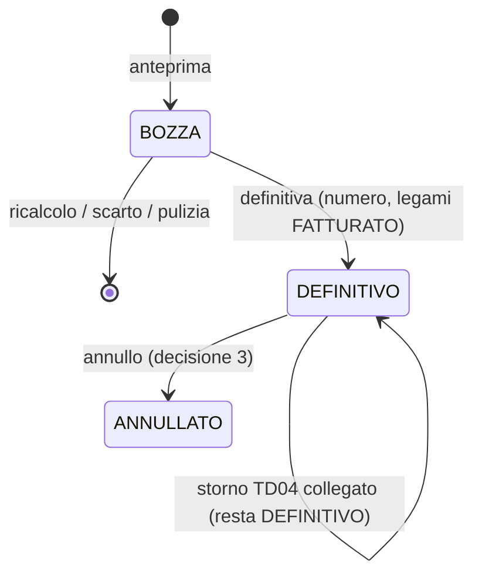
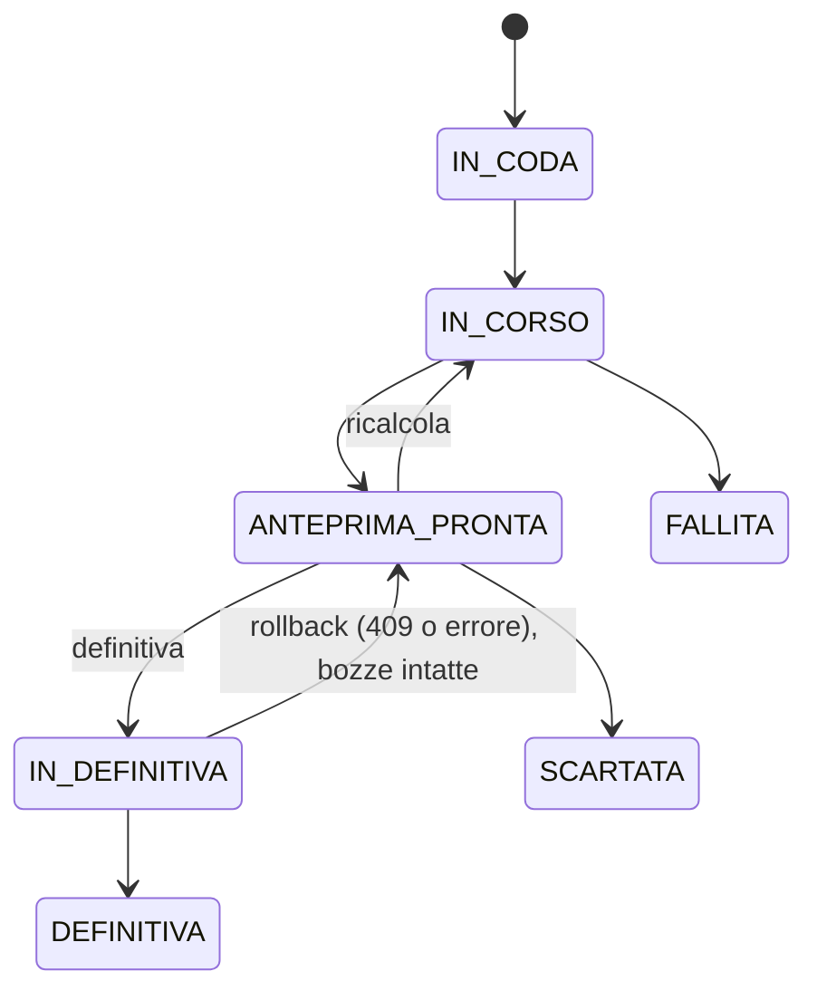
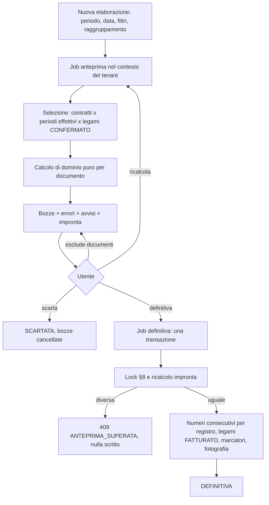

# Fase 4.4 — Valorizzazione per periodo ed export

**Data**: 2026-11-05
**Stato**: decisioni prese il 2026-11-05 (§19); approvata da Graziano il 2026-11-05
**Base**: `origin/master` `8e991f87` (4.3 e seguiti in produzione, sha-8e991f8), worktree `rifiuti-wt-rentri-registro`
**Origine**: roadmap `winwaste/docs/roadmap-fasi3-4-import-gestori.md` §4.4 (con §4.5, §6, §8, §9); WinWaste `fatturazione.md` §3-§8, `contabilita.md` §8, `fatturazione-provider-sdi.md`; spec e piano della 4.3; ledger `.superpowers/sdd/2026-11-03-fase4-3/progress.md` (decisioni 1-24).

Convenzioni del documento:
- «Decisione N della 4.3» = decisione di Graziano numerata nella spec o nel ledger della 4.3. È vincolante.
- «Scelta di chi scrive» (S1, S2, …) = scelta di progetto da confermare in revisione.
- «Decisione N» (senza «della 4.3») = decisione di Graziano del 2026-11-05, numerata nel §19. Le domande del §18 sono state decise.
- `schema` = `apps/backend/prisma/schema.prisma`. I percorsi `src/...` sono sotto `apps/backend/`. I `file:riga` sono verificati sul worktree.

---

## 1. Intento e perché

La 4.3 ha dato a ogni movimento fatturabile un legame. Il legame ha cliente, contratto, elenco e righe con quantità, prezzo, sconto e IVA congelati. Il legame ha uno stato, e `FATTURATO` è già previsto, ma nessuno lo scrive. La colonna `riferimento_fattura` è testo libero in attesa di una FK (`schema:3761-3813`). Oggi un gestore vede quanto deve fatturare movimento per movimento, ma non ha un documento, un numero né un file da dare al commercialista o al gestionale.

In WinWaste l'elaborazione periodica fa tutto in un passo (`fatturazione.md` §3):
1. seleziona contratti e movimenti;
2. costruisce la fattura con fissi, minimi, scaglioni, IVA, bollo e spese;
3. stampa in **non definitiva** quante volte serve;
4. in **definitiva** numera, registra e marca `NFATT` nella stessa transazione;
5. l'**annullo** cancella la registrazione e azzera i marcatori.

Lo fa con difetti noti:
- canoni fissi senza scadenze fatturati due volte (§8.1);
- definitiva non atomica fra un documento e l'altro (§8.2);
- lock su file non protetto (§8.3);
- importi come testo nella cultura italiana (§8.5).

La 4.4 costruisce questo passo, senza quei difetti. È l'opzione C della strategia: motore prezzi, valorizzazione ed export. L'emissione verso lo SDI è della 4.5. Con la 4.4 il gestore produce fatture numerate, valide contro l'XSD ufficiale FatturaPA, e le esporta in CSV, in XML e verso TeamSystem (4.4c); Zucchetti segue in un pezzo 4.4d. Le può inviare allo SDI col proprio intermediario finché la 4.5 non c'è. È la consegna «B poi C» della roadmap (§6.2).

Perché ora: la 4.3 è chiusa e la 4.3b ha fissato il contratto di dati (spec 4.3 §7.6). La 4.5 aspetta un XML già validato.

## 2. Obiettivi, non-obiettivi, anti-obiettivi

### Obiettivi

1. Un'**elaborazione** sceglie un periodo, una data documento e dei filtri (cliente, contratto, categoria, registro IVA). Produce un'**anteprima** (la «non definitiva» di WinWaste): documenti in bozza con righe, totali, errori e avvisi. L'anteprima è ripetibile e non scrive nulla sui legami.
2. La **definitiva** fa tutto in **una sola transazione**: numera i documenti per registro IVA e anno senza buchi, li rende immutabili e marca `FATTURATO` i legami e i marcatori degli addebiti. Un errore a metà non lascia nulla di scritto.
3. L'**annullo** di un documento ripristina i legami e i marcatori, nei limiti della decisione 3.
4. Il **calcolo** copre il caso comune (decisione 2): prezzo per quantità, sconti a cascata, prezzo speciale, fissi con scadenze, minimi, IVA per aliquota e natura, bollo, spese di incasso, split payment, scadenze di pagamento, arrotondamenti come WinWaste. Tutto in funzioni di dominio pure.
5. **Export**:
 - CSV generico;
 - XML FatturaPA validato contro l'XSD ufficiale prima di uscire;
 - adattatore TeamSystem nella 4.4c (file a record fissi); adattatore Zucchetti nella 4.4d, quando sono noti prodotto e ambiente di prova (decisioni 9 e 11);
 - copia di cortesia in PDF (decisione 10).
6. Gli **scostamenti** dopo la fattura (decisione 9 della 4.3, `scostamento_dopo_fattura`) hanno una lista e una regola (D7 della roadmap, decisione 1).
7. Tutto per tenant, con RLS FORCE e job per tenant (roadmap §9.7).

### Non-obiettivi

- **Invio allo SDI, notifiche, webhook, firma digitale**: 4.5. La 4.4 produce l'XML FPA12 non firmato e lo segnala.
- **Conservazione a norma**: pezzo successivo, con un conservatore unico per cliente (memoria `rifiuti-conservazione-decisioni`). La 4.4 salva però l'XML esatto e il suo `sha256`, che servono alla conservazione.
- **Prima nota, piano dei conti, scadenzario, RiBa, provvigioni maturate, ritenuta d'acconto, dichiarazione d'intento**: fuori ambito. Un contratto con ritenuta dà l'errore `RITENUTA_NON_GESTITA` (S14).
- **Famiglie di addebito** fuori dal perimetro della decisione 2: errore esplicito, mai un calcolo approssimato.
- **Clienti esteri** (IdFiscaleIVA non italiana, `XXXXXXX`), valute diverse da EUR, fatturazione da magazzino (`FATMAGAUTOMATICA`), fatturazione immediata e presa in carico (`WWNET63`, `WWNET21`).
- **Fatture libere** scritte a mano senza movimenti: non nella prima uscita. Restano solo le note di credito di storno (decisione 3).
- **Import dello storico fatture** da WinWaste: è della 3.8, che deve anche fissare il numero di partenza (S9).
- Nessuna modifica al registro, ai FIR, a RENTRI, al MUD, alle pese.

### Anti-obiettivi (cosa non deve mai succedere)

- **Mai un buco o un doppione nella numerazione** di un registro IVA in un anno. Neanche con definitive parallele, errori a metà, annulli o rollback.
- **Mai un legame `FATTURATO` senza documento definitivo**, né un documento definitivo senza i suoi legami marcati.
- **Mai fatturare due volte** lo stesso legame, la stessa scadenza di un fisso o lo stesso periodo di un canone.
- **Mai cambiare un documento definitivo**: né il listino, né «Aggiorna prezzi», né una rettifica del registro, né un cambio dell'anagrafica del cliente o del cedente. I dati di anagrafica stanno in una fotografia sul documento.
- **Mai bloccare il registro per la fatturazione.** Una rettifica di un movimento fatturato riesce sempre (decisione 9 della 4.3).
- **Mai un XML non valido fuori da WasteFlow.** L'XML che non passa l'XSD non si scarica.
- **Mai importi in `number`**: si usa `Prisma.Decimal` o una stringa decimale.
- **Mai una query fra più tenant** sulle tabelle di fatturazione.

## 3. Vincoli ereditati e scelte di chi scrive

### 3.1 Vincoli dalla 4.1-4.3 (vincolanti)

| Fonte | Vincolo per la 4.4 |
|---|---|
| 4.3, decisione 2 | Prezzi e sconti si leggono **congelati** dalle righe del legame. Il prezzo speciale (`prezzo_speciale = true`, `prezzo` nullo) lo calcola la 4.4. |
| 4.3, decisione 5 | Un legame `DA_COLLEGARE` o `PROPOSTO` del periodo **non si fattura** e **si elenca come errore**. Vale anche per i `MANCANTE`. |
| 4.3, decisione 7 | Il periodo si decide sulla `data_movimento` del legame. |
| 4.3, decisione 9 | La rettifica o l'annullo di un movimento fatturato non si blocca. Il legame segna `scostamento_dopo_fattura`. Il seguito (nota di credito o altro) spetta alla 4.4 (decisione 1). |
| 4.3, decisione 21 | Un legame rimasto indietro rispetto alla testa della catena (`DA_RIALLINEARE`) non si fattura e non si esclude (`lista-legami.service.ts:11-18`). |
| 4.3, decisioni 11 e 22 | Senza «fatturazione da» non esistono legami. La 4.4 non la rilegge: lavora solo sui legami esistenti. |
| 4.3, §7.6 | Si leggono solo i legami `CONFERMATO` con `fatturato_il IS NULL`. Si marca `FATTURATO` nella stessa transazione che numera. Righe del legame `FOR UPDATE` in ordine di `id`. |
| 4.3, §5.4 | Ordine dei lock del legame (`src/application/legami-movimento/lock-legame.ts:1-12`). La 4.4 non lo inverte (§8). |
| 4.2, D15 | I marcatori `GIAF`, `FACC`, `FDET`, `CFATT` non stanno sul listino. La 4.4 li scrive in una tabella sua. |
| 4.1, D4 | Si leggono i valori **del contratto**. Valori effettivi con `destinatarioEffettivo` e `contoCorrenteEffettivo` (`src/domain/contratti-cliente/regole-contratto-cliente.ts:619`, `:642`). |
| 4.1, D8 | `SOSPESO` = nessun documento. `SOSPESO_MOVIMENTI` = solo addebiti fissi. `BOZZA` e `ANNULLATO` = mai. |
| Roadmap §9 | Ogni tabella nuova ha `tenant_id` e la policy ENABLE+FORCE nella stessa migration. Le figlie hanno un `tenant_id` proprio. I job lavorano un tenant alla volta. |

### 3.2 Scelte di chi scrive (riepilogo, dettaglio nei paragrafi)

- **S1.** Le bozze dell'anteprima e i documenti definitivi stanno nella **stessa tabella** (`stato` BOZZA / DEFINITIVO / ANNULLATO). La definitiva aggiorna sul posto: niente copia, stesso codice per anteprima, PDF e XML (§4.3).
- **S2.** L'anteprima ha un'**impronta**: hash di legami, versioni del listino e del contratto. La definitiva la ricalcola sotto lock. Se non coincide: 409 `ANTEPRIMA_SUPERATA`, come in «Aggiorna prezzi» della 4.3 (§5.4).
- **S3.** **Una transazione per tutta la definitiva**, con un tetto di 500 documenti (§5.4).
- **S4.** **Trigger di immutabilità** sui documenti non in bozza e sulle loro righe (§4.12). È un'eccezione motivata al «nessun trigger» della 4.3, come il trigger delle causali della 4.3b.
- **S5.** La definitiva **non prende mai** il lock del registro, il lock consultivo per radice o `impostazioni_fatturazione FOR UPDATE` (§8).
- **S6.** L'annullo e lo storno rimettono i legami a `CONFERMATO` con `movimento_vigente_id` = il **movimento fatturato**. Se il registro è cambiato nel frattempo, la 4.3 li mostra `DA_RIALLINEARE` e li riallinea con il suo codice e i suoi lock (§5.5).
- **S7.** Il **cedente** sta in una tabella propria `cedente_fatturazione`, non sulla riga `impostazioni_fatturazione` che la 4.3 blocca `FOR SHARE` a ogni registrazione (§4.9).
- **S8.** Anteprima e definitiva girano come **job BullMQ per tenant** nel contesto dell'azienda, col ruolo applicativo e senza `BYPASSRLS` (§9).
- **S9.** **Numero di partenza** per registro e anno: un amministratore lo imposta finché in quella coppia non esiste un definitivo. Serve a chi arriva da WinWaste a metà anno (§4.6).
- **S10.** Una riga di documento per ogni riga di legame (una per movimento e per addebito), come WinWaste senza raggruppamento delle bolle. Le fasce del prezzo speciale a periodo sono righe aggregate (§6.3).
- **S11.** Serializzatore XML **proprio** e puro, nell'ordine delle sequenze dell'XSD, con normalizzazione dei testi all'insieme di caratteri ammesso. Validazione XSD con `xmllint-wasm` (nessuna dipendenza nativa) (§7.2).
- **S12.** Contropartite e codici del gestionale in una **tabella di mappature per adattatore**, non in colonne del listino (§7.3).
- **S13.** Arretrati: un'opzione dell'elaborazione, spenta di default, include i legami `CONFERMATO` non fatturati con data anteriore al periodo. Spenta, l'anteprima li conta come avviso (§5.2).
- **S14.** Ritenuta d'acconto, dichiarazione d'intento e provvigioni maturate non sono gestite: errore o assenza esplicita (§6.13).
- **S15.** Spese di incasso: importo della spesa × numero delle rate della condizione di pagamento. Da verificare su un'estrazione reale (§6.8).
- **S16.** Il bollo si **dichiara** sempre quando è dovuto (`DatiBollo`). Si **addebita** al cliente solo se il contratto ha una spesa di bollo (§6.9).
- **S17.** I **legami esclusi** dalla decisione 5 non bloccano il documento del loro contratto: il documento ha l'avviso `MOVIMENTI_DA_COLLEGARE_ESCLUSI` con il numero dei movimenti esclusi.
- **S18.** Il **CSV non rende «emesso»** un documento: non è un file da inviare allo SDI né al gestionale (§7.1).
- **S19.** Un documento **misto** (movimenti e canoni) è `TD24` se contiene almeno una riga `MOVIMENTO`; `TD01` solo se ha soli canoni o altri addebiti senza movimenti (§6.14).
- **S20.** Uno **storno con `rifatturabile = false`** lascia i legami `FATTURATO` e registra l'eventuale scostamento come **gestito**, con la nota «storno documento N» (§5.6).
- **S21.** Il **CSV si allinea a `exportToCsv`** di audit (§7.1).

## 4. Modello dati

Principio: **nessuna colonna nuova su `waste_movements`**. Le tabelle nuove hanno RLS FORCE nella stessa migration. Sulle tabelle esistenti si aggiungono solo colonne nullable o con default, unici e FK.

### 4.1 Panoramica

| Tabella | Nuova / modificata | Ruolo |
|---|---|---|
| `cedente_fatturazione` | nuova | dati del cedente che la tabella `tenants` non ha, registro predefinito |
| `numerazioni_fattura` | nuova | contatore per (tenant, registro IVA, anno) |
| `elaborazioni_fatturazione` | nuova | il lotto: parametri, stato, impronta, job |
| `documenti_fattura` | nuova | testata: bozza, definitivo, annullato |
| `righe_documento_fattura` | nuova | `DettaglioLinee` |
| `riepiloghi_iva_documento` | nuova | `DatiRiepilogo` per aliquota e natura |
| `rate_documento_fattura` | nuova | `DettaglioPagamento` |
| `marcatori_addebiti_fatturati` | nuova | scadenze dei fissi, periodi dei canoni, conguagli, acconti (D15 della 4.2) |
| `contatori_file_fatturapa` | nuova | progressivo univoco del nome file per tenant |
| `mappature_export_contabile` | nuova (4.4c) | codici dell'adattatore |
| `credenziali_export_contabile` | nuova (4.4d) | credenziali cifrate per tenant e adattatore via API (§7.3) |
| `legami_movimento` | modificata | `documento_id` più le colonne della presa d'atto dello scostamento |
| `spese_accessorie` | modificata | `codice_iva_id` (aliquota e natura della spesa, rimandate dalla 4.1 D23) |
| `registri_iva` | modificata | `suffisso_numero` facoltativo |

Le tabelle nuove sono 11: 9 nascono nella 4.4a, `mappature_export_contabile` nella 4.4c e `credenziali_export_contabile` nella 4.4d. Il conteggio di `rls-catalogo.postgres.spec.ts` sale di conseguenza. Il valore finale lo fissa il costruttore sul master del rilascio.

### 4.2 `elaborazioni_fatturazione`

| Colonna | Tipo | Note |
|---|---|---|
| `id`, `tenant_id` | uuid | RLS |
| `stato` | enum `stato_elaborazione_fatturazione` | `IN_CODA`, `IN_CORSO`, `ANTEPRIMA_PRONTA`, `IN_DEFINITIVA`, `DEFINITIVA`, `FALLITA`, `SCARTATA` |
| `periodo_dal`, `periodo_al` | date | estremi inclusi, sul giorno italiano |
| `data_documento` | date | unica per tutti i documenti dell'elaborazione |
| `filtri` | jsonb | clienti, contratti, categorie, tipi, registri IVA. Validato dal DTO, mai interpretato dal database |
| `raggruppamento` | enum | `PER_CONTRATTO` / `PER_ELENCO` (decisione 5) |
| `includi_arretrati` | boolean default false | S13 |
| `impronta` | varchar(64) null | S2, calcolata alla fine dell'anteprima |
| `riepilogo` | jsonb null | conteggi di documenti, errori e avvisi e totali, per la lista |
| `errori_generali` | text[] | per esempio `CEDENTE_INCOMPLETO` |
| `job_id` | varchar null | BullMQ |
| `avviata_da`, `definita_da`, `definita_il` | uuid, uuid, timestamp null | |
| `errore_tecnico` | varchar(200) null | messaggio senza dati personali in caso di `FALLITA` |
| `versione`, `created_at`, `updated_at` | | lock ottimistico |

Indice `(tenant_id, stato, created_at)`. Al massimo **un'elaborazione per tenant** in `IN_CORSO` o `IN_DEFINITIVA`: indice unico parziale `(tenant_id) WHERE stato IN ('IN_CORSO','IN_DEFINITIVA')`. La clausola sta solo nella migration, come `NULLS NOT DISTINCT` della 4.2. Le anteprime pronte possono essere più di una.

### 4.3 `documenti_fattura` (testata)

| Colonna | Tipo | Note |
|---|---|---|
| `id`, `tenant_id` | uuid | |
| `elaborazione_id` | uuid null | null per una nota di credito di storno (§5.6) |
| `stato` | enum `stato_documento_fattura` | `BOZZA`, `DEFINITIVO`, `ANNULLATO` |
| `emesso_il` | timestamp null | decisioni 4 e 12. Dopo l'emissione niente annullo, solo storno |
| `tipo_documento` | varchar(4) | `TD01`, `TD04`, `TD24` (decisione 8) |
| `registro_iva_id` | uuid | FK `(registro_iva_id, tenant_id)` NoAction |
| `anno` | smallint | anno della `data_documento` |
| `numero` | int null | null in bozza. Assegnato dalla definitiva |
| `numero_testo` | varchar(20) null | `numero` più `suffisso_numero` del registro (S9, §4.10). È il `Numero` dell'XML |
| `data_documento` | date | |
| `cliente_id`, `cliente_fatturazione_id`, `contratto_id`, `elenco_id` | uuid | `elenco_id` solo con `PER_ELENCO`. FK composte NoAction. Rendono «in uso» cliente e contratto |
| `periodo_dal`, `periodo_al` | date | periodo effettivo del contratto (§5.2) |
| `formato_trasmissione` | varchar(5) | `FPR12` / `FPA12` |
| `codice_destinatario`, `pec_destinatario` | varchar | valori effettivi |
| `esigibilita_iva` | `esigibilita_iva` | dal contratto |
| `totale_imponibile`, `totale_iva`, `totale_documento`, `netto_a_pagare` | numeric(14,2) | Lo split payment toglie l'IVA dal netto |
| `bollo_dovuto` | boolean | |
| `importo_bollo` | numeric(6,2) null | |
| `fotografia` | jsonb | cedente, cessionario (ditta, sede, persona fisica), pagamento, conto, testo di fatturazione, CIG, CUP, `IdDocumento`. Scritta in bozza, riscritta e congelata alla definitiva |
| `documento_origine_id` | uuid null | per `TD04`: il documento stornato (`DatiFattureCollegate`) |
| `errori`, `avvisi` | text[] | insiemi chiusi (§6.13). Un documento con `errori` non vuoti non diventa definitivo |
| `escluso_da_definitiva` | boolean default false | l'utente toglie il documento dall'elaborazione |
| `xml`, `xml_sha256`, `xml_generato_il` | bytea, varchar(64), timestamp null | scritti alla prima generazione (§7.2), poi immutabili |
| `progressivo_file` | varchar(5) null | unico per tenant (§7.2) |
| `definito_da`, `definito_il`, `annullato_da`, `annullato_il`, `motivo_annullo` | | `motivo_annullo` da 1 a 200 caratteri dopo trim |
| `versione`, `created_at`, `updated_at` | | |

Vincoli:
- Unico parziale `(tenant_id, registro_iva_id, anno, numero) WHERE stato = 'DEFINITIVO'`. Un numero annullato secondo la decisione 3 si riusa.
- CHECK:
- `stato = 'BOZZA'` ⇔ `numero IS NULL`;
- `stato <> 'BOZZA'` ⇒ `errori = '{}'`;
- `stato = 'ANNULLATO'` ⇒ `motivo_annullo` presente;
- `tipo_documento = 'TD04'` ⇒ `documento_origine_id` presente;
- `emesso_il IS NOT NULL` ⇒ `stato <> 'BOZZA'`.
- Unico `(tenant_id, progressivo_file)` dove non nullo.
- Indici: `(tenant_id, stato, data_documento)`, `(tenant_id, cliente_fatturazione_id)`, `(tenant_id, elaborazione_id)`.

### 4.4 `righe_documento_fattura`

| Colonna | Tipo | Note |
|---|---|---|
| `id`, `tenant_id`, `documento_id` | uuid | FK `(documento_id, tenant_id)` CASCADE. La cancellazione la permette solo il trigger e solo sulle bozze |
| `numero_linea` | int | 1..n, unico per documento |
| `tipo_riga` | enum | `MOVIMENTO`, `FASCIA_SPECIALE`, `FISSO`, `MINIMO`, `SPESA_INCASSO`, `BOLLO`, `STORNO` |
| `legame_id`, `riga_legame_id` | uuid null | per `MOVIMENTO`. FK composte NoAction |
| `movimento_fatturato_id` | uuid null | `movimento_vigente_id` del legame alla definitiva (S6) |
| `riga_addebito_id` | uuid null | FK `(riga_addebito_id, tenant_id)` NoAction. Rende «in uso» la riga di listino |
| `descrizione` | varchar(1000) | testo già normalizzato per l'XML |
| `data_movimento`, `cer_code`, `numero_fir` | | per descrizione, CSV e `AltriDatiGestionali` |
| `quantita` | numeric(14,3) null | |
| `unita_misura` | varchar(10) null | |
| `prezzo_unitario` | numeric(14,6) | |
| `sconto` | varchar(20) null | formula a cascata |
| `importo_lordo`, `importo_sconto`, `prezzo_totale` | numeric(14,2) | |
| `codice_iva_id`, `aliquota_iva`, `natura_iva` | | congelati |

La riga porta l'importo, a differenza del legame che non lo salva (4.3 §4.3). Motivo: la riga di un documento definitivo è un dato fiscale emesso, non un derivato da ricalcolare.

### 4.5 `riepiloghi_iva_documento` e `rate_documento_fattura`

- **Riepilogo**: `(documento_id, aliquota, natura)` unico, `imponibile`, `imposta`, `esigibilita`, `riferimento_normativo` varchar(100) null (descrizione del codice IVA per le nature).
- **Rate**: `(documento_id, ordine)` unico, `modalita` (MP01-MP23), `data_scadenza`, `importo`, `istituto`, `iban`, `abi`, `cab`, `bic`. ABI e CAB si ricavano dall'IBAN italiano (rimando della 4.1 D21).

### 4.6 `numerazioni_fattura`

Chiave primaria `(tenant_id, registro_iva_id, anno)`. Colonne `ultimo_numero int NOT NULL DEFAULT 0`, `ultima_data date null`, `numero_partenza int NOT NULL DEFAULT 0`, `versione`.

- La riga nasce con `INSERT … ON CONFLICT DO NOTHING` e poi si blocca `FOR UPDATE`. Solo la definitiva, l'annullo e lo storno la toccano.
- **Numero di partenza** (S9). `PUT` di `numero_partenza` e `ultima_data` è ammesso solo se non esiste un `DEFINITIVO` o un `ANNULLATO` di WasteFlow in quella coppia. Effetto: `ultimo_numero := numero_partenza`, audit. Il primo numero di WasteFlow è `numero_partenza + 1`.
- **Invariante senza buchi**: per ogni (registro, anno), i numeri dei `DEFINITIVO` sono esattamente `numero_partenza+1 .. ultimo_numero`. Nessun CHECK lo può esprimere. Lo verificano un test Postgres (§15) e una sonda di `system-health` che conta le violazioni per tenant, senza dati personali.
- **Ordine delle date**: `data_documento ≥ ultima_data` della coppia. Altrimenti errore generale `DATA_ANTERIORE_ULTIMA_FATTURA` (come `controllanumerazione` di WinWaste, `fatturazione.md` §3.1).

### 4.7 `marcatori_addebiti_fatturati` (D15 della 4.2)

| Colonna | Note |
|---|---|
| `tenant_id`, `riga_addebito_id` | FK NoAction |
| `tipo` | `SCADENZA_FISSO`, `PERIODO_CANONE` (decisione 6), `CONGUAGLIO`, `ACCONTO_FATTURATO`, `ACCONTO_DETRATTO` |
| `chiave_competenza` | varchar(25): `AAAA-MM-GG` della scadenza, oppure `AAAA-MM-GG/AAAA-MM-GG` del periodo |
| `documento_id`, `riga_documento_id` | FK NoAction |

Unico `(tenant_id, riga_addebito_id, tipo, chiave_competenza)`. La definitiva inserisce i marcatori: una violazione dell'unico vuol dire doppia fatturazione e dà 409 con rollback totale. L'annullo e lo storno li cancellano. Il fatto resta nell'audit.

`uso-listino.ts` aggiunge le sorgenti `righeDocumento` e `marcatori`, come la 4.3 ha fatto con `righeLegame`.

### 4.8 Collegamento ai legami

Colonne additive su `legami_movimento`:
- `documento_id uuid null`, FK `(documento_id, tenant_id)` → `documenti_fattura`, NoAction;
- `scostamento_gestito_il timestamp null`, `scostamento_gestito_da uuid null`, `scostamento_nota varchar(200) null` (decisione 1).

CHECK aggiunti, con `NOT VALID` e poi `VALIDATE` come nella 4.3:
- `(stato = 'FATTURATO') = (documento_id IS NOT NULL)`. In produzione non esistono legami `FATTURATO`, quindi il `VALIDATE` passa. `IMPORTATO_FATTURATO` resta senza documento;
- `scostamento_gestito_il IS NOT NULL` ⇒ `scostamento_dopo_fattura`.

`riferimento_fattura` resta e prende il testo «`numero_testo` del `gg/mm/aaaa`» per le viste esistenti della 4.3.

### 4.9 `cedente_fatturazione` (S7)

Una riga per tenant, unico `tenant_id`.

| Colonna | Note |
|---|---|
| `regime_fiscale` | RF01-RF20, secondo l'enumerazione dell'XSD vigente |
| `rea_ufficio` | sigla della provincia. Il numero REA è `tenants.rea_number`, già usato dal MUD |
| `capitale_sociale` | numeric(15,2) null |
| `socio_unico` | `SU` / `SM` / null |
| `stato_liquidazione` | `LN` / `LS`, default `LN` |
| `registro_iva_predefinito_id` | uuid null, per i contratti senza registro |
| `id_trasmittente_codice` | varchar(28) null. Vuoto = partita IVA del cedente. La 4.5 lo sovrascrive col provider |
| `versione`, `modificato_da` | |

P.IVA, codice fiscale, ragione sociale e indirizzo si leggono da `tenants` (`schema:31-50`) e si mostrano in sola lettura. Se manca l'indirizzo (nullable dal signup), l'elaborazione dà l'errore generale `CEDENTE_INCOMPLETO`.

### 4.10 Colonne additive

- `spese_accessorie.codice_iva_id uuid null`, FK NoAction. Senza codice IVA, una spesa che si applica dà l'errore `SPESA_SENZA_CODICE_IVA`.
- `registri_iva.suffisso_numero varchar(10) null` (per esempio `/A`). Non modificabile se il registro ha già un definitivo nell'anno in corso (409).

### 4.11 Stati





Legame: `CONFERMATO → FATTURATO` alla definitiva. `FATTURATO → CONFERMATO` all'annullo o allo storno totale (S6). Le due transizioni erano già previste dalla 4.3 (§4.4).

### 4.12 Immutabilità (S4)

Trigger `BEFORE UPDATE OR DELETE` su `documenti_fattura`, `righe_documento_fattura`, `riepiloghi_iva_documento` e `rate_documento_fattura`. Le figlie seguono lo stato della testata.
- **DELETE** ammesso solo per le bozze.
- **UPDATE** di una testata non in bozza ammesso solo su `stato` (DEFINITIVO → ANNULLATO), `annullato_*`, `motivo_annullo`, `emesso_il`, `xml*`, `progressivo_file` (da null a valore, una volta sola), `versione` e `updated_at`.
- Le figlie di un documento non in bozza non si modificano.

Motivo: il documento è un atto fiscale. Il registro ha la stessa protezione per un'altra via (`entryHash` e niente `UPDATE`). La migration ha il rollback con `DROP TRIGGER`.

### 4.13 RLS

Ogni tabella nuova ha `tenant_id`, `ENABLE` e `FORCE ROW LEVEL SECURITY` nella stessa migration, con le due policy standard (`README-tenant-transazione.md:150-165`). Va anche nei modelli per tenant dell'estensione Prisma e nella relazione di `Tenant`. Le figlie hanno un `tenant_id` proprio.

## 5. Flusso



### 5.1 Avvio

`POST /elaborazioni-fatturazione` controlla:
- `periodo_dal ≤ periodo_al`;
- l'intervallo non attraversa l'anno solare (come WinWaste, per le regole a periodo);
- `data_documento` non futura e ≥ `periodo_al` (scelta di chi scrive: una fattura non precede le sue operazioni);
- il cedente è completo;
- nessun'altra elaborazione del tenant è `IN_CORSO` o `IN_DEFINITIVA`.

Crea la riga `IN_CODA` e accoda il job. Risponde 202 con l'id. La UI interroga `GET /:id`.

### 5.2 Selezione

Per i **contratti** del tenant che passano i filtri:

1. Stato: `ATTIVO` entra. `SOSPESO_MOVIMENTI` entra solo con gli addebiti fissi (avviso `MOVIMENTI_SOSPESI`). `SOSPESO` dà l'errore `CONTRATTO_SOSPESO` (documento non generato ma elencato). `BOZZA` e `ANNULLATO` non entrano. Un contratto principale ha validità che interseca il periodo.
2. **Periodo effettivo**: con periodi di fatturazione, `periodoDaFatturare` (`src/domain/contratti-cliente/periodi-fatturazione.ts:148`) decide se una fine di periodo cade nell'intervallo, e il periodo del contratto sostituisce quello digitato (regola 4 di WinWaste, `fatturazione.md` §6). Nessuna fine nell'intervallo: il contratto non entra (informazione, non errore). Senza periodi vale l'intervallo digitato.
3. **Allegati** (`contrattoPrincipaleId`): confluiscono nel documento del principale (decisione 5).

Per i **legami** di ciascun contratto:
- `stato = 'CONFERMATO'`, `fatturato_il IS NULL`, `data_movimento` nel periodo effettivo (con S13 anche prima, fino a «fatturazione da»);
- `movimento_vigente_id` = testa della catena. Un legame indietro è `DA_RIALLINEARE`: errore, non fatturato (decisione 21).

**Errori del periodo** (decisione 5): legami `DA_COLLEGARE`, `PROPOSTO`, `MANCANTE` e `DA_RIALLINEARE` con data nel periodo. Si leggono riusando il frammento SQL di `ListaLegamiService` (`sqlCandidati`, `sqlGiornoMovimento`), senza duplicarlo:
- quelli con contratto si attribuiscono al documento come avviso (S17);
- quelli senza contratto vanno negli errori generali dell'elaborazione, con il link alla pagina «Da collegare» filtrata.

La selezione è in sola lettura: nessun lock, un'istantanea `REPEATABLE READ` per job.

### 5.3 Anteprima (non definitiva)

Per ogni documento (contratto, o contratto ed elenco) il servizio legge i dati e chiama il **calcolo puro** (§6). Scrive bozze, righe, riepiloghi, rate, `errori` e `avvisi`.
- Le bozze di un ricalcolo **sostituiscono** le precedenti della stessa elaborazione (DELETE e INSERT in una transazione).
- Alla fine scrive l'**impronta** (S2): sha256 delle coppie `(legame.id, legame.versione)` in ordine di id, più `(contratto.id, versione)`, `(elenco.id, versione)`, `(riga_addebito.id, versione)` e `(codice_iva.id, versione)` usati, più parametri e filtri. Come `improntaVariazione` (`src/domain/listino/variazione-prezzi.ts:180`).
- Numerazione prevista per registro: «da 15/A a 42/A». Solo informazione, nessuna riserva.
- Il riepilogo mostra documenti, totali per registro, errori (bloccanti per il documento) e avvisi.
- L'utente può **escludere** un documento dalla definitiva (`escluso_da_definitiva`) e riammetterlo. I legami restano per la prossima elaborazione. Per togliere un singolo movimento si usa «Escludi dalla fatturazione» della 4.3.
- **Pulizia**: un cron giornaliero cancella le bozze delle elaborazioni `SCARTATA` o `FALLITA` più vecchie di 7 giorni e delle `ANTEPRIMA_PRONTA` più vecchie di 30. Per tenant, nel suo contesto (§9).

### 5.4 Definitiva

`POST /elaborazioni-fatturazione/:id/definitiva` con `impronta` e `versione`. Accoda il job e risponde 202. Il job apre **una transazione** (S3). Opzioni: `impostaTimeoutLock` (5 s), timeout della transazione 120 s, `statement_timeout`.

1. Elaborazione `FOR UPDATE`. Deve essere `ANTEPRIMA_PRONTA` con la stessa `versione`, poi passa a `IN_DEFINITIVA`. Un secondo clic riceve 409 `ELABORAZIONE_GIA_IN_DEFINITIVA`.
2. Numerazioni dei registri coinvolti: `INSERT … ON CONFLICT DO NOTHING`, poi `FOR UPDATE` in ordine di `registro_iva_id`.
3. Contratti `FOR SHARE` in ordine di id. Elenchi e righe di listino usate `FOR SHARE` in ordine di id (`bloccaListinoInCondivisione`, `lock-legame.ts`).
4. Testate dei legami `FOR UPDATE` in ordine di id, poi righe dei legami (`bloccaRigheLegame`). Con `joinLineari(tx)` e `JOIN unnest`.
5. Rilettura e **ricalcolo dell'impronta** sotto lock. Se diversa: rollback, la riga torna `ANTEPRIMA_PRONTA` (seconda transazione breve) e la risposta del job è `ANTEPRIMA_SUPERATA` con le differenze contate (legami nuovi, cambiati, fatturati da altri). Le bozze restano.
6. Ricalcolo puro dei documenti non esclusi e senza errori. Deve dare gli stessi importi delle bozze. In caso di differenza: errore interno, rollback, segnalazione. Non dovrebbe mai succedere.
7. Ordine deterministico: registro, cliente di fatturazione (ragione sociale, poi id), numero di contratto, codice dell'elenco. Numeri `ultimo_numero + 1 …` per registro. `ultima_data := data_documento`.
8. Scritture, tutte con `UPDATE … FROM unnest(...)` (vietati i cicli di UPDATE singoli):
 - documenti: `stato = DEFINITIVO`, numero, `numero_testo`, fotografia riletta sotto lock;
 - legami: `FATTURATO`, `fatturato_il`, `documento_id`, `riferimento_fattura`;
 - `movimento_fatturato_id` sulle righe;
 - `INSERT` dei marcatori;
 - documenti con errori o esclusi: restano in bozza per un nuovo giro.
9. Elaborazione `DEFINITIVA`. Audit: una riga per documento (id, numero, totale) e una per l'elaborazione.

Un errore in qualunque passo annulla tutto: nessun numero consumato, nessun legame marcato. È l'anti-obiettivo della roadmap §4.4 e il rimedio al difetto §8.2 di WinWaste. Il tetto di 500 documenti è una costante: oltre, 400 `TROPPI_DOCUMENTI` e l'utente divide con i filtri. Il costruttore la tara con il test di volume (§15).

### 5.5 Annullo (S6, decisione 3)

`POST /documenti-fattura/:id/annulla` con `motivo` e `versione`. Per la decisione 3 è ammesso solo se il documento è `DEFINITIVO`, non emesso (`emesso_il` nullo) e ha il numero uguale a `ultimo_numero` della sua coppia.

Una transazione:
1. numerazione `FOR UPDATE`;
2. documento `FOR UPDATE`;
3. testate e righe dei legami del documento `FOR UPDATE` in ordine di id;
4. documento `ANNULLATO`;
5. `ultimo_numero := ultimo_numero - 1`, `ultima_data` := data del definitivo precedente (o la data di partenza);
6. marcatori del documento cancellati;
7. legami a `CONFERMATO`: `fatturato_il`, `documento_id` e `riferimento_fattura` nulli, `scostamento_dopo_fattura` falso, `scostamento_gestito_*` nulli, `movimento_vigente_id := movimento_fatturato_id` della riga;
8. audit.

Effetto del passo 7: i valori congelati delle righe del legame descrivono il movimento fatturato. Se il registro è andato avanti, il legame è «indietro» e la pagina «Da collegare» della 4.3 lo mostra `DA_RIALLINEARE`. L'azione «Riallinea» della 4.3 lo riporta alla testa con i suoi lock e le sue regole (`esitoCorrezione`): nuova quantità, cambio di CER, annullo, causale. La 4.4 non riscrive quella logica e non prende il lock per radice.

### 5.6 Nota di credito di storno (decisioni 3 e 1)

`POST /documenti-fattura/:id/storno` con `motivo`, `data_documento` e `rifatturabile`.

- Crea un `TD04` `DEFINITIVO` sullo stesso registro, con il numero successivo e le stesse righe, gli stessi riepiloghi e le stesse rate. Gli importi restano positivi: è il tipo documento a dare il segno, come richiede la FatturaPA. `DatiFattureCollegate` punta al documento d'origine.
- Con `rifatturabile = true`: legami e marcatori del documento d'origine si ripristinano come al §5.5 passo 7. Con `false` restano `FATTURATO`: il ricavo è stornato e non si rifattura. Per i legami con `scostamento_dopo_fattura` lo scostamento si registra come **gestito** (`scostamento_gestito_*`, nota «storno documento N»): la nota di credito è la sua risposta (S20).
- Lock: numerazione → documento d'origine `FOR UPDATE` → legami.
- Un documento ha al più uno storno totale. Unico parziale su `documento_origine_id` per i `TD04` non annullati.
- Storni parziali e note libere: non nella prima uscita.

### 5.7 Scostamenti dopo la fattura (D7 della roadmap, decisione 1)

**Fatto.** La 4.3 imposta `scostamento_dopo_fattura` quando un movimento fatturato viene rettificato o annullato (`legami-correzioni.ts:17-19`). La fattura non cambia.

**Lista «Scostamenti»** (`GET /scostamenti-fattura`), con i legami `FATTURATO` con scostamento non gestito. Per ciascuno:
- documento, numero e data;
- quantità e importo fatturati, dalle righe del documento;
- valore attuale, ricalcolato dalla testa della catena col prezzo congelato (funzione pura, sola lettura). Per una riga a prezzo speciale si mostra solo la differenza di quantità;
- il tipo di correzione: rettifica, annullo, cambio di CER o di causale.

**Regola (decisione 1).** Due rimedi:
- **presa d'atto** con nota obbligatoria (`POST /legami-movimento/:id/presa-atto-scostamento`, colonne del §4.8): chiude lo scostamento senza documento;
- **storno totale e rifatturazione** del documento (§5.6, `rifatturabile = true`), poi una nuova elaborazione dopo il riallineamento.

## 6. Calcolo

### 6.1 Principi

- Dominio puro in `src/domain/fatturazione/` (calcolo, IVA, bollo, rate, controlli SDI, serializzazione XML), senza database. Il servizio legge, chiama, scrive.
- Riuso senza riscrittura:
- `importoRiga`, `scontoCascata`, `arrotonda2` (`src/domain/listino/importi-riga.ts:83`, `:72`, `:23`);
- `applicaScaglioni` e `validaPrezzoSpeciale` (`prezzo-speciale.ts:288`, `:173`);
- `scadenzeNelPeriodo` e `periodoCompetenza` (`scadenze-fisse.ts:257`, `:229`);
- `periodoDaFatturare`;
- `destinatarioEffettivo` e `contoCorrenteEffettivo`;
- le funzioni dei codici IVA.
- Importi come stringhe decimali o `Prisma.Decimal`. Arrotondamento a metà per eccesso in valore assoluto, la porta di `Format("0.00")` di WinWaste (`importi-riga.ts:19`).
- Ogni regola ha test con esempi presi da `fatturazione.md` §4, per esempio la tabella a scaglioni A/D di §4.5 (470,00 e 300,00).

### 6.2 Righe dai legami (prezzo singolo)

Per ogni riga del legame con `prezzo_speciale = false`: `importoRiga(quantita, prezzo, sconto)`. Il lordo è arrotondato prima dello sconto, lo sconto a parte, come WinWaste (`fatturazione.md` §4.7). Una riga senza quantità o senza prezzo in un legame `CONFERMATO` è un'anomalia: errore `RIGA_LEGAME_INCOMPLETA`, che la 4.3 dovrebbe già rendere impossibile.

Descrizione: descrizione della riga, poi «CER `cer` del `data`», poi «FIR `numero`» se c'è. Il numero del FIR va anche in `AltriDatiGestionali` (`TipoDato` `FIR`).

### 6.3 Prezzo speciale (decisione 2)

- **`DOCUMENTO`**: `applicaScaglioni` sulla quantità del singolo legame, una riga per fascia raggiunta.
- **`PERIODO`**: somma delle quantità delle righe del legame con la stessa riga di listino nel documento, con la stessa UM (altrimenti errore `UM_NON_UNIVOCA`). Poi `applicaScaglioni` e una riga `FASCIA_SPECIALE` per fascia. Le fasce citano la riga di listino. I legami sono collegati alla fattura tramite `documento_id`.
- **`PROGRESSIVO_DA_DATA`, `CONGUAGLIO_365`, `GIORNO`, condizionati (`condizione`, `condizioniRiferite`), `specialegamma`**: fuori dalla decisione 2. Errore `FAMIGLIA_NON_CALCOLATA` con il nome della regola.

### 6.4 Addebiti fissi `F`

- **Con scadenze**: una riga `FISSO` per ogni scadenza di `scadenzeNelPeriodo` dentro il periodo effettivo e le date del contratto, senza marcatore `SCADENZA_FISSO`. Descrizione con `periodoCompetenza`. Anche le scadenze dell'anno precedente non fatturate (come il tag `5` di WinWaste): fino all'inizio del contratto, al più 12 mesi indietro (scelta di chi scrive).
- **Senza scadenze** (decisione 6): una riga per periodo effettivo con il marcatore `PERIODO_CANONE` sulla chiave `dal/al`. Due elaborazioni sullo stesso periodo non lo fatturano due volte (difetto A di WinWaste chiuso). Due periodi che si sovrappongono parzialmente: errore `CANONE_PERIODO_SOVRAPPOSTO`.
- `quantita_fissa` vuota = 1, zero = non fatturare (`fatturazione.md` §4.1).
- `SOSPESO_MOVIMENTI`: entrano solo queste righe.

### 6.5 Minimi (decisione 2)

- **Minimo di riga** (`minimo_fatturabile`): se l'importo netto della riga è inferiore, si aggiunge «Differenza per minimo fatturabile». Con `minimo_per_categoria` il confronto va sulla somma della categoria (`fatturazione.md` §4.6).
- **`MW`, `MF`, `M`+categoria**: minimo sul documento, sulle righe CER o sulle righe della categoria. Si aggiunge la differenza (riga `MINIMO`).
- **`T…`, `N…`, `$A`, `$D`, `$R`**: errore `FAMIGLIA_NON_CALCOLATA` (decisione 2).

### 6.6 Famiglie non calcolate

Un documento che contiene una riga di listino di una famiglia non calcolata non diventa definitivo (errore). Nessun calcolo parziale. L'errore dice quale riga e quale famiglia. Il calcolo puro dichiara l'insieme delle famiglie supportate in una costante con un test di guardia: ampliarlo è un cambio esplicito.

### 6.7 IVA

- Imponibile per coppia `(aliquota, natura)`: somma dei `prezzo_totale` delle righe.
- Imposta = `arrotonda2(imponibile × aliquota / 100)` **sul totale per aliquota**, come WinWaste (`fatturazione.md` §4.7).
- Natura con aliquota zero, vietata altrimenti: già garantita dai codici IVA della 4.2. Nature generiche `N2`, `N3`, `N6`: errore `NATURA_NON_AMMESSA` (difetto 9 di WinWaste).
- `RiferimentoNormativo` = descrizione del codice IVA (≤ 100).
- Esigibilità sul riepilogo: `I`, `D` o `S` dal contratto.

### 6.8 Spese di incasso (S15)

Con `speseIncassoId` sul contratto (se assente, del cliente, come in D4 della 4.1): una riga `SPESA_INCASSO`. Importo = importo della spesa × numero delle rate. Codice IVA da `spese_accessorie.codice_iva_id`. Una spesa a zero non genera la riga.

### 6.9 Bollo (S16)

- **Dovuto** se la somma degli imponibili con natura nell'insieme dei casi soggetti a bollo supera 77,47 €. L'insieme (N1, N2.1, N2.2, N3.5, N3.6, N4) è una costante di dominio con fonte (DPR 642/1972, tariffa art. 13) e va confermato da un commercialista (§17).
- Dovuto: `DatiBollo` con `BolloVirtuale = SI` e `ImportoBollo = 2.00` (costante con data di validità).
- **Addebito** al cliente come riga `BOLLO` solo se il contratto ha una spesa `BOLLO`. Il suo codice IVA deve avere natura N1 (escluso art. 15), altrimenti errore.
- Senza spesa: bollo dichiarato e non addebitato, avviso `BOLLO_NON_ADDEBITATO`.

### 6.10 Split payment ed esigibilità

- `SCISSIONE`: l'IVA si calcola e si dichiara (`EsigibilitaIVA = S`). Il `netto_a_pagare` e le rate escludono l'IVA.
- `DIFFERITA`: `D`, nessun effetto sugli importi.
- Pagamento in contanti (MP01) con split o differita: errore `PAGAMENTO_NON_AMMESSO` (`fatturazione.md` §4.7).

### 6.11 Scadenze di pagamento

Da `CondizionePagamento` (modalità, `giorniRate`, `fineMese`):
- `CondizioniPagamento` = `TP02` con una rata, `TP01` con più rate;
- data = `data_documento` + giorni, spostata a fine mese se `fineMese`;
- importo diviso in parti uguali, il resto sull'ultima rata;
- IBAN e istituto dal conto corrente effettivo per i bonifici (MP05), dal cliente per la RiBa (MP12). Senza: errore `PAGAMENTO_SENZA_BANCA`.

### 6.12 Arrotondamenti e controlli di coerenza SDI

Prima di accettare un documento il dominio verifica le regole dello SDI sugli importi:
- `PrezzoTotale` contro `PrezzoUnitario × Quantità` con gli sconti;
- `ImponibileImporto` contro la somma dei `PrezzoTotale`;
- `Imposta` contro `Imponibile × Aliquota`;
- `ImportoTotaleDocumento` contro i riepiloghi più l'eventuale bollo.

Una violazione dà l'errore `IMPORTI_NON_COERENTI`, mai un file scartato più tardi.

Sconto a cascata in XML: un `ScontoMaggiorazione` `SC` con `Percentuale` per ogni termine. Test basato su proprietà con migliaia di casi: la differenza fra il nostro netto e la formula dello SDI resta nella sua tolleranza. Se il test trova un caso fuori tolleranza, il costruttore lo segnala prima di scegliere un'altra rappresentazione (§17).

Documento con totale ≤ 0: errore `TOTALE_NON_POSITIVO` (un `TD01` o `TD24` non va in negativo).

### 6.13 Codici di errore e di avviso

Insiemi chiusi, validati nel dominio e da CHECK (`errori <@ ARRAY[...]`), con un messaggio breve per ciascun codice, come i motivi della 4.3.

- **Errori generali dell'elaborazione**: `CEDENTE_INCOMPLETO`, `DATA_ANTERIORE_ULTIMA_FATTURA`, `DATA_FUTURA`, `LEGAMI_SENZA_CONTRATTO`.
- **Errori del documento**:
- contratto e cliente: `CONTRATTO_SOSPESO`, `SENZA_REGISTRO_IVA`, `CLIENTE_SENZA_DATI_FISCALI`, `SEDE_CLIENTE_INCOMPLETA`, `DATI_PA_INCOMPLETI` (FPA12 con CIG o CUP e senza `IdDocumento`);
- pagamento: `SENZA_CONDIZIONE_PAGAMENTO`, `PAGAMENTO_SENZA_BANCA`, `PAGAMENTO_NON_AMMESSO`;
- spese: `SPESA_SENZA_CODICE_IVA`;
- righe e calcolo: `RIGA_LEGAME_INCOMPLETA`, `FAMIGLIA_NON_CALCOLATA`, `PREZZO_SPECIALE_NON_VALIDO`, `UM_NON_UNIVOCA`, `CANONE_PERIODO_SOVRAPPOSTO`, `NATURA_NON_AMMESSA`;
- importi: `IMPORTI_NON_COERENTI`, `TOTALE_NON_POSITIVO`;
- non gestito: `RITENUTA_NON_GESTITA`.
- **Avvisi**: `MOVIMENTI_DA_COLLEGARE_ESCLUSI`, `MOVIMENTI_SOSPESI`, `ARRETRATI_PRESENTI`, `BOLLO_NON_ADDEBITATO`, `DESTINATARIO_ASSENTE` (`0000000` senza PEC), `FPA_DA_FIRMARE`, `DATA_OLTRE_TERMINE_DIFFERITA` (data oltre il 15 del mese dopo la fine del periodo, con TD24).

### 6.14 Tipo documento (decisione 8, S19)

`TD24` se il documento contiene almeno una riga `MOVIMENTO` di un periodo passato; `TD01` se ha soli canoni o addebiti senza movimenti. Un documento misto (movimenti e canoni) è `TD24` per la sola presenza di una riga `MOVIMENTO`: scelta di chi scrive, da confermare con il commercialista insieme alla decisione 8. `TD04` solo per gli storni (§5.6).

## 7. Export

Solo documenti `DEFINITIVO` o `ANNULLATO` (l'annullato con la marcatura). Il download dell'XML e del file del gestionale rende il documento «emesso» (decisione 12, §11). Le bozze si esportano solo come CSV di controllo dell'anteprima, con il nome «ANTEPRIMA».

### 7.1 CSV generico

ZIP con `testate.csv` (una riga per documento) e `righe.csv` (una riga per linea, con numero, data e cliente ripetuti).
- UTF-8 con BOM, separatore `;`, decimali con la virgola, date `gg/mm/aaaa`: il formato che Excel in italiano apre bene. 
- **Allineamento a `exportToCsv` di audit** (S21): `src/infrastructure/persistence/permission-audit-log.repository.ts:512` (`exportToCsv`) e il controller `src/api/audit/audit.controller.ts:161-172`. Si riprende lo schema: intestazione in prima riga, ogni cella fra virgolette con i doppi apici raddoppiati, `Content-Type: text/csv` e `Content-Disposition: attachment`. Si differenzia di proposito su separatore `;`, BOM, decimali con la virgola e date `gg/mm/aaaa`, che nell'audit sono `,` e ISO e in Excel italiano si aprirebbero male.
- Il CSV **non rende «emesso»** il documento (S18) e resta a chi vede i documenti.
- Selezione: registro, anno, intervallo di numeri o di date, cliente.
- Audit dell'export (chi, quanti documenti, formato).

### 7.2 XML FatturaPA

- **Formato**: `FPR12` se il codice destinatario ha 7 caratteri, `FPA12` se ne ha 6 (PA). FatturaPA 1.2.x secondo l'XSD ufficiale vigente. Il costruttore copia nel repository il file pubblicato su fatturapa.gov.it con versione e `sha256` verificati da un test, e una copia locale di `xmldsig-core-schema.xsd` con lo `schemaLocation` riscritto: la validazione non va in rete.
- **Mappatura**:
- `DatiTrasmissione`: `IdTrasmittente` (S7), `ProgressivoInvio` = `progressivo_file`, `FormatoTrasmissione`, `CodiceDestinatario`, `PECDestinatario` solo con `0000000`;
- `CedentePrestatore`: P.IVA e codice fiscale del tenant, denominazione, regime fiscale, sede, `IscrizioneREA`;
- `CessionarioCommittente`: ditta del cliente di fatturazione (P.IVA e/o codice fiscale), denominazione oppure nome e cognome, sede del cliente;
- `DatiGeneraliDocumento`: tipo, `EUR`, data, `numero_testo`, `DatiBollo`, `ImportoTotaleDocumento`, `Causale` (righe del testo di fatturazione, a blocchi di 200);
- `DatiContratto`: `IdDocumento` (elenco o contratto), CIG, CUP. `DatiFattureCollegate` per i `TD04`;
- `DettaglioLinee`, `DatiRiepilogo`, `DatiPagamento`.
- **Testi**: molti campi dell'XSD ammettono solo i caratteri Latin di base e Latin-1. Un normalizzatore puro traslittera (virgolette tipografiche, lineette, `€` → `EUR`) e tronca alle lunghezze dell'XSD prima della serializzazione. Test con l'XSD sui casi limite.
- **Generazione** (S11): serializzatore proprio, deterministico. Stesso documento, stessi byte.
- Alla **prima** richiesta di XML, il servizio assegna `progressivo_file`: base 36 su 5 caratteri da `contatori_file_fatturapa` `FOR UPDATE`, una riga per tenant che nessun altro flusso blocca. Poi genera, **valida** con `xmllint-wasm` e salva `xml`, `xml_sha256` e `xml_generato_il` (permessi dal trigger, una volta sola).
- Le richieste successive restituiscono i byte salvati.
- Una validazione fallita non salva nulla e restituisce 422 `XML_NON_VALIDO` con i messaggi dell'XSD, senza dati personali nel log.
- **Nome file**: `IT<partita IVA>_<progressivo_file>.xml`. Più documenti in un ZIP.
- **FPA12**: avviso `FPA_DA_FIRMARE`. Lo SDI rifiuta una fattura PA non firmata: la firma è della 4.5 o dell'intermediario del cliente.

### 7.3 Adattatori verso i gestionali (decisioni 9 e 11)

- **TeamSystem** nella 4.4c. **Zucchetti** (Ad Hoc Revolution o Infinity) nella 4.4d, che parte quando sono noti prodotto e ambiente di prova.
- Interfaccia `AdattatoreExportContabile` con `codice`, `nome`, `modalita` (`FILE` o `API`), `mappatureRichieste()`, `genera(documenti, mappature) → file[]` e, per gli adattatori via API, `invia(documenti, mappature, credenziali) → esito[]`. Un adattatore `FILE` implementa solo `genera`; uno `API` implementa `invia` (e `genera` se serve un file di controllo). Registro degli adattatori nel modulo. L'interfaccia è completa già nella 4.4c, così la 4.4d aggiunge un adattatore e una tabella, senza cambiare il modello.
- `mappature_export_contabile` (S12, 4.4c): `(tenant, adattatore, tipo, chiave_wasteflow) → valore`. Per esempio codice IVA → codice del gestionale, addebito o categoria → conto ricavi, cliente → codice cliente, modalità di pagamento → codice pagamento. Una mappatura mancante blocca l'export di quel documento con l'elenco delle chiavi mancanti. Mai un file con un codice indovinato.
- **`credenziali_export_contabile` (4.4d)**: `tenant_id`, `adattatore`, `endpoint`, `credenziali_cifrate`, `iv`, `auth_tag`, `versione_chiave`, `ultimo_uso`, `versione`. Unico `(tenant_id, adattatore)`. Cifratura con le stesse primitive di `rentri-crypto` (`src/infrastructure/rentri/rentri-crypto.util.ts`), RLS ENABLE+FORCE come ogni tabella nuova. Le credenziali si scrivono e non si rileggono: l'API restituisce solo «impostate» e la data dell'ultimo uso. Mai nei log né nell'audit. Solo ADMIN e SUPER_ADMIN.
- Un invio via API riuscito rende il documento «emesso» come il download (stessa regola della decisione 12; scelta di chi scrive).
- **TeamSystem** (4.4c): file a record fissi, testata e righe secondo i tracciati `cTeamSystemRec1/2` ricostruiti in `contabilita.md` §8. Test con file di riferimento scritti a mano dal tracciato. Prima del rilascio serve una prova d'import su un TeamSystem reale di un cliente (§17).
- **Zucchetti** (4.4d): `invia` verso l'API del prodotto scelto, con le credenziali per tenant. Il tracciato e l'ambiente di prova si fissano quando sono noti.

### 7.4 Copia di cortesia PDF (decisione 10)

`pdfmake` è già fra le dipendenze del backend. Un solo layout semplice, generato al volo dai dati salvati (non dall'XML) e senza valore fiscale («Copia di cortesia: l'originale è il file XML»). Anche per le bozze, con la filigrana «ANTEPRIMA».

## 8. Concorrenza e lock

**Ordine globale** (mai invertito). La 4.4 aggiunge due anelli prima della coda della 4.3 e uno dopo:

```
registro (advisory) → legame per radice (advisory) → impostazioni_fatturazione FOR SHARE      [solo 4.3]
→ elaborazione FOR UPDATE → numerazioni FOR UPDATE per registro_iva_id                          [solo 4.4]
→ contratti FOR SHARE → elenchi FOR SHARE → righe di listino FOR SHARE                         [4.3 e 4.4]
→ testate e righe dei legami FOR UPDATE per id                                                  [4.3 e 4.4]
→ marcatori (INSERT/DELETE) → documenti in BOZZA FOR UPDATE                                     [solo 4.4, definitiva]
annullo e storno: numerazioni FOR UPDATE → documento DEFINITIVO FOR UPDATE
                  → testate e righe dei legami FOR UPDATE per id → marcatori (DELETE)            [solo 4.4]
contatori_file_fatturapa FOR UPDATE: da solo, in una transazione che non prende altro            [solo 4.4]
```

Perché non c'è ciclo:
- La 4.4 **non prende mai** lock del registro, lock per radice né `impostazioni_fatturazione FOR UPDATE` (S5). Tutto ciò che la 4.3 tiene prima della testata del legame (contratto, elenchi, righe) la 4.4 lo vuole solo `FOR SHARE`, e `FOR SHARE` non confligge con `FOR SHARE`.
- I servizi del listino prendono `FOR UPDATE` su contratto ed elenchi ma non toccano mai legami, numerazioni e documenti: si serializzano con la definitiva senza ciclo.
- **Annullo e storno bloccano il documento prima dei legami** (numerazione → documento → legami, nessuna elaborazione), mentre la definitiva blocca i legami prima dei documenti. L'ordine è opposto, ma non c'è conflitto: la definitiva tocca solo documenti in `BOZZA`, l'annullo e lo storno solo documenti `DEFINITIVO`. Un documento non può stare in entrambi gli insiemi, quindi le due operazioni non si contendono mai la stessa riga di `documenti_fattura`. I legami si contendono solo se uno stesso legame è nella definitiva (`CONFERMATO`) e nell'annullo (`FATTURATO` di quel documento): impossibile nello stesso istante, e dopo il commit dell'annullo la definitiva ricalcola l'impronta (§5.4 passo 5). Sullo stesso registro le due operazioni si serializzano già sulla numerazione, che prendono per prima.
- La pulizia delle bozze e il ricalcolo prendono prima l'elaborazione `FOR UPDATE`.

Effetti sugli operatori durante una definitiva (accettati, documentati in `ops/README.md`):
- La **registrazione** di un movimento nuovo non aspetta: il suo legame è nuovo e non è bloccato.
- **Rettifica** di un movimento il cui legame è nella definitiva: la correzione del registro riesce sempre. Il riallineamento del legame aspetta al più il tetto della 4.3 (2 s, `LOCK_TIMEOUT_AGGANCIO`). Se la definitiva dura di più, il legame resta `DA_RIALLINEARE`. Se aspetta fino alla fine, trova `FATTURATO` e scrive lo scostamento. In nessun caso un dato è incoerente.
- **Conferma, modifica, «Aggiorna prezzi»** su un legame bloccato: 409 `OPERAZIONE_CONCORRENTE` dopo 5 s, oppure, dopo il commit, il legame è `FATTURATO` e si salta (`aggiorna-prezzi.service.ts:22-27` lo prevede già).
- **Modifica del listino** di un contratto dell'elaborazione: aspetta la fine della definitiva, poi l'impronta delle anteprime aperte cambia (S2).
- **Due definitive** dello stesso tenant: l'indice unico parziale del §4.2 ne ammette una sola. Fra tenant diversi non c'è alcun lock comune.

Tetti: `impostaTimeoutLock` e `OPZIONI_TRANSAZIONE_SCRITTURA` per tutte le scritture interattive. 55P03, P2028 e 40P01 diventano 409 `OPERAZIONE_CONCORRENTE` (`traduciErrorePrisma`).

## 9. RLS e job

- **Coda BullMQ `fatturazione`** (S8), con i job `anteprima` e `definitiva`. Il job porta `tenantId` ed `elaborazioneId`. Il worker gira nel contesto dell'azienda del job, come `rentri-sync` e `audit-logging` (`README-tenant-transazione.md`, pezzo 2c). Senza azienda: `UnrecoverableError` senza toccare il database. Col **ruolo applicativo** e la RLS FORCE: un errore di tenant è fermato dal database.
- Tentativi: `anteprima` fino a 2 (idempotente, sostituisce le bozze). `definitiva` 1 solo, senza retry automatico: un secondo tentativo dopo un errore troverebbe l'impronta cambiata o lo stato non più valido. L'utente rilancia. Stato `FALLITA` con `errore_tecnico` e `segnalaErroreJob`.
- **Pulizia delle bozze** (cron giornaliero): elenca i tenant con `PrismaSistemaService` ed `escludiPiattaforma`, come `RentriRiconciliazioneJob` (`src/infrastructure/jobs/rentri-riconciliazione.job.ts:44`). Per ciascun tenant apre una transazione nel suo contesto. Un errore su un tenant non ferma gli altri. Mai un `DELETE` fra più tenant (roadmap §9.7).
- Nessun job pianificato di elaborazione: l'avvio è solo su richiesta dell'utente (decisione 7). Esistono solo la pulizia delle bozze e il controllo dei job orfani.
- Nuove tabelle: §4.13. Il test di confronto con lo schema le elenca. Una tabella con `tenant_id` senza policy fa fallire `rls-catalogo`.
- La sonda di `system-health` sui buchi di numerazione usa una funzione mirata del ruolo di sistema che restituisce solo conteggi per tenant, nessun dato.

## 10. Vincoli di costruzione

1. RLS come al §4.13 e al §9. Tenant esplicito in ogni `where`, `INSERT` e lock.
2. Migration additive: tabelle e colonne nuove, unici e FK `NOT VALID` + `VALIDATE`, `SET LOCAL lock_timeout = '5s'`. Eccezioni dichiarate: il trigger del §4.12 e gli indici unici parziali (clausola solo in migration, `migrate diff` pulito). Rollback scritto.
3. Ordine dei lock del §8. Barriere nei test di concorrenza con `pg_stat_activity` (`wait_event_type = 'Lock'`), mai `sleep`.
4. Liste grandi: `joinLineari(tx)` più `JOIN unnest`. Vietati i cicli di UPDATE singoli. Il test di regressione sul piano generico copre le query della definitiva.
5. Importi con `Prisma.Decimal`. Nell'API, stringhe con il punto. In UI, virgola (`appNumeroIt`, `leggiNumero`, `formatNumero`), mai parser nuovi.
6. Audit in `activity_log` per avvio, definitiva, annullo, storno, presa d'atto, export, numero di partenza e cedente. Solo id, numeri e importi, nessun dato personale.
7. Nessuna scrittura su `waste_movements`: la guardia della 4.3 (`guardia-registro.spec.ts`) si estende ai moduli `fatturazione`.
8. Commit e testi in italiano, termini tecnici in inglese. `@Roles` su ogni rotta. `requireRequestTenantId(req)`.

## 11. API (nuovo modulo `api/fatturazione`)

| Rotta | Scopo | Ruoli |
|---|---|---|
| `GET`/`PUT /cedente-fatturazione` | dati del cedente (§4.9) | lettura / amministratori |
| `GET /numerazioni-fattura?anno=` | stato per registro: ultimo numero, ultima data, partenza | lettura |
| `PUT /numerazioni-fattura/:registroIvaId/:anno` | numero di partenza (S9) | amministratori |
| `POST /elaborazioni-fatturazione` | avvia l'anteprima (202) | scrittura |
| `GET /elaborazioni-fatturazione`, `GET /:id` | lista; stato, riepilogo, errori generali, documenti paginati | lettura |
| `POST /:id/ricalcola`, `POST /:id/scarta` | | scrittura |
| `POST /:id/documenti/:docId/escludi` / `riammetti` | | scrittura |
| `POST /:id/definitiva` | corpo `impronta`, `versione` (202) | amministratori |
| `GET /documenti-fattura`, `GET /:id` | filtri: registro, anno, stato, cliente, date | lettura |
| `POST /documenti-fattura/:id/annulla` | `motivo`, `versione` | amministratori |
| `POST /documenti-fattura/:id/storno` | `motivo`, `dataDocumento`, `rifatturabile` | amministratori |
| `POST /documenti-fattura/:id/emesso` | «Segna come emesso» (decisione 4) | amministratori |
| `POST /documenti-fattura/:id/xml` | scarica l'XML e rende il documento «emesso» (decisione 12). Corpo `confermaEmissione: true` | amministratori |
| `GET /documenti-fattura/:id/pdf` | copia di cortesia, non cambia lo stato | lettura |
| `POST /documenti-fattura/export` | `formato` (`CSV`, `XML_ZIP`, codice dell'adattatore) e selezione. `CSV` non cambia lo stato (S18) e resta a lettura. `XML_ZIP` e adattatori rendono «emessi» i documenti, con `confermaEmissione: true` | `CSV`: lettura. `XML_ZIP` e adattatori: amministratori |
| `POST /documenti-fattura/:id/invia/:adattatore` | invio via API (4.4d) | amministratori |
| `GET`/`PUT /export-contabile/:adattatore/credenziali` | 4.4d, solo scrittura e stato «impostate» | amministratori |
| `GET /scostamenti-fattura` | §5.7 | lettura |
| `POST /legami-movimento/:id/presa-atto-scostamento` | `nota` | amministratori |
| `GET`/`PUT /export-contabile/:adattatore/mappature` | 4.4c | amministratori |

**Download che cambia lo stato.** L'XML e il file del gestionale passano a `POST` perché cambiano lo stato del documento: un `GET` non deve avere effetti, e un'anteprima del browser o un prefetch non deve rendere «emesso» un documento. La UI chiede una conferma esplicita («la fattura diventerà emessa e non si potrà più annullare») e invia `confermaEmissione: true`. Senza, 400. Un documento già emesso si riscarica senza conferma e senza cambiare nulla.

Errori nello stile del listino e della 4.3 (`error` più `message`, dettagli numerici in `details`): `ANTEPRIMA_SUPERATA`, `ELABORAZIONE_GIA_IN_DEFINITIVA`, `ELABORAZIONE_IN_CORSO`, `TROPPI_DOCUMENTI`, `ANNULLO_NON_AMMESSO` (non l'ultimo numero o già emesso), `STORNO_GIA_PRESENTE`, `XML_NON_VALIDO`, `MAPPATURE_MANCANTI`, `VERSIONE_SUPERATA`, `OPERAZIONE_CONCORRENTE`.

## 12. Permessi per ruolo

Si riusano `RUOLI_LETTURA`, `RUOLI_SCRITTURA` e `RUOLI_AMMINISTRATORI` (`src/api/legami-movimento/ruoli.ts`).

| Azione | VIEWER | OPERATOR | ADMIN / SUPER_ADMIN |
|---|---|---|---|
| Vedere elaborazioni, documenti, scostamenti; PDF; export CSV | sì | sì | sì |
| Scaricare XML o file del gestionale, invio via API (rendono «emesso») | no | no | sì |
| Avviare, ricalcolare, scartare un'anteprima; escludere documenti | no | sì | sì |
| Definitiva, annullo, storno, «emesso», presa d'atto | no | no | sì |
| Cedente, numero di partenza, mappature | no | no | sì |

Decisione 12: scaricare l'XML o il file del gestionale rende il documento «emesso» e lo possono fare solo ADMIN e SUPER_ADMIN, con conferma esplicita. PDF e CSV restano a chi vede il documento e non cambiano lo stato. Scelta di chi scrive: numerare e annullare sono atti fiscali e restano agli amministratori. L'operatore prepara. Senza ruolo amministratore il download dell'XML è negato, anche per un documento già emesso.

## 13. Interfaccia

Menu «Fatturazione» (accanto a «Da collegare» della 4.3). Pagine `pagina-lavoro`, tema «Foglio salvia», testi in italiano, numeri in sola lettura con `it-IT`, campi modificabili con la virgola.

- **Elaborazioni**: tabella con data, periodo, stato (badge), documenti, totale, errori. Pulsante «Nuova elaborazione» che apre un dialog: periodo, data documento, raggruppamento, arretrati, filtri cliente e contratto con ricerca lato server, come la 4.3c.
- **Anteprima** (dettaglio dell'elaborazione), con tre schede:
- «Documenti»: cliente, contratto, registro, imponibile, IVA, totale, errori e avvisi. Esclusione e riammissione per riga. Il dettaglio apre un dialog con righe, riepilogo IVA, rate e anteprima PDF;
- «Errori del periodo»: i legami da collegare raggruppati per motivo, con link a «Da collegare» filtrata per periodo e contratto;
- «Numerazione prevista».
- Barra in basso: «Ricalcola», «Scarta», «Rendi definitiva». La conferma è un dialog con «Verranno emessi N documenti, numeri da X a Y del registro R, data gg/mm/aaaa». Stato del job con aggiornamento periodico. Dopo un `ANTEPRIMA_SUPERATA`, messaggio con le differenze e pulsante «Ricalcola».
- **Documenti**: lista filtrabile (registro, anno, stato, cliente, date), selezione multipla, export (CSV; XML e adattatore solo amministratori, con conferma). Il dettaglio mostra le azioni «Scarica XML» (solo amministratori, con la conferma della decisione 12), «PDF», «Annulla» (attivo solo se ammesso, con tooltip del motivo), «Nota di credito di storno», «Segna come emesso».
- **Scostamenti**: lista del §5.7 con «Presa d'atto» (dialog con nota) e «Storna e rifattura».
- **Impostazioni**: la pagina «Fatturazione da» della 4.3a aggiunge le schede «Dati del cedente» e «Numerazione» (tabella per registro e anno, con «Numero di partenza» solo se ammesso).
- **Export contabile** (4.4c): una pagina per adattatore con le mappature e l'elenco di quelle mancanti. Nella 4.4d la stessa pagina ha la scheda delle credenziali per gli adattatori via API.
- **Riquadro del legame** (4.3c): con `FATTURATO` mostra il link al documento. Con scostamento mostra «Vai agli scostamenti».

## 14. Casi limite

- **Movimento rettificato durante l'anteprima**: l'impronta cambia (la versione del legame sale) e la definitiva risponde `ANTEPRIMA_SUPERATA`.
- **Legame confermato dopo l'anteprima, stesso periodo**: entra nell'impronta ricalcolata, quindi `ANTEPRIMA_SUPERATA`. Motivo: con il prezzo speciale a periodo, fatturarlo a parte darebbe fasce sbagliate.
- **Contratto annullato o sospeso fra anteprima e definitiva**: la versione del contratto cambia (impronta). Al ricalcolo, errore del documento.
- **Due anteprime che si sovrappongono**: lecite. La prima definitiva vince. La seconda riceve `ANTEPRIMA_SUPERATA`.
- **Cliente modificato dopo la definitiva**: il documento non cambia (fotografia). L'XML generato dopo usa la fotografia.
- **Data documento in un anno diverso da quello dei movimenti** (fattura di dicembre emessa a gennaio): numerazione dell'anno della data documento. Avviso `DATA_OLTRE_TERMINE_DIFFERITA` se oltre il 15.
- **Primo anno con WasteFlow a metà anno**: numero di partenza obbligatorio prima della prima definitiva. Senza, la UI avvisa: «La numerazione partirà da 1».
- **Annullo di un numero intermedio**: 409 `ANNULLO_NON_AMMESSO` con l'indicazione «usa la nota di credito di storno».
- **Annullo con scostamento**: il legame torna `CONFERMATO` e compare `DA_RIALLINEARE` (S6).
- **Storno di un documento già stornato**: 409.
- **Legame `IMPORTATO_FATTURATO`**: mai selezionato.
- **Riga di listino o codice IVA citati da documenti**: «in uso», non eliminabili (FK NoAction e `uso-listino.ts`).
- **Registro IVA disattivato con definitivi**: il registro resta, i documenti restano leggibili. Una nuova elaborazione su quel registro dà errore.
- **Testi con caratteri fuori Latin-1** nelle anagrafiche: normalizzati. Test con XSD.
- **Elaborazione `FALLITA` a metà anteprima**: bozze parziali cancellate al successivo ricalcolo o dalla pulizia. Nessun effetto sui legami.
- **Crash del worker durante la definitiva**: la transazione non è confermata, quindi nulla è scritto. La riga resta `IN_DEFINITIVA`. Al riavvio, un controllo dei job orfani (stato `IN_DEFINITIVA` e job BullMQ non attivo) la riporta a `ANTEPRIMA_PRONTA` con avviso. È il rimedio al difetto §8.3 di WinWaste (lock non rilasciato).
- **Tenant di un gruppo**: ogni azienda numera i suoi registri. Nessun documento fra aziende.

## 15. Test

**Dominio puro** (jest, senza database):
- calcolo di righe, fasce, fissi, minimi, IVA, bollo, spese, split e rate con gli esempi di `fatturazione.md` §4;
- test basati su proprietà: coerenza degli importi con le regole SDI del §6.12 e somma delle rate uguale al netto;
- normalizzatore dei testi; serializzatore XML deterministico (stessi input, stessi byte);
- guardia sull'insieme delle famiglie calcolate.

**XSD**: ogni XML dei test (FPR12, FPA12, TD04, split, bollo, persona fisica, 300 righe) passa `xmllint-wasm`. Controprove con XML rotti apposta. In CI anche `xmllint` di sistema, se disponibile nell'immagine. Test del `sha256` dei file XSD copiati.

**Postgres reale** (`wasteflow-pg-test-registro` su 55438, ruolo `wasteflow_app`, `flock` per i processi pesanti, pulizia per id esatti con `pulisciTenantDiTest`):
- schema, CHECK, trigger di immutabilità (UPDATE e DELETE vietati sui definitivi), RLS e `rls-catalogo` col conteggio nuovo, FK «in uso»;
- **concorrenza della numerazione**:
- 8 definitive in parallelo su tenant diversi e lo stesso schema;
- definitive in sequenza ravvicinata sullo stesso registro con barriere;
- annullo contro definitiva sullo stesso registro;
- storno contro definitiva.
Dopo ogni prova: invariante senza buchi né doppioni (query del §4.6) e `ultimo_numero` coerente;
- **atomicità**: guasto iniettato dopo l'assegnazione dei numeri e prima del commit. Nessun numero consumato, nessun legame `FATTURATO`, marcatori assenti, elaborazione `ANTEPRIMA_PRONTA`;
- **interazioni con la 4.3**:
- definitiva e conferma concorrente;
- definitiva e rettifica: riesce sempre; scostamento scritto oppure `DA_RIALLINEARE`;
- definitiva e «Aggiorna prezzi»: salta;
- definitiva e modifica del listino: serializzata;
- definitiva e registrazione di un movimento nuovo: nessuna attesa oltre il tetto;
- annullo seguito da «Riallinea» della 4.3;
- **doppio clic** sulla definitiva: un 202 e un 409. Due job: uno solo arriva a `DEFINITIVA`;
- **marcatori**: due elaborazioni sullo stesso periodo di un canone, la seconda non lo fattura;
- **volume**: 10.000 legami e 500 documenti, anteprima e definitiva entro i tetti (misure nel rapporto del task). Piano generico per le query su `unnest`;
- RLS: un job con il tenant sbagliato non vede né scrive nulla.

**e2e Playwright** (azienda di test propria, decisione 23 della 4.3; retry sul 429):
- API (4.4b): elaborazione completa da movimenti registrati via API; definitiva; XML valido scaricato; annullo dell'ultimo; storno e rifatturazione dopo una rettifica; `ANTEPRIMA_SUPERATA`;
- UI (4.4c): nuova elaborazione, anteprima con errori del periodo e link a «Da collegare», esclusione di un documento, definitiva, documenti, export CSV e XML, PDF, scostamenti con presa d'atto, numero di partenza, cedente incompleto che blocca.

## 16. Divisione in pezzi

Quattro pezzi in sequenza, ognuno con la sua PR e rilasciabile da solo, come la 4.3. Dimensione complessiva L (come la roadmap).

**4.4a — Modello, numerazione, cedente e motore di calcolo (M-L).**
- Migration: tutte le tabelle del §4.1 tranne `mappature_export_contabile`, colonne additive, CHECK, trigger, RLS, `rls-catalogo`, modelli Prisma.
- Servizi: cedente e numero di partenza, con le loro API e la UI minima (schede «Dati del cedente» e «Numerazione»).
- Dominio puro completo del §6 e dei controlli SDI.
- Servizio di numerazione (riserva sotto lock, annullo dell'ultimo) con i test di concorrenza e d'invariante.
- Rilascio senza cambiare il comportamento: nessun documento si crea ancora.

**4.4b — Elaborazione, documenti ed export di backend (L).**
- Selezione, job di anteprima e definitiva, impronta, annullo, storno, scostamenti con presa d'atto, pulizia, controllo dei job orfani.
- XML FatturaPA con XSD, progressivo del file, CSV.
- API del §11 (tranne le mappature).
- Test Postgres pesanti ed e2e via API.
- Se la revisione del piano la trova troppo grande, si divide in 4.4b1 (elaborazione) e 4.4b2 (CSV e XML).

**4.4c — Interfaccia, PDF e adattatore (M-L).**
- Pagine e dialog del §13, PDF di cortesia.
- Interfaccia degli adattatori (`genera` e `invia`) e adattatore **TeamSystem** con le mappature (tabella, API e pagina). Solo TeamSystem (decisione 11).
- e2e UI.

**4.4d — Zucchetti (S-M).** Parte quando sono noti prodotto (Ad Hoc Revolution o Infinity) e ambiente di prova.
- Tabella `credenziali_export_contabile` (cifrata come `rentri-crypto`, RLS FORCE), API e scheda UI delle credenziali.
- Adattatore Zucchetti via API (`invia`), con le sue mappature.
- Il modello non cambia: usa l'interfaccia e le mappature della 4.4c.
- Prova d'invio sull'ambiente di prova; e2e con un finto server.

Ordine: 4.4a → 4.4b → 4.4c → 4.4d (la 4.4d può slittare senza fermare la 4.5). La 4.5 può partire dopo la 4.4b: le servono l'XML validato e lo stato del documento, non la UI.

## 17. Cosa resta al costruttore

1. Nomi esatti di tabelle, enum, vincoli e migration. Timestamp. Conteggio finale di `rls-catalogo`.
2. Versione esatta dell'XSD FatturaPA vigente e delle enumerazioni (`RegimeFiscale`, `Natura`, `ModalitaPagamento`, `TipoDocumento`), con `sha256`. Nessuna dipendenza di rete in validazione.
3. Prova che `xmllint-wasm` valida l'XSD FatturaPA con l'import di `xmldsig`. Se non funziona, si sceglie un'alternativa (`libxmljs2` o `xmllint` nel container) e la si segnala prima di procedere.
4. Il test basato su proprietà dello sconto a cascata contro la tolleranza SDI (§6.12). In caso di fallimento si torna in revisione per scegliere la rappresentazione.
5. Conferma da un commercialista dell'insieme delle nature soggette a bollo, delle spese di incasso per rata (S15) e della data minima del documento.
6. Convenzione dei CSV esistenti nel codice (§7.1).
7. Regola degli elenchi dei contratti allegati: come i servizi del listino (`elenchi-addebiti.service.ts`).
8. Tetti (500 documenti, timeout 120 s) tarati sul test di volume.
9. Forma esatta del `riepilogo` JSON e dei DTO, con i nomi del frontend come vincolo (come nella 4.3c, Task 25).
10. Prova d'import del file TeamSystem su un'installazione reale prima del rilascio della 4.4c. Prova d'invio Zucchetti sull'ambiente di prova prima della 4.4d.
11. Il significato di `registri_iva.ricevute_split` (4.1 D24) in fatturazione. Nella 4.4 non si usa. Se un caso reale lo richiede, si torna in revisione.

## 18. Domande

Le domande sono state decise: vedi §19.

## 19. Decisioni di Graziano (2026-11-05)

Sono vincolanti. Le opzioni scartate del §18 sono state tolte.

1. **Movimento rettificato o annullato dopo la definitiva:** lista degli scostamenti con due rimedi, presa d'atto con nota oppure nota di credito di storno totale e rifatturazione.
2. **Addebiti calcolati nella prima uscita:** caso comune (CER e V a prezzo singolo, fissi con scadenze, prezzo speciale per documento e per periodo, minimi); le altre famiglie danno un errore esplicito che blocca solo il documento.
3. **Annullo di un definitivo:** solo l'ultimo numero della serie e solo se non emesso; in ogni altro caso nota di credito.
4. **Emesso:** al primo download dell'XML o del file del gestionale, oppure con «Segna come emesso». Precisata dalla decisione 12 sui ruoli e sulla conferma.
5. **Raggruppamento:** un documento per contratto principale con gli allegati, più l'opzione «un documento per elenco».
6. **Canoni fissi senza scadenze:** una volta per periodo effettivo del contratto, con marcatore; sovrapposizione parziale = errore.
7. **Avvio:** solo su richiesta dell'utente, eseguito come job in background.
8. **Tipo documento:** TD24 quando il documento raccoglie movimenti con FIR di un periodo passato, TD01 per i soli canoni, con l'avviso sul termine del 15 del mese successivo. Da confermare con un commercialista prima della 4.4b.
9. **Adattatori verso i gestionali:** TeamSystem (file a record fissi) e poi Zucchetti Ad Hoc/Infinity (API con credenziali per tenant); per Zucchetti vale la decisione 11. **Aruba Fatturazione Elettronica** non è un adattatore della 4.4: entra come candidato provider SDI della 4.5, accanto a Openapi e Invoicetronic.
10. **PDF di cortesia:** sì, nella 4.4c, con `pdfmake`.
11. **Zucchetti in un pezzo 4.4d.** Parte quando sono noti prodotto (Ad Hoc Revolution o Infinity) e ambiente di prova. La 4.4c contiene solo TeamSystem. L'interfaccia degli adattatori prevede comunque l'invio via API con credenziali cifrate per tenant, così la 4.4d non cambia il modello.
12. **Il download rende «emesso».** Scaricare l'XML FatturaPA o il file del gestionale rende il documento «emesso». Lo possono fare solo ADMIN e SUPER_ADMIN, con una conferma esplicita («la fattura diventerà emessa e non si potrà più annullare»). PDF e CSV restano a chi vede il documento e non cambiano lo stato.
13. **Definitive spente in produzione fino alla 4.4c:** 4.4a e 4.4b vanno in produzione con la definitiva disattivata da un interruttore per azienda (spento di default); si accende dopo il rilascio della 4.4c e la conferma del commercialista. Anteprime e CSV restano disponibili.
14. **Commercialista:** si costruisce con la decisione 8 (TD24). La conferma su TD24, documenti misti e nature soggette a bollo è un gate prima di accendere le definitive in produzione, non prima del codice.
15. **TeamSystem senza prova d'import reale:** nessuna installazione disponibile. Il file si valida sul tracciato ricostruito e si rilascia segnalato in UI e nel rapporto come «non verificato su un'installazione reale».
16. **Esecuzione:** subagent-driven, come la 4.3.
17. **Addebiti TT e TF nella prima uscita (05/11):** si calcolano anche gli addebiti `TT` (peso netto di tutti i rifiuti dell'elenco) e `TF` (peso netto dei rifiuti conferiti nei giorni festivi), così i contratti allegati, che hanno solo righe `T`, si fatturano. `TS`, `TP`, `TQ`, `TR` e `T` + 3 cifre restano in errore esplicito (`FAMIGLIA_NON_CALCOLATA`). Estende la decisione 2 e il §6.5.
18. **Annullo di una nota di credito TD04 (05/11):** nella prima uscita non è ammesso (409 `ANNULLO_NON_AMMESSO`). Una nota di credito sbagliata si corregge con un nuovo documento. Si rivede se serve nell'uso reale.
19. **Giorni festivi di `TF` (05/11):** domenica e festività nazionali civili, 4 ottobre compreso dal 2026. Il patrono del comune resta fuori; se serve, entra più avanti come dato della sede.
